# User Manual — Restorify

Management system for mechanical and auto body & paint repair shops.

> **About this document.** This is the manual displayed by the app in **Help** (`/ayuda`). The Spanish
> version is [manual-usuario.md](manual-usuario.md): both have the same headings and tags.
> Screenshots are located in `public/ayuda/es/` and `public/ayuda/en/` (fictional sample data, never production data).
> A comment `<!-- rol: admin -->` or `<!-- rol: tecnico -->` below a heading makes that section,
> up to the next heading of equal or higher level, visible only to that role; with no tag, everyone sees it. The app does not
> display this note or the table of contents.
---

## Table of Contents

1. [What is Restorify](#1-what-is-restorify)
2. [System vocabulary](#2-system-vocabulary)
3. [Signing in](#3-signing-in)
4. [How the screen is organized](#4-how-the-screen-is-organized)
5. [Dashboard](#5-dashboard)
6. [Customers](#6-customers)
7. [Vehicles](#7-vehicles)
8. [Work orders](#8-work-orders)
9. [Photos, videos and voice notes](#9-photos-videos-and-voice-notes)
10. [Kanban board](#10-kanban-board)
11. [Notifications](#11-notifications)
12. [Finance](#12-finance)
13. [Commissions](#13-commissions)
14. [Parking fee](#14-parking-fee)
15. [Settings](#15-settings)
16. [Installing the app on your phone](#16-installing-the-app-on-your-phone)
17. [What each role can do](#17-what-each-role-can-do)
18. [Things the system does automatically](#18-things-the-system-does-automatically)
19. [Common issues](#19-common-issues)

---

## 1. What is Restorify

Restorify provides complete management for an auto repair shop: customers, their vehicles,
work orders from intake to delivery, photos and
videos of the work, money coming in and going out for each order, and staff
commissions.

It runs in your browser without installing anything, although on a phone it is best to
add it to your home screen (section 16). It is designed to work seamlessly
whether you are on an office computer or on a phone on the shop floor.

A single business can have **multiple workshops** (locations). Each workshop manages its
own customers, vehicles, orders and finances separately.

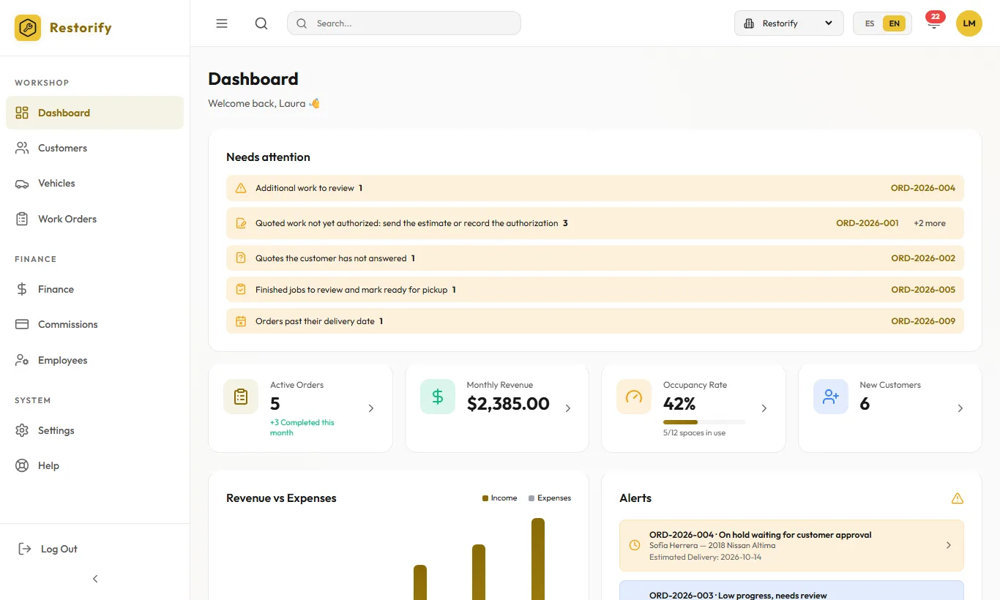

---

## 2. System vocabulary

**Workshop.** A physical shop. Everything you record belongs to a workshop and does not
mix with the others. An administrator can switch workshops; other
staff only see their own.

**Role.** Defines what each person can do. There are three: **Admin**,
**Mechanic** and **Painter**. Mechanics and painters have the exact same
permissions; in this manual we call them **technicians**.

**Customer.** The owner of the vehicle. A customer can have multiple
vehicles and multiple orders.

**Vehicle.** The car. It belongs to a customer and is identified by its VIN
(the 17-character serial number) and, when it has one, its license plate.

**Work order.** The specific job to be done on a vehicle. It is the
core of the system: inside it live intake photos, labor,
parts, assigned technicians, progress, videos, voice notes and the
customer's signature. Each order receives an automatic number formatted like
`ORD-2026-001`.

**Labor.** What is charged for the work. It is the base for technician
commissions, which is why it is the only order financial figure they see.

**Commission.** The share of labor earned by a technician when the order is
delivered. Since October 2026, each job (task) has **its technician**, and the commission for
that job belongs to them.

**Job.** A labor line with its type (mechanical or painting), its price and its
technician. A job **without a technician** pays commission to nobody.

**Quote.** The work presented to the customer for authorization.
**What the customer does not authorize is not done or charged.**

**Additional work.** Unexpected findings discovered by the technician on the shop floor and reported from the order, which pauses the order while the office decides whether to quote it to the customer or discard it.

**Ready for pickup.** A flag set by the office on a completed order to confirm that the work was inspected in the shop; at that point the customer receives an email notifying them that their vehicle is ready.

**Parking fee.** A fee for vehicle storage or extended stay at the shop, depending on whether the job is insurance-covered or private.

---

## 3. Signing in

Open the system address in your browser (`restorifyauto.net`). You will see the
sign-in screen.

1. Enter your **Email**.
2. Enter your **Password**.
3. Tap **Sign In**.

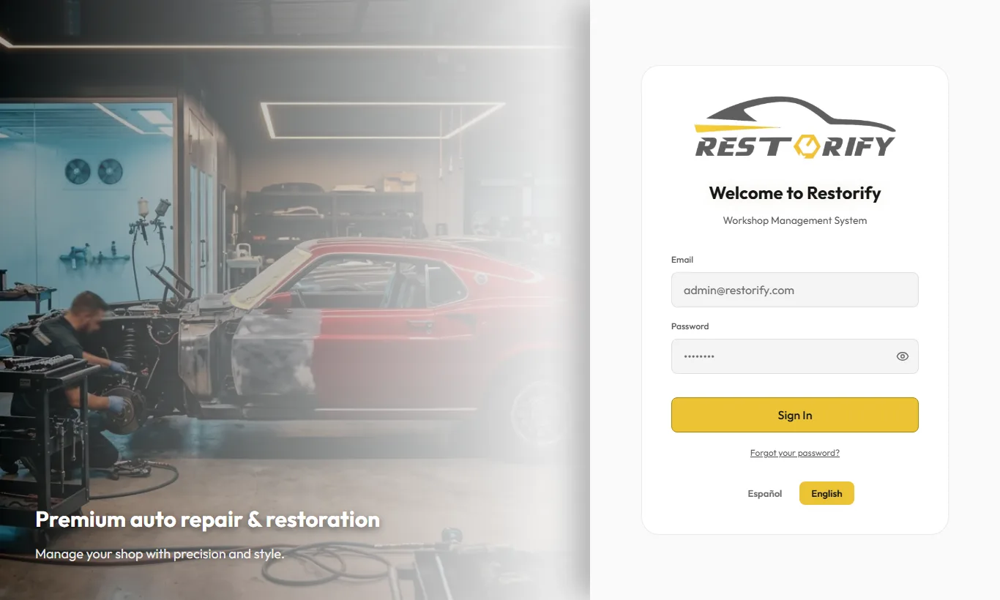

**There is no public registration.** Accounts are created by an administrator in
Settings or Employees. If you do not have an account, ask your system administrator.

On the same screen you can switch language between **Español** and **English**.
Your choice is remembered for next time.

If your email or password is incorrect, a red notice appears above the
form and you cannot sign in. If the notice indicates that your account does not have access to the
shop, the account exists but has not been assigned in the system: ask an
administrator to add you in **Employees**.

### If you forgot your password

1. Tap **Forgot your password?** below the Sign In button.
2. Enter your email and tap **Send link**.
3. Check your inbox—and your spam folder—and open the
   link you received.
4. The link takes you to a screen to enter your **New password** and
   confirm it. Once saved with **Save password**, **Go to the app** takes you to the dashboard.

Each link works **only once** and expires quickly (one hour under standard settings). If you open it again or too late,
the screen warns you that the link expired: return to the start and request another with **Back to sign in**.

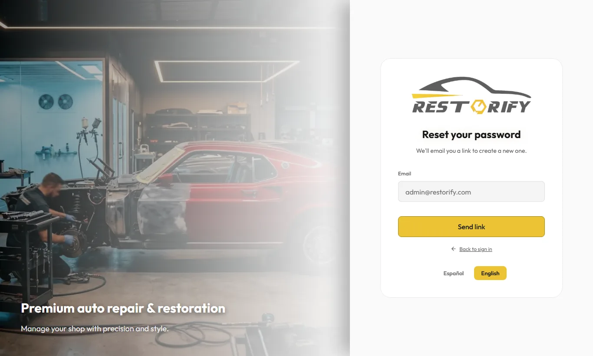

For security, the confirmation message is identical whether or not an account exists for
that email, so no one can discover which emails are registered. If you
receive nothing, ask an administrator to set a new password for you in
Settings or Employees.

### Signing out on a shared phone

If multiple people use the same tablet or phone, **sign out when you finish**.
Beyond protecting your account, this ensures that the device stops receiving your
notifications and starts receiving those of whoever signs in next. When you sign out, the app
clears what was loaded on screen: whoever signs in next will not see your orders or your
amounts.

---

## 4. How the screen is organized

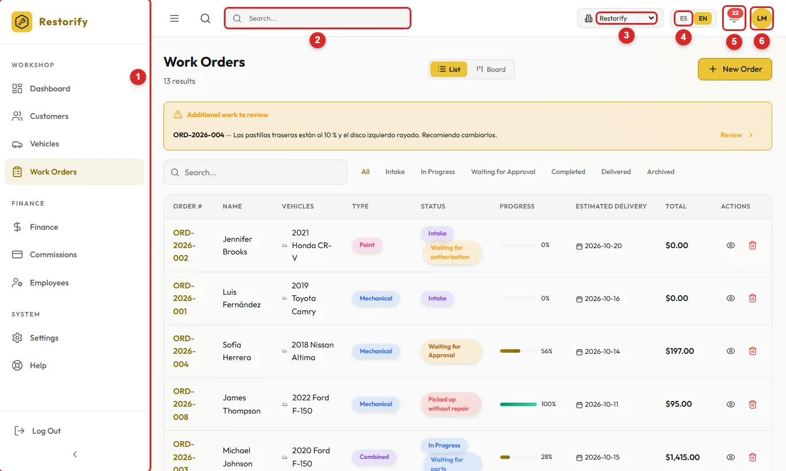

### Sidebar (left)

The main menu, organized in three sections:
- **Workshop**: **Dashboard**, **Customers**, **Vehicles**, **Work Orders** and, for technicians, **My commissions**. (Customers and Vehicles are only visible to administrators).
- **Finance** (administrators only): **Finance**, **Commissions** and **Employees**.
- **System**: **Settings**.

At the bottom is the **Log Out** button. The Kanban board no longer has its own entry in the menu: it is located inside **Work Orders** (section 10).

It can be collapsed using the arrow to gain screen space.

### Header (top)

- **Global search.** The **Search...** field: type at least 2 characters to search across
  customers, vehicles and work orders at the same time. Results appear grouped by type. A customer opens their profile and an order
  opens its details; a vehicle takes you to the **Vehicles** list.
- **Workshop selector** (administrators only). Switches the active shop. Everything
  you view from that point forward belongs to the selected workshop.
- **Language.** ES / EN buttons.
- **Notification bell.** Your alerts: assigned orders, technician progress updates,
  orders ready for delivery, and generated commissions. See section 11.
- **Avatar.** Your photo or initials. Takes you to **Settings**.

### On the phone

- The sidebar turns into a menu opened with the ☰ button at the top
  left. There you will find the workshop picker and **Log Out**.
- Search opens with the **magnifying glass** in the header and takes over the full screen.
- A **bottom bar** appears with the most commonly used shortcuts:
  - For everyone: **Home** and **Orders**.
  - For technicians: **Commissions** (opens their accepted and paid commissions directly).
  - For administration: **Customers** and **Vehicles**.
- Tables turn into cards, making them easier to tap with your finger.
- Large forms (such as New Order) open full screen.

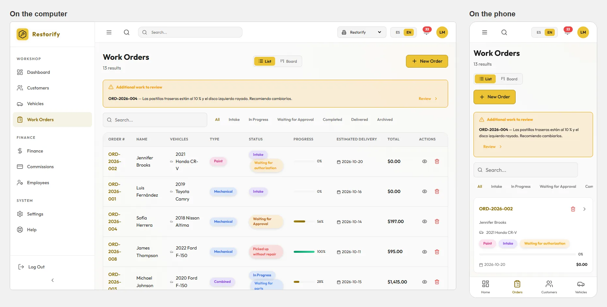

---

## 5. Dashboard

This is the home screen. It summarizes shop activity.

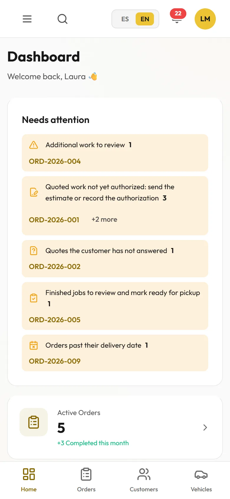

### What an administrator sees
<!-- rol: admin -->

- **Needs attention**, right at the top: items awaiting an office decision, showing the
  count for each and the orders they lead to:
  - **Additional work to review**: items reported by a technician that have not been quoted or
    discarded. Opens the order in Summary.
  - **Quoted work not yet authorized: send the estimate or record the authorization**: added jobs that have not been sent to the customer or authorized yet. Opens the order in Work.
  - **Quotes the customer has not answered**: sent estimates awaiting a customer response. Opens the order in Work.
  - **Jobs without a technician: nobody earns their commission**: nobody earns commission on these jobs until a technician is assigned. Opens the
    order in Work.
  - **Finished jobs to review and mark ready for pickup**: orders where technicians finished the work, waiting for the office to inspect them and mark them ready for pickup.
  - **Orders past their delivery date** (completed orders do not count).
  - **Customer emails that failed (last 72 h)**: the **Review** button leads to
    Settings, where they can be retried.

  If nothing is pending, it displays «All caught up: nothing is waiting on the office.» It updates automatically whenever someone modifies an order.
- **Active Orders** and how many are **Completed this month**.
- **Monthly Revenue**.
- **Occupancy Rate**: how many shop spaces are in use relative to the
  configured capacity.
- **New Customers** this month.
- **Revenue vs Expenses**: comparative chart for recent months.
- **Alerts**: orders paused awaiting authorization and in-progress orders with low progress (under 30%).
- **Recent Orders**, with a **View order** button and total.

### What a technician sees
<!-- rol: tecnico -->

The same screen, without any money figures: revenue, totals, new customers
and the financial chart do not appear. The order indicator shows **My Active Orders**,
and **Alerts** and **Recent Orders** show only **their own orders**.

Right at the top is **My jobs**: the tasks assigned to them across all undelivered
orders that they have not marked as done yet. First come those ready to work on (the
order due earliest comes first); at the end, those marked with **Waiting for authorization**. When
you tap one, its order opens on the **Tasks** tab, where you can mark it **Done** and
add updates. Completed tasks are not listed individually, only counted («N done on orders not yet delivered»).

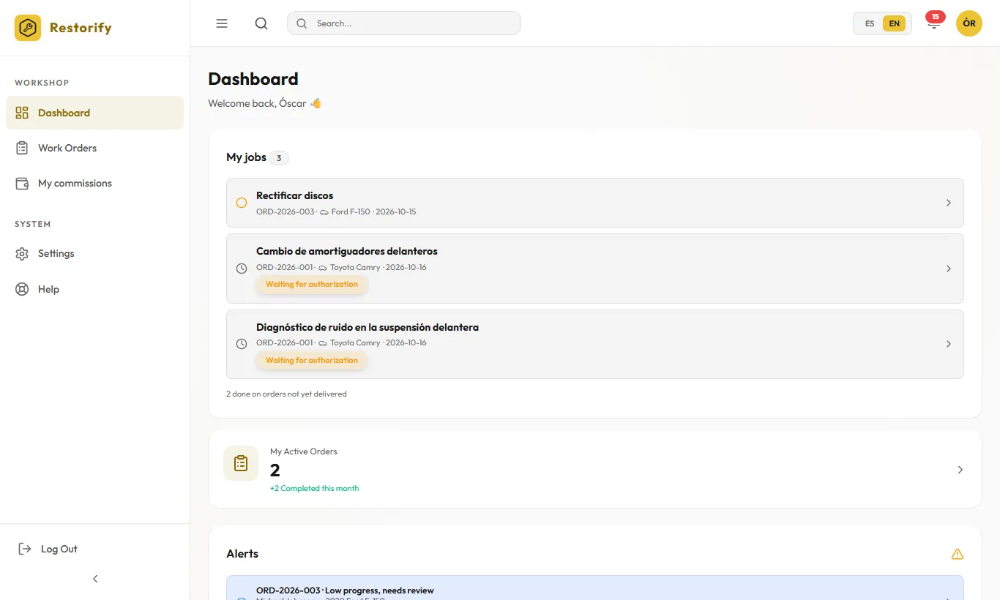

---

## 6. Customers
<!-- rol: admin -->

*(Administrators only. A technician sees the customer inside their orders.)*

List of all customers registered at the workshop, with phone, email,
vehicle count and number of generated orders.

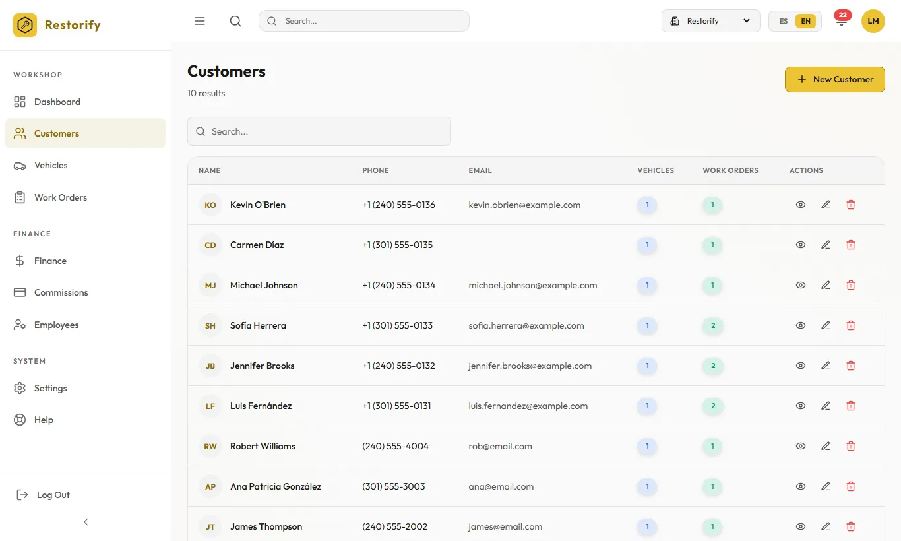

### Registering a customer

1. Tap **New Customer**.
2. Fill in **Name** and **Phone** (required), plus **Email**, **Address** and **CRM Notes** if available.
3. Choose the **Email language** (Español or English, English by default). The customer can also change it by choosing their language on their link.
4. **Create**.

**The phone number includes its country.** To the left of the number is the country selector, with
**United States (+1)** selected by default and **Mexico (+52)** right after; the rest
are the most common countries among customers. Choose the customer's country and enter
the number without the country code. The system uses this number to **call** and to send
**WhatsApp** messages, so the wrong country will dial elsewhere. If a US number
has too few or too many digits, the field alerts you with «A United States number has 10 digits.» when you leave it.

> Previously registered customers keep their numbers as they were and are treated
> as US numbers. If one is from another country, open it, select the correct country and save.

> Always collect the **Email** whenever the customer has one: check-in confirmations
> and vehicle status changes are sent there automatically, with the link to their
> report (section 8, *Customer link*). If you type it incorrectly, the form alerts you
> before saving.

When the customer has an email, the **Receives email updates** checkbox appears.
Uncheck it if the customer does not want emails. The customer can also opt out
themselves from their link; in that case you will see the box unchecked.

### Viewing a customer profile

The **View** button opens their full record (**Customer Profile**): their details, all **Registered Vehicles** and
**Service History** showing the status of each order (the total is only visible to an
administrator).

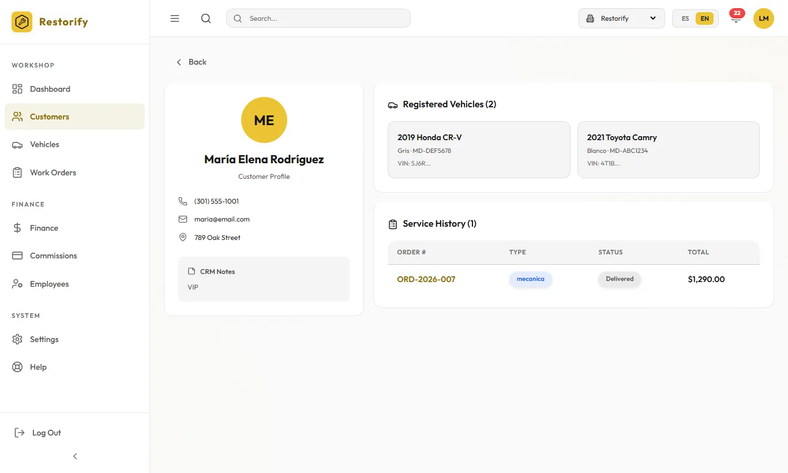

### Editing and deleting

The **Edit** button updates customer details. **The Delete button only appears for
administrators**: deleting a customer removes all their vehicles with them. If the
customer has existing work orders, the system blocks deletion to preserve history.

---

## 7. Vehicles
<!-- rol: admin -->

*(Administrators only. A technician sees the vehicle inside their orders.)*

All vehicles registered at the workshop, showing make, model, year, VIN, plate,
color and owner.

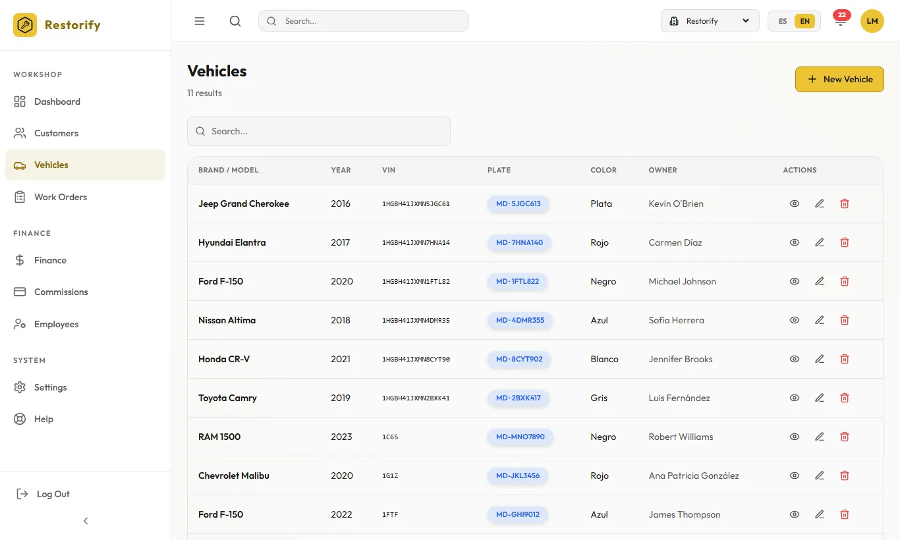

### Registering a vehicle

The form is designed to fill in almost entirely on its own from the VIN.

1. Tap **New Vehicle**.
2. **Owner**: select a customer from the list, or create one right there with **Add new customer**.
3. **VIN**: enter the 17 characters and tap **Decode**. The system looks up the official
   vehicle database and fills in make, model and year. Below, additional details appear
   (engine, body style, assembly plant). A VIN never includes the letters I, O
   or Q; if you type them, the system warns: «A VIN never contains the letters I, O or Q.».
4. Review **Brand**, **Model** and **Year**. Whatever you enter manually takes priority.
5. **Color**: choose from the list or type it. Color is not part of the VIN.
6. **Plate**: choose the **Plate state** that issued it and enter the **Plate** number. The system warns
   if the format does not match that state's typical pattern, without preventing you from saving.
7. **Create**.

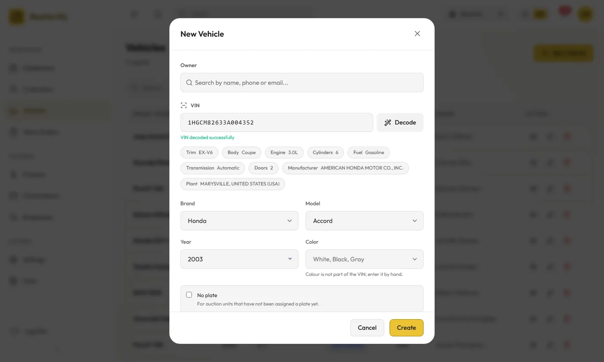

### Vehicles with no plate

Units purchased at auction often arrive without plates. Check the
**No plate** box and the plate and state fields are disabled. In lists, that
vehicle will show the badge «No plate».

Do not invent placeholder text like "NO PLATE" or "N/A" in the field: it would show up
in searches and print on the work order as if it were a real license plate.

### Editing and deleting

The **Edit** button updates vehicle details. **Delete is administrators only**, because it deletes
the service history for that vehicle. If it has associated work orders, the system does not allow deletion.

---

## 8. Work orders

The largest module. This is where the work of the shop lives.

### How the list and the board look

At the top right is the **View** selector, which lets you toggle between:
- **List**: the traditional work orders table.
- **Board**: the Kanban view with cards organized by status column (section 10).

The system automatically remembers the last view you used on that device.

**If you are an administrator**, you see all orders for the active workshop and their totals.
**If you are a technician**, you see **My Work Orders**: only those assigned to you. Those of your coworkers do not appear in the list, on the board, or in search. If you open a link or notification for an order not assigned to you, the system alerts you: «That order isn't one of yours. If you should be working on it, ask an administrator to assign you.».

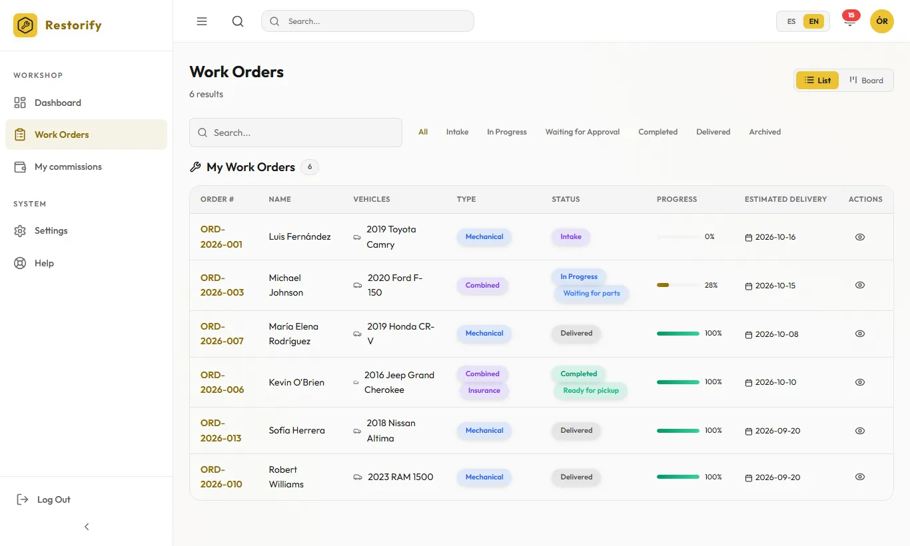

At the top there is a search bar with the **Search...** field (filters by order number or customer name in both list and board views). In the list view, there are also status filters: **All**, **Intake**, **In Progress**, **Waiting for Approval**, **Completed**, **Delivered** and **Archived** (on the board these are not needed: the columns are the statuses).

Each order can display badges depending on its condition:
- **Insurance**: if the work is handled through an insurance company.
- **Waiting for parts**: if parts have been ordered that have not yet arrived at the shop.
- **Waiting for authorization**: if a quote sent to the customer is awaiting response.
- **To review**: if the technician finished the work and the office must inspect it before release.
- **Ready for pickup**: when the office confirmed that the work is ready for the customer to collect.
- **Picked up without repair**: if the vehicle was retrieved without completing the work.
- **Archived**: if the delivered order was moved to historical archives.

### Work order statuses

| Status | Meaning |
|---|---|
| **Intake** | The vehicle just arrived. Work has not started yet. |
| **In Progress** | Work is actively underway on the vehicle. |
| **Waiting for Approval** | The order is paused because the technician reported additional work or the office sent a quote awaiting customer response. It returns to In Progress automatically when the customer responds or when the finding is discarded. The technician cannot lift the pause on their own. |
| **Completed** | The technician finished the work. Progress automatically moves to 100% and the office receives a notification that work is finished. **The customer is not notified yet**: their link shows «Final inspection» and the order displays the **To review** badge. The technician cannot reopen it to In Progress; only an administrator can reopen it. |
| ↳ **Ready for pickup** | A sub-status on Completed set **only by an administrator** using the **Mark ready for pickup** button. At that moment an email is dispatched to the customer letting them know their vehicle is ready, and their link displays «Ready for pickup». |
| **Delivered** | The customer picked up the vehicle. **Only an administrator** sets this, through the delivery dialog. It records collection in Finance, books parts costs, freezes parking fees if applicable, and generates commissions (section 18). |
| **Picked up without repair** | The customer retrieved the vehicle **without all work being completed**. **Only an administrator**, using the **Picked up without repair** button (see below). |

**Waiting for parts** is not a general order status: in the parts table, each part is marked as **Not ordered**, **Ordered** and then **Arrived**. As long as any part has not arrived, the order displays the **Waiting for parts** badge in the list and on the board, and the customer sees on their report which part is being awaited. When marked **Arrived**, assigned technicians receive a notification.

**Progress updates automatically** with tasks: each task marked as done adds to progress based on its labor price (a $400 task weighs more than a $50 task). A technician or administrator can adjust it manually if it does not reflect actual progress; when the next task is marked as done, it recalculates automatically.

### Creating an order
<!-- rol: admin -->

Tap **New Order** (button visible only to administrators). Creation happens in **four steps**, indicated at the top as **Step 1 of 4**, etc.:
1. **Customer**
2. **Vehicle and check-in**
3. **Jobs**
4. **Deposit**

The **Previous** and **Next** buttons let you navigate between steps without losing entered information. If any required field is missing, the system takes you to that step and highlights the missing field. If you enter a new customer or vehicle and decide to tap **Cancel**, the system saves them in their respective modules so you do not have to retype them next time. The order is created only with the **Create** button on the final step.

**Step 1 — Customer.** Select an existing customer under **-- Select customer --**, or tap **New Customer** to register one right there (Name and Phone are required).

**Step 2 — Vehicle and check-in.** Select the vehicle under **-- Select vehicle --**, or tap **New Vehicle** to register it with the VIN decoder. Then record intake conditions:
- **Fuel Level**: E (empty), 1/4, 1/2, 3/4 or F (full).
- **Miles In**: current odometer reading (positive integers only).
- **360° Inspection**: six standard zones to photograph vehicle condition upon arrival: Front, Rear, Left, Right, Interior and Dashboard. Tap each box to take or select a photo.
- Media buttons below the zones: **Photo**, **Video**, **Voice note** and **Gallery**. These let you capture details of preexisting dents, paperwork or video walkarounds. Photos are compressed on the phone before uploading and video is optimized (the button shows «Processing…»).
- **360° inspection notes**: open text for general observations about vehicle condition.

> This inspection is shop evidence if a customer later claims preexisting damage. Check-in photos and videos are the only media set to **Visible to customer** from the start. Intake voice notes remain **Internal** until an administrator chooses to publish them.

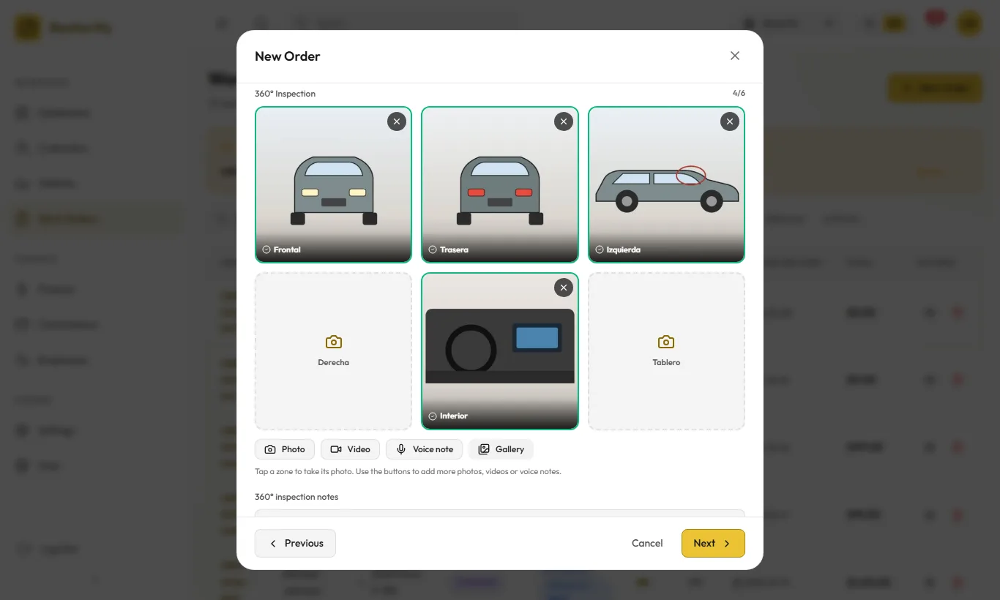

**Step 3 — Jobs.**
- **Work Type**: **Mechanical**, **Painting** or **Combined**.
- **Estimated Delivery**.
- **Insurance work**: check the box if the repair is covered by insurance, and enter the **Insurance company** and **Claim number**.
- **Add job**: type (Mechanical or Painting), description, price and assigned **Technician**. If the type does not match the person's registered trade (for example, painting assigned to a mechanic), the system displays the warning «Assign a painting job to a mechanic?» with options **Assign anyway**, **Choose another** or **Cancel**. You can leave the job as **Unassigned**.
- **Add part**: description, quantity, unit price and optional cost.
- If you type a job or part and do not tap **Add**, the **Create** button prompts you to add it or discard it before continuing.

Items quoted in this step start as **Not authorized**: they are charged only when the customer authorizes them through a quote or when the office records manual authorization. The check-in signature does not authorize quoted work.

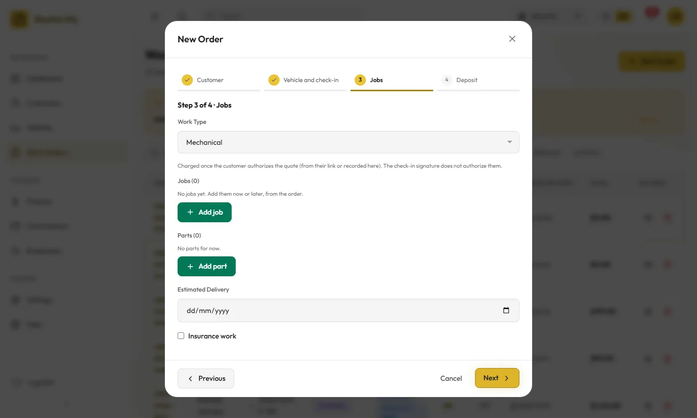

**Step 4 — Deposit.** The advance payment left by the customer (leave 0 if none). If the customer pays a deposit:
- Select **How the customer paid** (Cash, Card, Zelle, Transfer, Check).
- If paid by check, record the **Check number** or upload a **Receipt photo (optional)**.
- It is automatically recorded as income in Finance under initial deposit.

When you tap **Create**, the system generates the order number (for example, `ORD-2026-001`) and opens its details. Photos and multimedia files continue uploading in the background without interrupting your workflow.

### Only the office creates orders

Mechanics and painters do not see the **New Order** button. Opening an order commits the shop, and assigning tasks determines who earns commissions; both responsibilities belong exclusively to administration.

### Work order details

This is the screen where daily work is tracked.

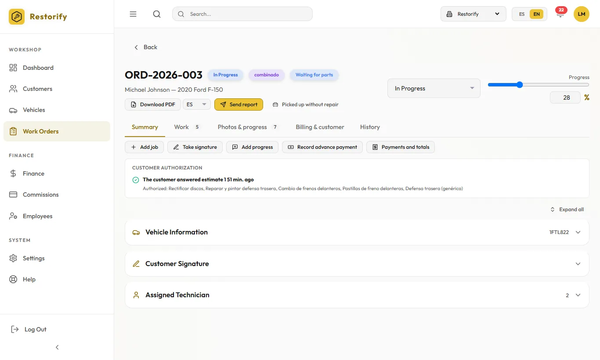

#### Order header

Always visible at the top:
- Order number, customer name and vehicle details.
- Status badges: **Insurance**, **Waiting for parts**, **Waiting for authorization**, **To review** or **Ready for pickup**, **Picked up without repair**, **Archived**.
- Action buttons (for administrators):
  - **Mark ready for pickup**: green button when the technician finished and the work was inspected.
  - **Download PDF** with the **PDF language** selector (**ES** / **EN**).
  - **Send report**: opens the window to share the customer link via email or WhatsApp.
  - **Archive** / **Back to the board**.
  - **Picked up without repair**: to close the order if the customer takes the car without repairs.
- Status selector and **Progress** bar (0 to 100%).

#### Quick actions

Below the header are highlighted buttons with the most frequent actions based on your role:
- **For administrators**:
  - **Deliver and charge** (highlighted when the order is marked ready for pickup).
  - **Add job** (highlighted if the order has no labor yet).
  - **Take signature** (highlighted during intake if the order has jobs and is not signed yet).
  - **Add progress**.
  - **Record advance payment**.
  - **Payments and totals**.
- **For technicians**:
  - **My jobs** (highlighted, takes them straight to assigned tasks).
  - **Add progress**.
  - **Report additional work** (active while the order is not completed).
  - **Vehicle details**.

#### Tabs (on computer)

| Role | Available tabs |
|---|---|
| **Administrator** | **Summary** · **Work** · **Photos & progress** · **Billing & customer** · **History** |
| **Mechanic or painter** | **Tasks** · **Order** · **Progress** |

Next to each tab is a line or file counter. A yellow indicator on **Work** warns that there is labor or parts **Not authorized**.

#### Collapsible sections

Within each tab, cards are grouped as collapsible sections that start **collapsed**: showing their title and a summary on the right (plate number, line count, dollar total or checkmark). The arrow expands or collapses the section, and the **Expand all** and **Collapse all** buttons expand or collapse all sections in that view. If you open an order from a notification or direct link, the corresponding section expands automatically.

On mobile there are no top tabs: all sections are stacked in a single column in the same order, with an **Expand all** / **Collapse all** button at the top.

Distributed across tabs, the sections are:

- **In the Administrator view**:
  - **Summary**: **Vehicle Information**, **Customer Signature**, **Assigned Technician**. (Above it displays alerts for reported additional work, unassigned jobs and pending work from prior visits).
  - **Work**: **Labor**, **Parts Description**, **Quote**, **Commission split**.
  - **Photos & progress**: **360° Inspection**, **Work Progress**.
  - **Billing & customer**: **Totals**, **Parking** (if enabled at the workshop), **Order balance** (if delivered), **Customer link**.
  - **History**: immutable audit log of all order changes.
- **In the Technician view**:
  - **Tasks**: list of assigned **Tasks** and the **Your estimated commission** card.
  - **Order**: **Vehicle Information**, **360° Inspection**, **Parts Description** (without dollar amounts), **Customer Signature**, **Assigned Technician**.
  - **Progress**: log of **Work Progress**.

#### Additional work reported by the technician

When a mechanic or painter finds damage or worn components not in the original order:
1. In their quick actions or task list, they tap **Report additional work**.
2. They enter what they found under **What you found** and capture evidence photos, video or a voice note.
3. The description and media are internal to the shop; the customer does not see them.
4. They tap **Report and pause the order**.
5. The order automatically moves to **Waiting for Approval** and a notification is sent to the office.

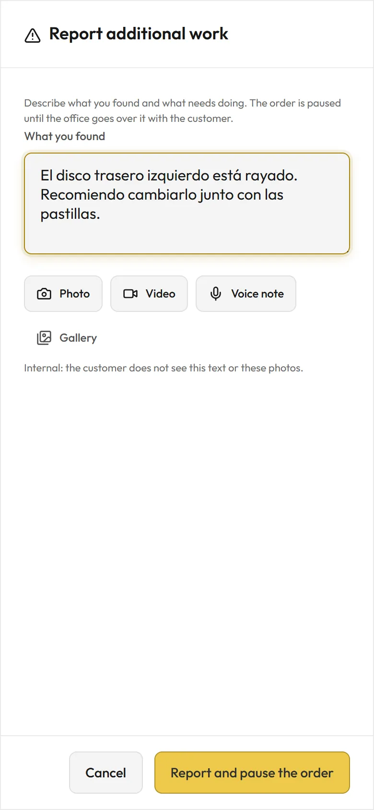

On the dashboard (under **Needs attention**) and above the Summary and Work tabs on the order, the office sees the card **The shop reported additional work**:
- **Quote the customer**: pre-populates a new job in Labor with the description and the technician who reported it. The office sets the price and then sends the quote to the customer.
- **Discard…**: opens a dialog to discard it internally or check **Show it in the customer’s report** entering **Text for the customer**. In that case it appears on their link as a informational "Shop note", at no cost.
- Once quoted or discarded, the order resumes from hold.

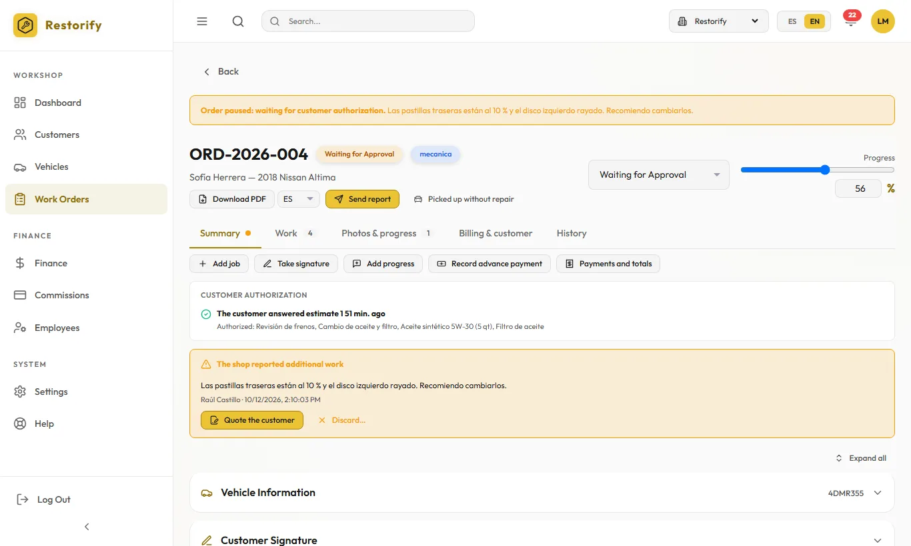

#### Labor and Tasks

- **For administrators (Labor)**:
  - Green button **Add job**: opens a row with **Type** (Mechanical or Painting), **Description**, **Price** and **Technician**.
  - If the type does not match the person's registered trade, the trade mismatch warning appears.
  - On each existing job there are two selectors (**Type** and **Technician**) that can be modified at any time without altering the quoted price. When a job is assigned to a technician, they join the order and receive a notification that a new job was assigned; when removed, they receive a notification that the job was reassigned.
  - If a job has no technician, it displays the badge **No technician**: nobody will earn that commission until one is assigned. The order warns above Summary with «N job(s) without a technician: nobody will earn their commission until you assign one.» and the **View jobs** button.
  - Once commission is paid, task selectors display a lock and the **Delete** button is disabled; to modify them, the payment must first be undone in Commissions.
- **For technicians (Tasks)**:
  - They view their tasks with description, type and labor price (from which their commission is derived). Parts are shown without prices.
  - They tap **Done** upon completing a task; if marked by mistake, they tap **Reopen job**.
  - Using **Add update**, they can upload photos, videos or voice notes linked to that specific job.
- **Badges on each line**:
  - *(No badge)*: **Authorized** by the customer. Performed and charged.
  - **Not authorized**: recently added; the customer has not seen it. Neither charged nor performed.
  - **Waiting for customer**: included in a sent quote; cannot be edited while awaiting response.
  - **Do not do** (struck through): declined by the customer. Neither performed nor charged.

#### Parts

- **Administrator**: table with Description, Quantity, Price, **Cost** (what the shop paid; if left blank it defaults to price) and order selector: **Not ordered**, **Ordered**, **Arrived**. When marked **Arrived**, assigned technicians on the order are notified.
- **Technician**: **Parts Description** card, where they only see parts and quantities required for their work, with no prices or costs.

#### Insurance work
<!-- rol: admin -->

If the repair is covered by an insurance company:
- In the **Vehicle Information** section, tap **Edit** next to Insurance to open the **Edit insurance** dialog.
- Check the **Insurance work** box, enter the **Insurance company** (such as State Farm or Geico) and the **Claim number**.
- The order displays the **Insurance** badge and, if parking fees are enabled at the workshop, automatically applies the insurance profile rules.

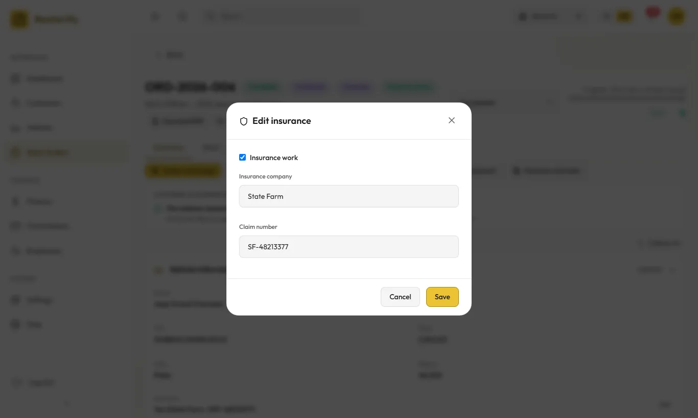

#### Your estimated commission (technicians)
<!-- rol: tecnico -->

Assigned technicians see the **Your estimated commission** card on their Tasks tab. It displays each authorized personal task with its price. The rate and amount show **Pending** until the office accepts the commission, after the order is delivered; the card explains: «Your commission is confirmed when the office accepts it, after the order is delivered.» Once accepted, the calculation appears (*task price × rate*) along with its amount. If the employee is on salary, the card indicates that the order earns no commission.

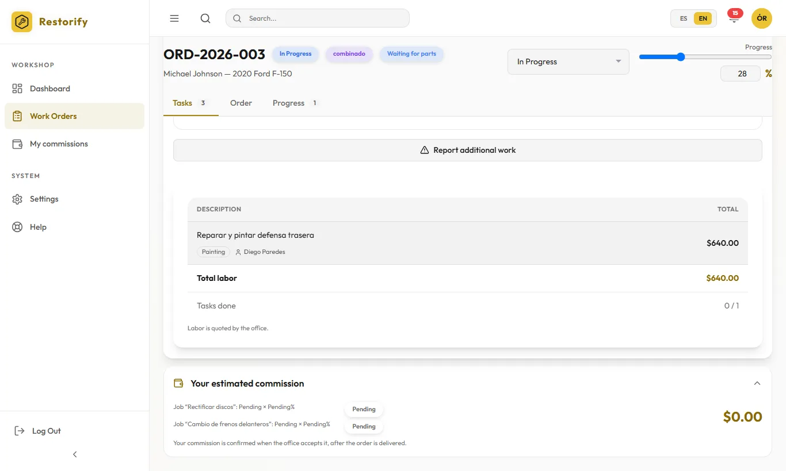

#### Assigned technicians

Only administrators can assign staff belonging to the order's workshop.
- Anyone added through a job has the **By job** tag and earns only their own jobs.
- Anyone on legacy jobs from before October 2026 has **In the split** and participates in the pool by specialty.
- A technician who has assigned jobs cannot be removed from the order; their tasks must first be reassigned to another person.

#### Work progress

A log where staff document work performed with text, photos, videos or voice notes. An entry can be linked to a specific job. A technician can delete their own updates as long as the order is not delivered. An administrator can delete any update and control whether it is shown to the customer.

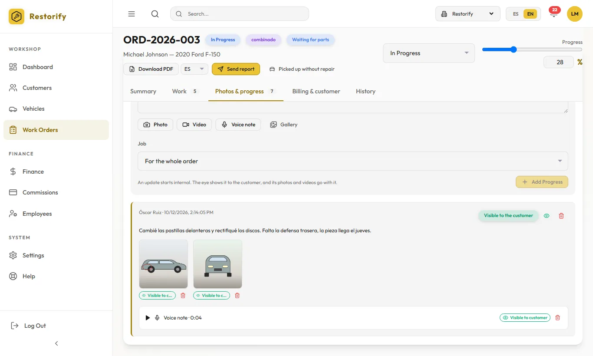

#### Customer signature
<!-- rol: admin -->

Captured by the office at the counter during intake. The customer signs with their finger on the screen to acknowledge the condition in which they dropped off the vehicle (mileage, fuel level and 360° inspection photos).
> **Important:** This signature **does not authorize the quote or quoted work**. It only confirms the physical drop-off of the car.

#### Quotes: what the customer authorizes
<!-- rol: admin -->

When jobs or parts are quoted, they start as **Not authorized**. In the **Quote** section, the office has two alternatives:

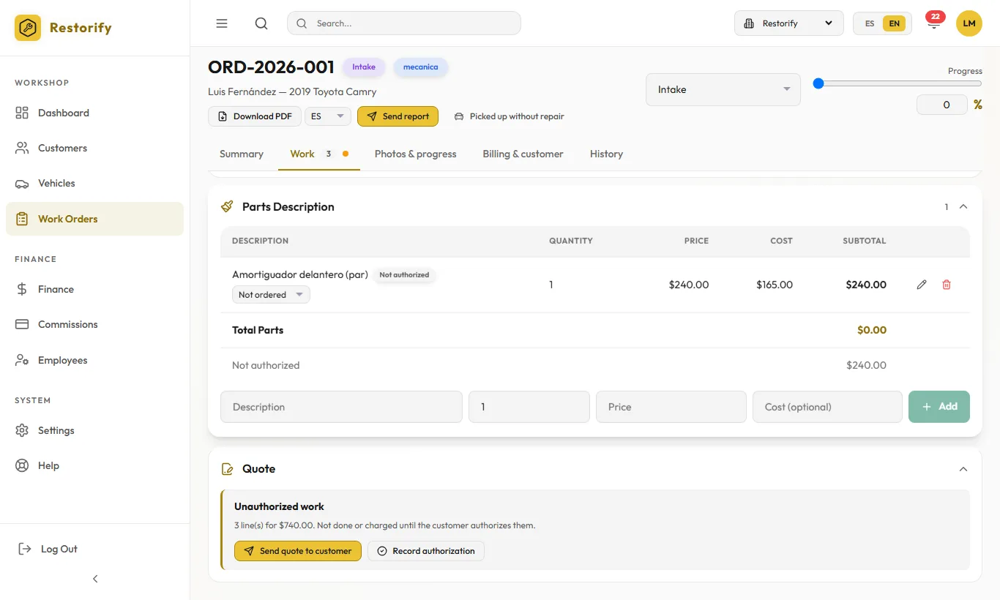

**A. Send quote to the customer.** Tap **Send quote to customer**. The customer receives an email with a link to their portal, where they review each item, individually check what they authorize, enter their name and confirm.
- While awaiting a response, lines display **Waiting for customer** and the order moves to **Waiting for Approval**.
- If you need to correct something, tap **Cancel quote**.
- If you add more work while waiting, tap **Add to quote and resend**.
- If the customer has no email, you can share the link via WhatsApp from the Customer link card.

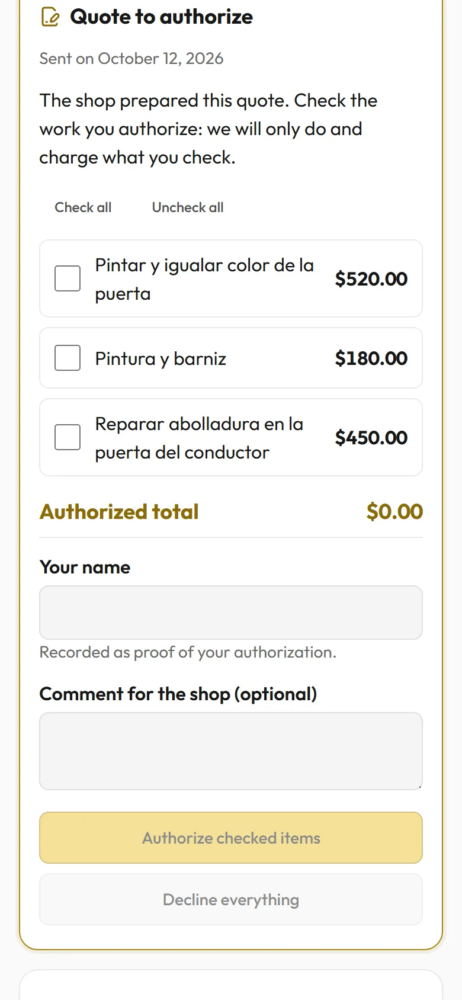

**B. Record authorization.** If the customer responded by phone, in person or via WhatsApp:
1. Tap **Record authorization**.
2. The **Work authorized by the customer** dialog appears with all items checked by default.
3. Uncheck anything the customer did not approve.
4. Under **How did they authorize?**, choose: **By phone**, **In person** or **Via WhatsApp**.
5. Enter **Authorized by** and add an optional **Note (optional)**.
6. Tap **Record**. The customer receives a confirmation email receipt.

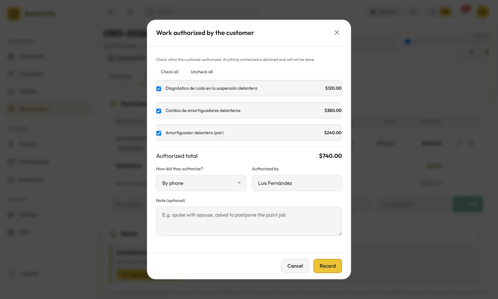

Authorized work immediately adds to the order total and alerts technicians about which work to perform; unauthorized work is marked as **Do not do** and is neither charged nor performed. An order with a quote awaiting response cannot be delivered.

#### Ready for pickup
<!-- rol: admin -->

When the technician sets the status to **Completed**, physical work is done but the customer is not notified yet. On the order details, the badge **To review** appears.

The office must inspect the vehicle and verify accounts. Once satisfied, tap the green **Mark ready for pickup** button in the header. At that instant:
1. The order badge updates to **Ready for pickup**.
2. An automatic email is sent to the customer letting them know their vehicle is ready.
3. On the customer's web report, the status changes from «Final inspection» to «Ready for pickup».
4. If the workshop charges parking for private customers, grace days begin counting from this event.

#### Delivering the order
<!-- rol: admin -->

When selecting the **Delivered** status or tapping **Deliver and charge** in quick actions, the delivery dialog opens:

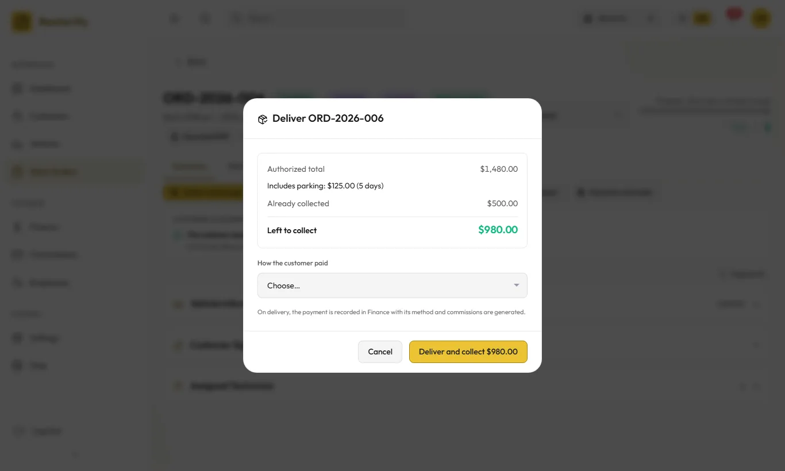

- It shows the **Authorized total** (including parking fees if applicable), amount **Already collected** and:
  - **Left to collect**: if a balance remains due. The button shows **Deliver and collect {monto}**.
  - **To refund to the customer**: if deposit or advances exceeded the total. The button shows **Deliver and refund {monto}**.
  - **Nothing left to collect.**: button shows **Deliver**.
- Select under **How the customer paid** or **How it is refunded**: Cash, Card, Zelle, Transfer or Check.
- If by check, record the **Check number** or upload a **Receipt photo (optional)**.
- Upon confirmation:
  - The payment or refund entry is booked in Finance.
  - The expense for parts cost is booked.
  - Accrued parking fees are frozen with the delivery date.
  - Commissions are generated as «To review» for the corresponding technicians.
  - The customer receives the email «Thank you for your visit».

#### Picked up without repair
<!-- rol: admin -->

If a customer decides to take their vehicle without performing the quoted repairs, tap the **Picked up without repair** button in the header:

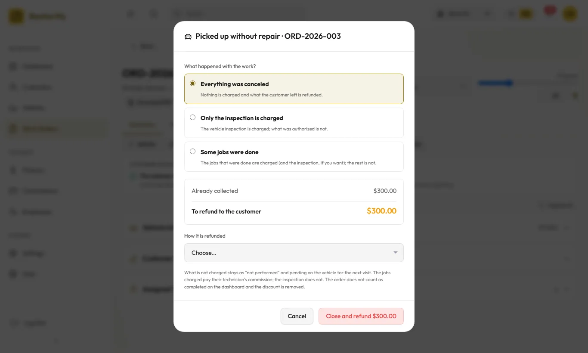

Under **What happened with the work?**, choose:
1. **Everything was canceled**: nothing is charged and whatever deposit the customer left is refunded.
2. **Only the inspection is charged**: enter the amount under **Charge ($)** for vehicle diagnosis or inspection.
3. **Some jobs were done**: check under **Jobs that were done** the specific tasks and parts actually completed (and optionally the inspection charge).

The system calculates the difference between what was already collected and what is due, requesting the payment or refund method. Whatever was not charged remains recorded as "not performed" and will appear as a suggestion on future visits for that car. Charged work earns commission for its technician (the inspection does not earn commission). The order does not count as completed on the dashboard.

#### Advance payments
<!-- rol: admin -->

If the customer makes partial payments while the vehicle is being repaired (for example, to purchase parts), tap **Record advance payment** in quick actions or on the **Totals** card in the Billing & customer tab:
- Enter the **Amount ($)**.
- Choose **How the customer paid** and attach the check number or receipt if applicable.
- Tap **Record advance payment**.
- It is recorded immediately in Finance and adds to **Deposit and advance payments** on the order, reducing the balance due at final delivery.

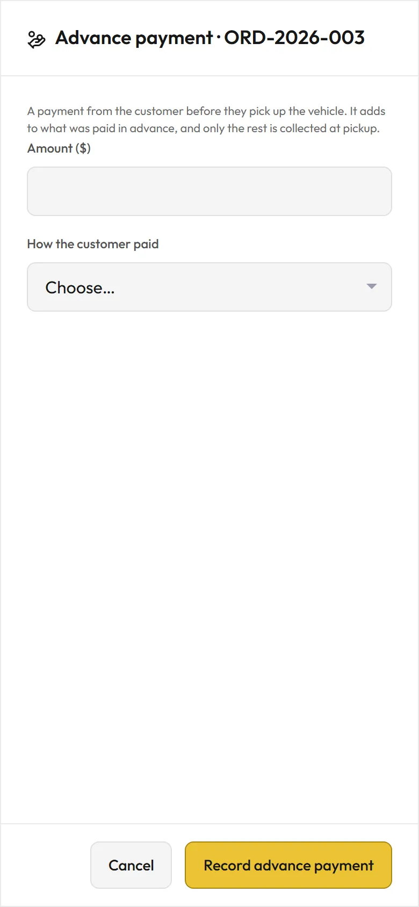

#### Discount
<!-- rol: admin -->

Administrators only, on the **Billing & customer** tab → **Totals** → **Apply discount**:
- Select the **Discount type**: **In dollars** or **As a percentage**.
- Enter the amount or percentage and a **Reason** (such as "regular customer").
- Tap **Apply**.
- **The shop absorbs the discount**: it lowers what the customer pays, but does not lower technician labor commissions or alter parking fees.
- To remove it, tap **Change discount** → **Remove discount**.

#### Order history
<!-- rol: admin -->

On the **History** tab (administrators only), an automatic audit log is maintained that cannot be edited or deleted. It details which user made each change, the exact date and time, and the before and after values: status changes, progress updates, signatures, added or deleted lines, technician reassignments, discounts, sent and answered quotes, and delivery or withdrawal records.

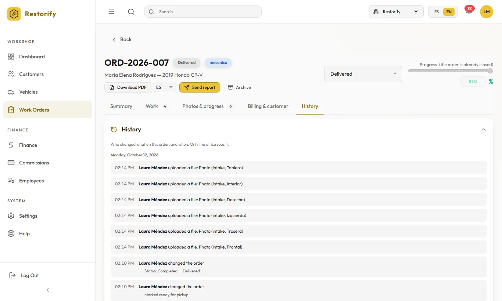

#### Customer link and email updates
<!-- rol: admin -->

Each order has a unique web link (`restorifyauto.net/r/...`) generated automatically when the customer signs intake:
- The customer opens it on their phone without passwords or registration.
- They view status, progress, check-in, published photos and videos, quote pending authorization, and their account balance.
- It allows them to call the shop directly or message via WhatsApp if the workshop has phone numbers configured.
- On the **Customer link** card, administrators can: **Copy**, **Open**, **Send via WhatsApp**, **Change link** (invalidates the previous one) or **Turn off**.
- The link remains active while the order is open and for up to 90 days after delivery.
- **Automatic emails**:
  - «We received your vehicle»: when the intake is signed.
  - «We are working on your vehicle»: when the order moves to In Progress.
  - «Your vehicle is ready»: when an administrator taps **Mark ready for pickup**.
  - «Thank you for your visit»: after the vehicle is delivered.
  - Emails are sent in the customer's configured language (Spanish or English).
  - When publishing photos or videos in an update, tap **Send update** on the card to notify the customer by email.

#### Sending the report and Downloading PDF
<!-- rol: admin -->

- **Send report**: opens a window to share the customer link directly by email or WhatsApp.
- **Download PDF**: generates a printable or archivable document with order details, published photos, authorized work, totals and signature. Next to the button, the **PDF language** selector allows choosing whether to generate in Spanish (**ES**) or English (**EN**).

#### Archiving an order
<!-- rol: admin -->

A delivered order remains in the main list for 90 days. To remove it from the daily view sooner, an administrator can archive it:
- On desktop: **Archive** button on the board card or in the detail header.
- On mobile: on the board card, menu **Move to → Archive**.
- The order moves to the **Archived** filter. It remains delivered without altering accounting. To restore it, open it from Archived and tap **Back to the board**.

### Deleting an order
<!-- rol: admin -->

Only an administrator can delete an order. This deletes its media files, progress updates, commissions and the automatic entries it generated in Finance. Bank-imported transactions remain intact.

**If the order already has paid commissions, the system prevents deletion** to avoid breaking payment reconciliations. You must first go to **Commissions → Payments made**, tap **Undo payment** on the corresponding payment, and then proceed to delete the order.

---

## 9. Photos, videos and voice notes

Each order has its own gallery. It is populated from the **360° Inspection** during order
creation and from **Work Progress** later on.

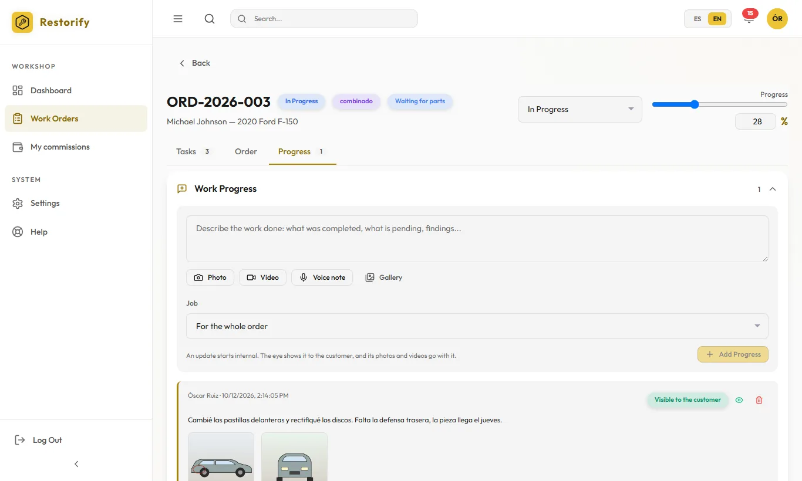

### Capturing

| Button | What it does | Limit |
|---|---|---|
| **Photo** | Opens the camera. The photo is reduced before uploading | — |
| **Video** | Records inside the app, at appropriate quality for a phone. In the last 15 seconds the counter turns red and **at 2 minutes it stops automatically**. You can switch cameras before recording, review the clip (plays upon tapping), retake or use the video. Before saving progress, **tap the video thumbnail to watch it** | 2 min |
| **Voice note** | Records audio. You can listen before using it | 2 min |
| **Gallery** | Choose a photo or previously recorded video. Videos are converted to a manageable size («Converting video {pct}%») | 2 min, 50 MB |

> **Record with the app's Video button**, not with your phone camera. One minute
> of iPhone video weighs hundreds of megabytes; recorded inside the app it weighs about 11 MB and
> uploads in seconds.

The first time, the browser requests camera and microphone permissions. If you
deny it, the app explains how to enable it in settings.

### The upload tray

While files are uploading, a floating tray appears: «{done} of {total} files uploaded». Tap it to see each file and its progress.

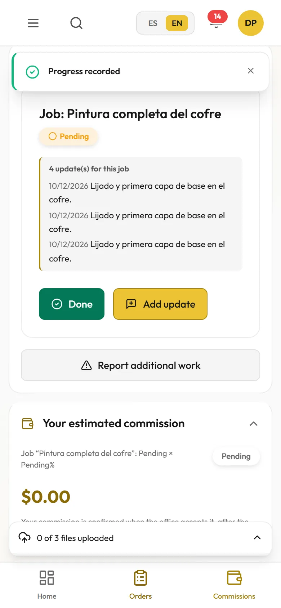

- **You can keep using the app** while files upload.
- **If connection drops**, the tray displays «Offline» and uploads resume on their own
  when connection returns.
- **If you close or reload the app**, pending files continue when signing back
  in with the same account. Long videos resume where they left off.
- **If a file fails**, it stays in the tray with the reason and two buttons:
  **Retry** or **Discard**. A file is not lost until you discard it.

### Customer visibility

Each file displays a label:

- **Visible to customer** — check-in photos and videos start this way.
- **Internal** — everything uploaded in a progress entry starts this way. A voice note recorded at check-in also starts internal (it is shop staff speaking): an administrator decides whether to make it visible.

An individual file is only published by an **administrator**, using the **Show on the customer report** /
**Hide from the customer report** button. A progress update is different:
whoever created it (technician or administrator) can tap **Show to customer**, and
its text and attached files become visible with it; **Stop showing** makes it internal again. The update
created when reporting additional work remains internal: that decision belongs to administration.
This allows technicians to document everything freely, while what the customer sees on their
link (section 8, *Customer link*) is what someone decided to publish.

### Viewing and deleting

- Tap a thumbnail to view it full size. Videos and audio recordings play
  there; arrows move to the next file.
- A technician can delete **their own** files as long as the order is not
  delivered. An administrator can delete any file.

---

## 10. Kanban board

The same information as the work orders list, displayed as a board with one
column per status. It is located inside **Work Orders**: at the top right, the
**List | Board** toggle switches views. The app remembers the last view you used, so
whoever works on the board finds it when returning. The search bar also filters
cards, and the order number on each card opens its details.

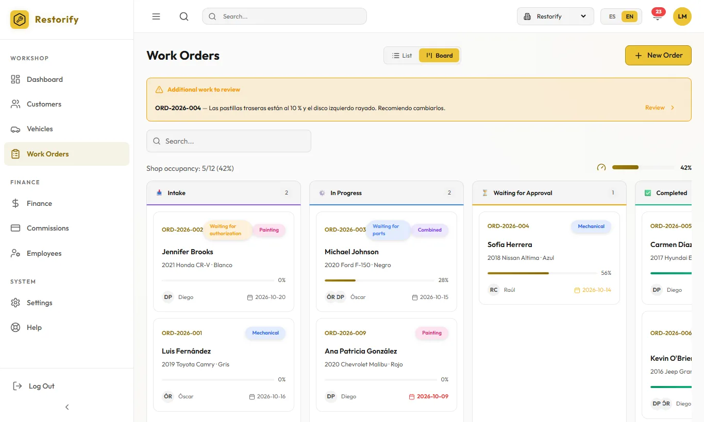

At the top, **shop occupancy** is displayed: how many active orders exist relative to
workshop capacity.

Cards display the order number, customer, vehicle, assigned personnel and work type (**Mechanical**, **Painting** or **Combined**), along with status badges like **Insurance**, **Waiting for parts**, **Waiting for authorization**, **To review** or **Ready for pickup**. On delivered orders, the **Archive** button allows moving them to the archived list.

There are two ways to change an order's status:

- **On computer**, drag its card to another column.
- **On phone**, each card has a **Move to** selector at the bottom. Columns
  are navigated by swiping sideways, one per screen.

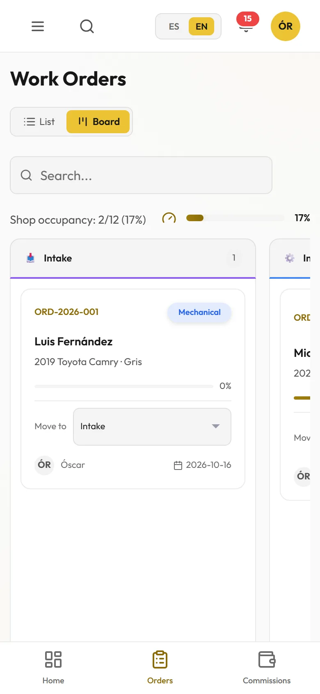

An administrator can move any order. A technician can only move orders assigned
to them, and never a **Completed** or **Delivered** order: on those cards the
selector does not appear. Nor do they have the options **Intake**, **Waiting for Approval**
or **Delivered**. A paused order does show the selector, but the system will not let it
leave the pause while there is undecided additional work or a quote
awaiting response.

Moving an order to **Delivered** opens the same delivery dialog as on the order details.

---

## 11. Notifications

### The bell

The red number on the bell shows your unread notifications. They arrive **instantly**
while the app is open, with a brief on-screen message.

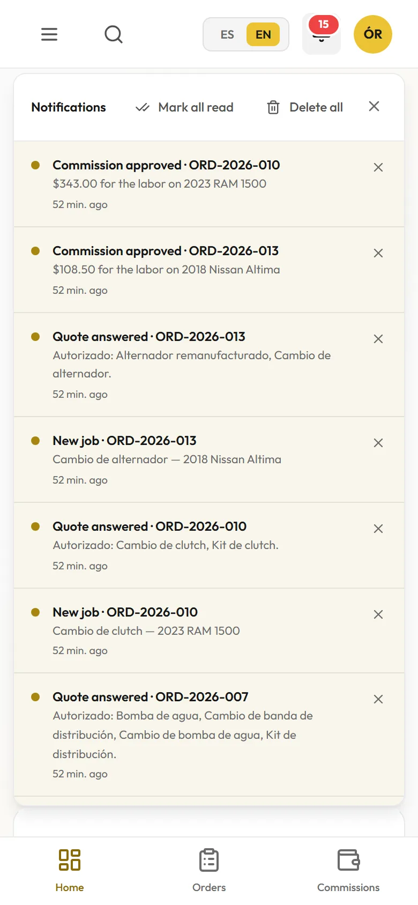

- Tap an alert to open its order; it is marked as read.
- **Mark all read** clears the counter.
- The **X** to the right of an alert deletes it without opening it.
- **Delete all** empties the bell, including older alerts that are not
  visible in the list. It asks for confirmation and cannot be undone.
- You never receive alerts for actions you performed yourself.
- Read alerts are deleted automatically after 60 days; unread ones, after 180 days.

### What notifications arrive

| Notification | Who gets it |
|---|---|
| **New order assigned** | The technician assigned by hand (not when they join through a job) |
| **New job** | The technician given a job, with the job and the vehicle |
| **Job reassigned** | The technician whose job is taken away |
| **Job done** | Administrators, when a technician marks a job as done |
| **No longer assigned** | The technician who is removed |
| **Intake registered** | Administrators. No longer sent, because only administration creates orders; older notices can still be read |
| **New progress update** | Administrators, when a technician adds a progress update |
| **Work finished** | Administrators, when a technician finishes an order: it has to be reviewed and marked ready for pickup |
| **The customer answered the quote** (or **The customer did not authorize the quote**, if they authorized nothing) | Administrators, when the customer answers from their link |
| **Additional work reported** | Administrators, when a technician reports additional work |
| **A part arrived** | Assigned technicians, when an ordered part is marked **Arrived** |
| **Quote without a response** | Administrators, once a day if a quote has gone more than 24 hours without a response |
| **Quote answered** / **Work not authorized** | Assigned technicians, when the customer answers the quote, with what was authorized or not |
| **Commission approved** | Each technician, when administration accepts their commission, with the accepted amount |
| **Past the delivery date** | Administrators and assigned technicians, once a day for each overdue order. **It replaces the previous day's notice**: there is only one per order, with the days overdue up to date |

### Notifications on your phone (push)

With push enabled, alerts arrive on your phone **even when the app is closed**,
just like any other application.

1. Go to **Settings → Notifications on this device**.
2. Tap **Enable on this device** and accept the permission prompt.
3. Tap **Send test**: it should arrive in a few seconds.

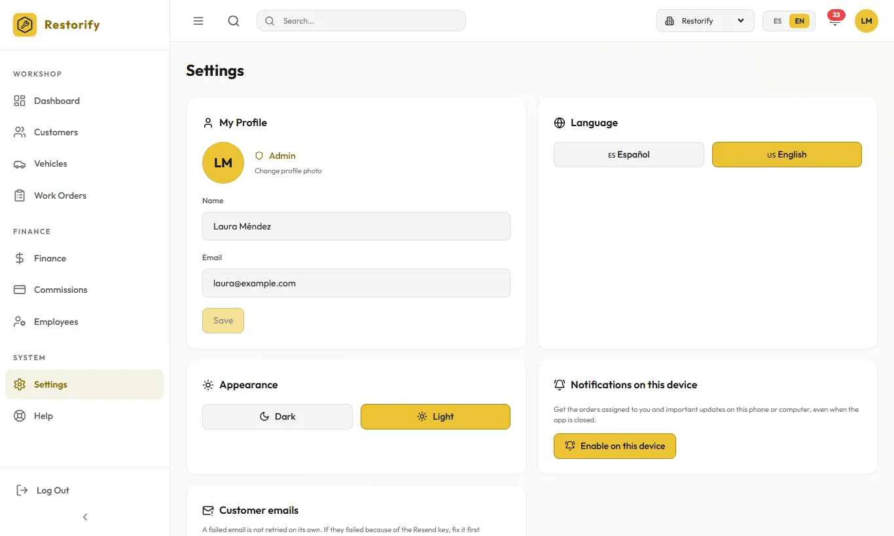

- Enabled **per device**: if you use a phone and a computer, enable it on both.
- On **iPhone**, you must first install the app on your home screen
  (section 16); the card explains the steps.
- If you denied permission, the card tells you how to enable it in browser
  settings.
- Upon **signing out**, that device stops receiving your alerts.
- If the card displays **«Push notifications are not configured on this server.»**,
  it is not an issue with your phone: the published build of the app was
  deployed without the notification key. Notify the system administrator.

---

## 12. Finance
<!-- rol: admin -->

**Administrators only.** Records all money coming in and going out of the workshop.

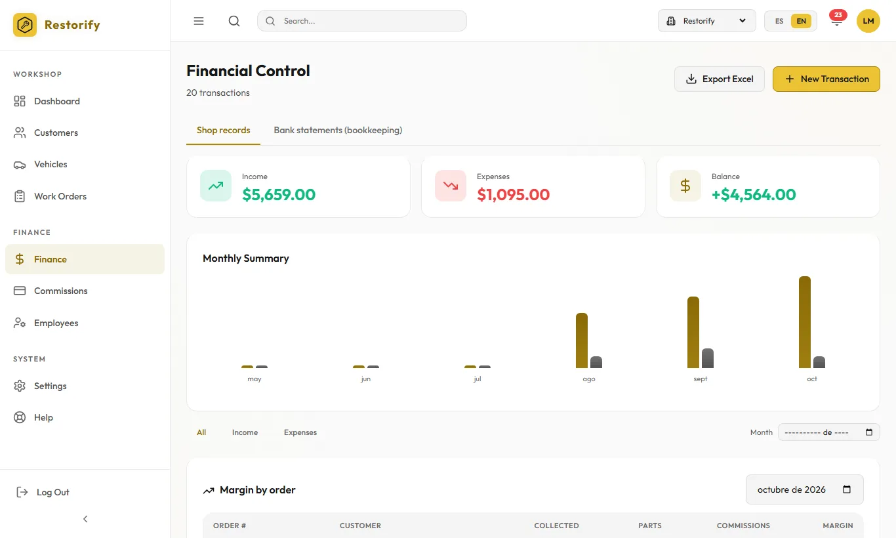

It has two views:

- **Shop records**: what the app records (order payments, parts costs,
  commissions, and manual transactions). At the top, **Income**, **Expenses** and **Balance**;
  below, the table with filters by type and by **Month**. **Export Excel** downloads what the
  table displays (for example, a month) for your accountant.
- **Bank statements (bookkeeping)**: imported bank statements, to
  reconcile past months and send them to your accountant. They are separate bookkeeping: **they are not added**
  to app income and expenses. Each shows its statement period, total money in and out, and is
  exported separately.

Payment methods are **Cash, Card, Zelle, Transfer and Check**. Bank
and Clover fees belong in the category **Bank and card fees**: record them manually
once a month, using the statement amount.

Many transactions **are created automatically by the system** (deposits, final payments upon delivery,
parts costs, commission payments; section 18). Do not enter them manually or
they will be duplicated. A commission payment appears as **one expense for each order** it
covers ("Comisión Mario Mecánico - ORD-2026-014"), all sharing the same check number.

### Margin by order

Between the cards and the table, **Margin by order** lists orders delivered in the selected
month: how much was **collected**, how much **parts** cost, how much was generated in
**commissions**, and the resulting **margin**, with monthly totals. Commissions count
from the moment they are generated, whether paid or not. If an order has a linked bank purchase
or manual transaction, it appears in the order **Balance** but is not subtracted again:
parts costs are already derived from their lines.

In the details of a delivered order, the **Order balance** card shows the same figures
for that order.

### Recording a manual transaction

1. **New Transaction**.
2. **Type**: income or expense.
3. **Category**: Client Payment, Parts Purchase, Commissions, Operating Expense or Bank and card fees.
4. **Amount** and **Date**. The date belongs to the shop: a transaction on the 1st
   counts in that month.
5. **Linked order** (optional): links the transaction to an order. In the table,
   this column leads directly to the order.
6. **Description**.
7. **Create**.

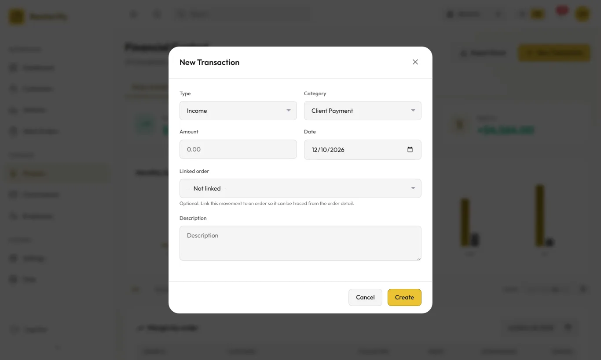

### Deleting a transaction

Each row has a trash icon button. Use it **only for manual transactions**
entered by mistake.

> **Do not delete automatic transactions** (initial deposits, final payments, parts
> costs, commission payments, adjustments or reversals). The system uses them
> to calculate subsequent balances: if you delete a final payment and the order is later
> edited, accounts will not balance. To adjust an order's financial figures,
> correct the order (labor, parts, status) and let the system
> record the adjustment. To reverse a commission payment, use **Undo payment**
> in Commissions.

### Importing a bank statement

Allows uploading a bank statement PDF and recording its transactions without
typing them one by one.

> Currently only **Wells Fargo** bank statements are supported. The file must
> be the PDF downloaded directly from the bank, not a scan or photo.

1. In the **Bank statements (bookkeeping)** view, tap **Import Bank Statement**.
2. Select the PDF. All processing happens in your browser; the file is
   not sent to any external service.
3. The list of discovered transactions appears. The system suggests a category
   based on keywords, flags potential internal transfers, and alerts to
   possible duplicates.
4. Review, adjust categories, and uncheck anything you do not want to import.
5. **Import Selected**.

> **Every checked row requires a category.** As long as any checked row lacks a category, the
> **Import Selected** button remains disabled and shows how many
> are missing above it. The **Assign to uncategorized** bar applies a category
> to all unassigned rows at once.

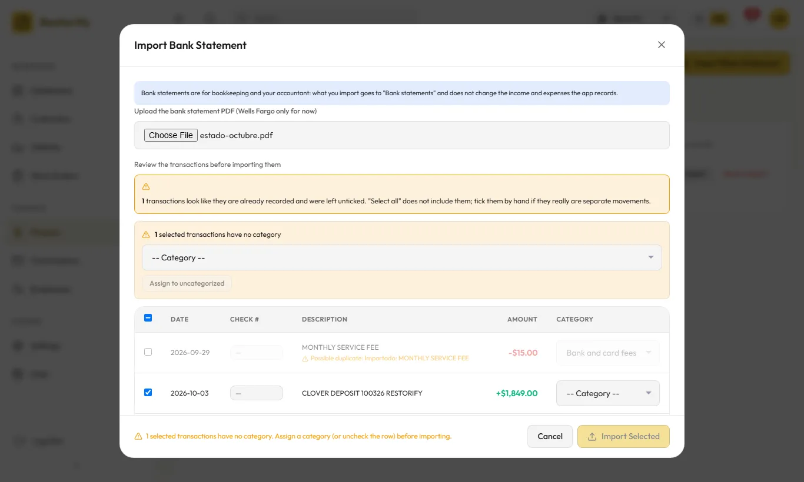

### If you import the same bank statement twice

This is the most expensive mistake on this screen, because it **duplicates all income and
expenses for that month**. The system protects you on three levels:

1. **Detects duplicate files.** If that exact file was already imported in this
   workshop, a red notice appears with the date. It recognizes the file by its contents, so
   renaming it will not bypass detection.
2. **Unchecks transactions already imported** from another statement (same type,
   same amount, date within two days) with the label «Possible duplicate». It does not compare them against app order collections: they are separate books.
3. **"Select all" excludes them.** If it truly is a separate transaction,
   check it manually.

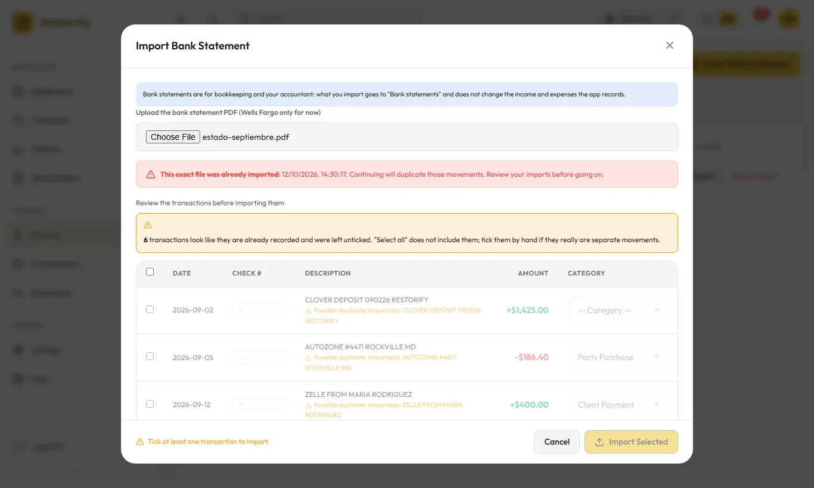

### Reverting an import

In the list of imports, the **Revert import** button removes
all transactions imported with that file in one step. This is the fix when something
was imported in excess or categorized incorrectly: revert and import again.

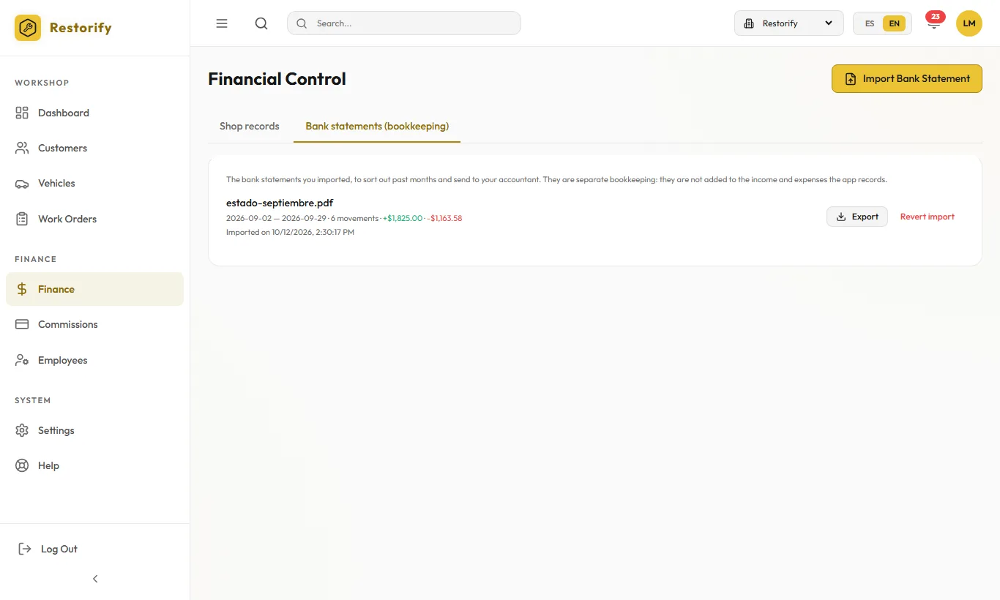

---

## 13. Commissions

Technicians earn commissions on labor for orders they deliver.
Administration manages review, approval and payments from **Commissions**, while technicians check their earnings in **My commissions** and in the details of each order.

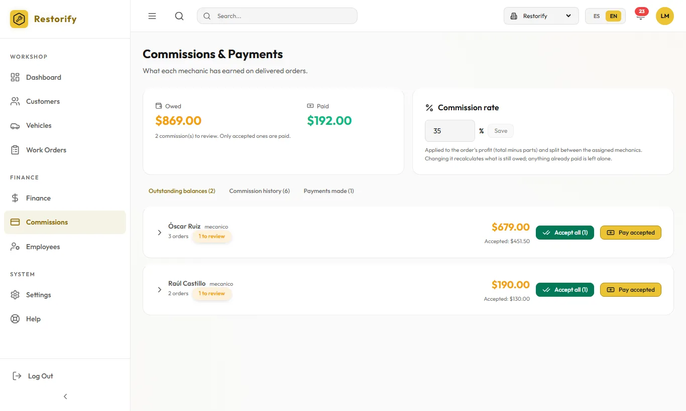

### How it is calculated

**Each job (task) pays its technician**, at their rate (their own rate, or the workshop rate if
they do not have an individual one):

```
task commission = task price × technician's rate
```

Example (at 35%): painting priced at $1,000 pays the painter **$350**; mechanical work priced at $200 pays the mechanic **$70**. If an additional paint job of $500 is added later and assigned to the painter, they earn **$175** more.

- **A job without a technician pays commission to nobody.** The order warns about this in Summary and upon
  delivery. Administration must assign a technician before delivery for it to generate commission.
- Salaried personnel do not earn commissions; labor on their tasks stays with the shop. Staff on a mixed scheme earn their salary (informational) plus the commission for their tasks.
- **Jobs from before October 2026.** Those without an assigned technician continue with split by specialty: each specialty is a pool shared among technicians manually assigned to that specialty (*pool ÷ teammates × individual rate*).
- **Shop discounts do not reduce commissions:** the discount is absorbed by the shop and commission is calculated on authorized labor.
- **Parking fees do not earn commissions:** they are a vehicle storage item for the shop.

The commission **is generated upon delivering** the order and starts in **To accept** status (suggested). If labor, crew or a rate changes before acceptance, it recalculates automatically. **Paid commissions are never recalculated**, which is why a job with paid commission is locked (section 8).

### For the office: Commissions and Payments
<!-- rol: admin -->

*(Sidebar: **Commissions**.)*

Has three tabs:

- **Outstanding balances** — what is owed to each technician and on which orders.
- **Commission history** — each detailed commission, with status **To accept**, **Accepted** or **Paid**.
- **Payments made** — recorded payments, with date, method and receipt.

#### Reviewing and accepting

Upon delivering an order, each commission starts as **To accept**. **Only accepted commissions can be paid.**

- In **Outstanding balances**, each technician's row shows how many commissions need review. The **Accept all ({count})** button approves them in bulk at suggested amounts.
- To adjust one before accepting, expand the technician's row and tap the pencil icon for that commission: you can adjust the **Rate** or directly the dollar **Amount**, and tap **Accept**.
- When the office accepts a commission, it moves to **Accepted** and the technician sees it reflected on their commissions screen.

#### Paying a balance

1. In **Outstanding balances**, tap **Pay accepted** on the technician's row (the button remains disabled if nothing is accepted).
2. The **Pay balance** dialog opens: displays the employee, amount calculated by the system, number of orders covered, and warns if unreviewed commissions remain (which are not included in this payment).
3. Select the **Pay Date** and **Method** (**Cheque**, **Cash**, **Zelle** or **Transfer**).
4. If paying by **Cheque**, enter the **Cheque number** or attach the **Cheque photo** (at least one is required to reconcile with the bank).
5. Tap **Record payment**.

The payment clears the technician's balance and is recorded automatically as an expense under category **Commissions** in Finance.

#### Undoing a payment

On the **Payments made** tab, each payment has an **Undo payment** button. When used, commissions from that payment return to outstanding and the corresponding expense transaction in Finance is removed.

#### Changing the commission rate

The general workshop rate is configured on the top card or in Settings → Workshops (default 35%). An individual's rate is set in **Employees**. Changing either recalculates only commissions that have not been paid yet.

### For the technician: My commissions
<!-- rol: tecnico -->

*(Sidebar: **My commissions**; on mobile, **Commissions** button on the bottom bar.)*

Technicians can check their earnings without seeing workshop finances:

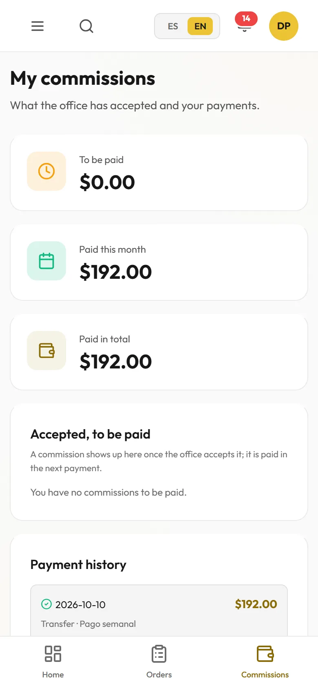

- Summary cards at top: **To be paid** (what the office already accepted and is ready for payment), **Paid this month** and **Paid in total**.
- **Accepted, to be paid**: list of commissions approved by the office that have not been settled yet, showing **Order #**, task or job, rate (**%**) and **Amount**.
- **Payment history**: list of received payments, showing date, method, check number and amount.

> **Why doesn't a newly delivered order show up?** When an order is delivered, its commission starts as suggested ("to review"). It appears in **My commissions** as soon as the office reviews and accepts it.

### Employees
<!-- rol: admin -->

*(Sidebar, administrators only.)*

Allows managing who works at the shop, how they are paid, and recent activity:

- **How each employee is paid**: list of mechanics and painters with their pay scheme — *Commission · 35% (shop rate)*, *Commission · 40%*, *Salary · $900.00 biweekly* or *Mixed*.
- Tap **View** to open their profile: shows pending and paid commissions, active and delivered orders, recent progress updates, and their **Pay** configuration:
  - **Commission rate**: personal percentage, or leave blank to use the workshop rate.
  - **Salary amount**: amount and frequency. Informational (not recorded in Finance). If an employee switches to salary and has pending commissions, the system alerts you to the amount: upon switching to salary, pending commissions stop counting, so it is best to pay them first.
- Below is staff administration: create accounts with **New User**, edit details, or remove employees.

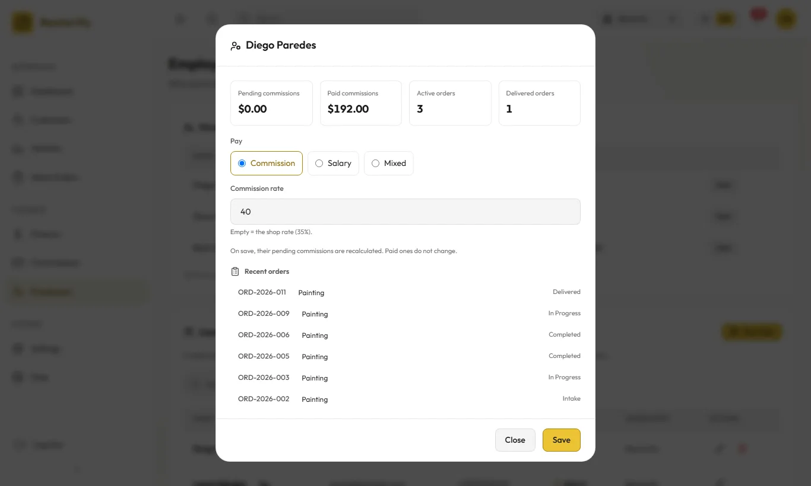

---

## 14. Parking fee
<!-- rol: admin -->

**Administrators only.** Allows charging for parking or extended vehicle storage at the shop, distinguishing between private work and insurance claims.

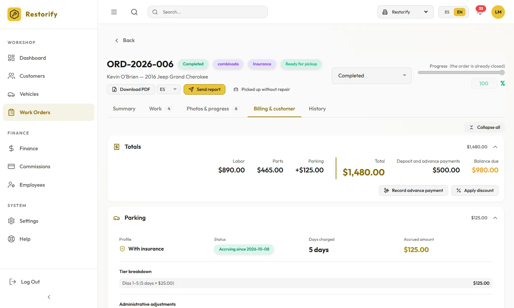

### How it is configured per workshop

In **Settings → Workshops**, within each workshop, the **Parking Fee** section allows enabling and defining shop rules:

- **Charge parking in this workshop**: enables or disables the module for that workshop.
- **Effective from**: date from which charges begin applying (defaults to today; the system disallows past dates to avoid surprise retroactive charges).
- **Include orders already in the workshop**: if checked, applies also to vehicles checked in prior to the effective date.
- **Notify customer when charges begin**: warns in the customer portal in advance when parking fees will start.
- **Customer policy (Spanish)** and **Customer policy (English)**: explanatory text the customer will see on their link with terms and conditions.

#### The two fee profiles

Each workshop configures two independent profiles:

1. **With insurance**:
   - Applies to orders marked as insurance work.
   - By default: starts counting from **Vehicle arrival**, charges on arrival day, and has 0 grace days.
2. **Without insurance (Private)**:
   - Applies to private customer orders.
   - By default: starts counting when the office marks the order ready for pickup, does not charge on the event day, and grants 2 grace days.

In each profile you can customize:
- **Starts counting**: **Vehicle arrival** or **Marked ready for delivery**.
- **Grace days**: free days before charges begin.
- **Business days only**: whether grace is counted Monday through Friday or calendar days.
- **Charge on the event day**: whether the trigger day counts as day 1.
- **Day cap** and **Amount cap ($)**: maximum limits charges will not exceed.
- **Rate tiers**: daily rate scales (**From day {day}**, rate **per day**). Add more tiers with **Add tier**.

Below, the **Live preview** tool allows testing any event date and end date to verify exact calculations before saving.

### Parking fee on a work order

Inside the order, on the **Billing & customer** tab (**Parking** section):

- Shows the **Profile** (**With insurance** or **Without insurance (Private)**) and its **Status**:
  - **Inactive**: module or profile is disabled.
  - **Waiting for order to be marked ready for delivery**: awaiting order completion before starting the count.
  - **Starts on {date}**: event occurred and grace period is running.
  - **No charge (order predates module start)**: order checked in before effective date without opting to include prior orders.
  - **No parking charge for this order**: parking fee disabled specifically for this order.
  - **Accruing since {date}**: actively charging based on days at the shop.
  - **Closed upon delivery**: final amount frozen upon delivery.
- Details **Days charged**, **Accrued amount**, whether a **Cap applied**, and the **Tier breakdown**.

#### Administrative adjustments

An administrator can tap **Administrative adjustments** to modify parking charges for that order:
- **Charge parking on this order**: check or uncheck to waive the fee entirely.
- **Manual rate ($/day)**: set a fixed daily rate instead of workshop tiers.
- **Manual start date**: manually set which day counting begins.
- **Waived days**: deduct specific days (for example, due to shop delays).
- **Internal note**: reason for the adjustment.
- Save changes with **Save adjustments**.

### Key rules for parking fees

- **Accrues automatically:** the system updates the amount hourly while the vehicle remains at the shop.
- **Freezes on delivery:** tapping **Deliver** closes parking charges permanently with that day's date and adds it to balance due («Includes parking: {amount} ({days} days)»). A delivered order never accrues parking fees again on its own.
- **Does not earn commissions:** parking revenue belongs to the shop and is not part of labor.
- **Discounts do not affect it:** applying a discount to an order reduces only authorized labor and parts, never parking fees.
- **On the customer link:** the customer sees the parking policy, fee notice, and itemized total on their account in their preferred language.

---

## 15. Settings

Accessible to everyone from the avatar in the header, displaying different options
based on role.

### For everyone

- **My Profile**: photo (**Change profile photo**), name and email.
- **Language** (**Español** / **English**) and **Appearance** (**Dark** / **Light**).
- **Notifications on this device**: enable, test and disable push alerts
  (section 11).
- **Report a problem**: button to notify support if you encounter a bug or system failure. You can attach a screenshot, and diagnostic data from the last 30 seconds is automatically attached securely (hiding private customer data and photos).

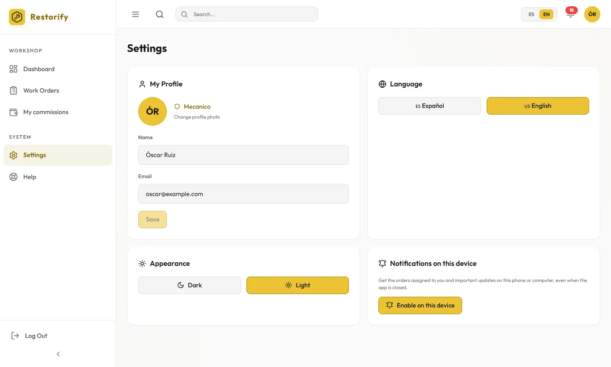

### Administrators only: workshops, staff and emails
<!-- rol: admin -->

**Workshops.** Create new locations with **New Workshop** and edit existing ones: name, address, **Change workshop logo**, **Theme colour**, **Workshop capacity** (work bays, for shop occupancy) and **Commission rate**.

Contact details and workshop rules:

- **Contact email (customer replies)**: where customer replies to automatic emails are sent.
- **Contact phones**: manageable list with **Add phone**. Each phone defines its **Type** (**Mobile** or **Office**), description, number and whether it **Answers WhatsApp**. Customers see them on their link (with call and message buttons), in emails and on the PDF.
- **Parking Fee**: configuration of parking rules and rates for that workshop (section 14).

An administrator can also use **Join this workshop** to become part of its staff. When deleting a workshop with **Delete everything**, the system shows everything that will be removed and reassigns staff to another workshop.

**Staff.** Adding, editing and removing staff, and configuring each person's pay, is managed in **Employees** (section 13); Settings includes the **Go to Employees** button. Next to each person, a bell icon indicates how many devices have push alerts enabled.

**Customer emails.** Displays the status of automated emails sent by the system. If emails failed in the last 72 hours (for example, due to network or service outages), the **Retry all** button appears to requeue them.

To create a user account from the users list:

1. Tap **New User**.
2. Fill in **Name**, **Email** and **Temporary Password** (minimum 8 characters).
3. Select the **Role** (**Admin**, **Mechanic** or **Painter**).
4. Choose the workshop under **Workshops**.
5. Tap **Create**.

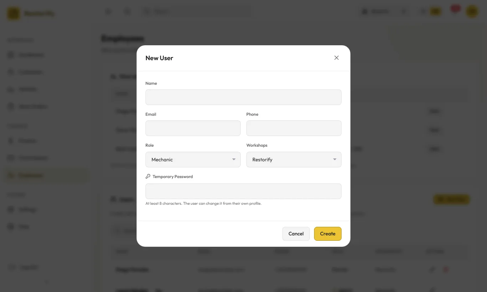

To remove someone, tap **Remove employee** in their row. **If they have assigned orders, the system blocks removal**: that work must first be reassigned. **If commissions have already been paid to them, removal is also blocked**: their payment records form the accounting history of what was disbursed.

---

## 16. Installing the app on your phone

Restorify can be added to your home screen. It opens full screen
with its own icon, and on iPhone it is **required** to receive push notifications.

### Android (Chrome)

1. Open `restorifyauto.net` in Chrome.
2. Menu ⋮ → **Install app** (or **Add to Home screen**).

### iPhone (Safari, iOS 16.4 or later)

1. Open `restorifyauto.net` in **Safari** (not Chrome or another browser).
2. Tap the **Share** button (the square with an arrow).
3. Choose **Add to Home Screen**.
4. Open Restorify **from the new icon**, sign in, and enable
   notifications in Settings.

The installed app always loads the latest system version; there is no need to
update it manually.

---

## 17. What each role can do

| | Administrator | Technician (mechanic / painter) |
|---|:---:|:---:|
| Dashboard | Everything, including financial figures, occupancy and **Needs attention** | No financial figures or occupancy; only their tasks and orders |
| Customers and vehicles: view | ✅ | Only those on their orders, inside the order |
| Customers and vehicles: create, edit, **delete** | ✅ | ❌ |
| Work orders: view (list and board) | ✅ all in the workshop | Only their own |
| Create a work order (4-step intake) | ✅ | ❌ |
| View labor (amounts) | ✅ | ✅ |
| View parts with prices, totals and deposit | ✅ | ❌ (views parts without prices) |
| Parts cost | ✅ | ❌ |
| Parts: mark ordered / arrived | ✅ | ❌ (views whether ordered or arrived) |
| Add or edit labor and parts | ✅ | ❌ |
| Assign technician and type for each task | ✅ | ❌ (views who is assigned to each) |
| Report additional work | — | ✅ from the order |
| Review, quote or discard additional work | ✅ | ❌ |
| Mark a task as done | ✅ all | ✅ their own and unassigned tasks |
| View their commission on the order | — | ✅ on their orders (amount, once the office accepts it) |
| Check **My commissions** | — | ✅ only their own accepted and paid commissions |
| Change order status | ✅ | ✅ on their orders (In Progress and Completed only) |
| Mark **Ready for pickup** | ✅ | ❌ |
| Mark **Delivered** or **Picked up without repair** | ✅ | ❌ |
| Apply shop discount or record advance payments | ✅ | ❌ |
| Parking fee: configure for workshop and adjust on order | ✅ | ❌ |
| Capture customer signature at intake | ✅ | ❌ (views it) |
| Upload photos, videos and voice notes | ✅ | ✅ on their undelivered orders |
| Publish files to customer | ✅ | Only their own progress updates with photos; not individual files |
| Send report to customer and download PDF (Spanish or English) | ✅ | ❌ |
| Customer link: view, share, change, send updates | ✅ | ❌ |
| View authorization status of each job | ✅ | ✅ |
| Send quotes and record authorizations | ✅ | ❌ |
| Work orders: **archive** and **delete** | ✅ | ❌ |
| Board: move cards | All | Only their own (except to Delivered or paused) |
| Shop Finance and Commissions | ✅ | ❌ |
| Employees: view pay, create and edit staff | ✅ | ❌ |
| Settings: profile, language, appearance, push | ✅ | ✅ |
| Settings: workshops, contact phones and customer emails | ✅ | ❌ |
| Switch active workshop | ✅ | ❌ |
| Notifications | Check-ins, progress, completed orders, finished tasks, quotes | Assignments, tasks, commissions |

All these rules are enforced by the database, so they apply even if someone
attempts to bypass the user interface.

---

## 18. Things the system does automatically

It is helpful to understand these so you are not surprised or record the same money twice.

**When creating an order with a deposit**, the deposit is recorded as income in Finance.

**When recording an advance payment**, it is booked as income in Finance and deducted from the balance due at delivery.

**When completing an order**, progress moves to 100%, the completion date is recorded, and the office receives a notification that work is finished. **The customer is not notified yet:** their link displays «Final inspection».

**When marking Ready for pickup**, the office confirms inspection; **at that moment an email is dispatched to the customer** notifying them that their vehicle is ready, and the link changes to «Ready for pickup».

**When marking an order as Delivered:**
- The remaining balance is recorded as **income** (or as an expense if refunding money from an excess deposit), with payment method and receipt.
- Parts costs are recorded as an **expense**.
- Accrued parking fees freeze with that day's date and add to the settled balance.
- **Suggested commissions** (**To accept**) are generated: for each task to its technician (along with legacy specialty splits). The technician receives a notification when the office accepts it, not upon delivery. A task without a technician earns no commission.

**When picking up without repair**, based on the selected option (cancel everything, inspection only, or some jobs), the difference with paid amounts is settled, open quotes are cancelled, and uncollected work is preserved as pending on the vehicle for future visits.

**When editing an already delivered order**, only the difference is recorded—as an additional charge or refund—and pending commissions recalculate.

**When removing an order from Delivered**, payments and parts costs are reversed, statuses unfreeze, and unpaid commissions are deleted. If delivered again, everything is re-recorded.

**Order progress calculates automatically:** it is derived from completed tasks divided by authorized tasks, weighted by each task's price (a $400 task affects the bar more than a $50 task).

**Parking fees accrue automatically:** the system updates the amount hourly while the vehicle remains at the shop with active parking charges. It generates no commission for technicians and shop discounts do not lower it.

**When applying a discount**, the shop absorbs it entirely: it discounts what the customer pays but does not lower authorized labor, so technician commissions do not decrease. Nor does it affect parking fees.

**When adding or removing labor or parts**, totals recalculate automatically.

**When paying commissions**, the expense is booked in Finance. When undoing payment, it is removed.

**The intake signature does not authorize quoted work:** it confirms vehicle condition upon drop-off. Quoted work is authorized only through a sent quote or by tapping **Record authorization**.

**When adding a job** after check-in, it starts unauthorized: it is neither charged nor performed until the customer authorizes it.

**When responding to a quote**, authorized items add to the total (and if the order is already delivered, an adjustment is booked in Finance); technicians receive notifications regarding what to do and what not to do, and the customer receives an email receipt.

**When signing intake**, the customer link is created and, if the customer has an email on file, a check-in confirmation email is sent.

**When changing work order status**, if the customer has an email on file, an update email is sent a few minutes later (changes are batched in a 3-minute window).

**When delivering an order**, the customer link remains accessible for 90 additional days.

**When deleting an order**, its media files, commissions and automatic entries are deleted. Bank-imported transactions remain intact.

**Periodic cleanup.** Read notifications are deleted after 60 days, and all notifications after 180 days. Completed email and push delivery logs are deleted after 90 days. Abandoned uploads and files from deleted orders are purged from storage.

**The order number** is generated so that two orders created at the exact same moment never receive the same number.

---

## 19. Common issues

**«The customer did not receive an email that their vehicle is ready.»**
The order must be in **Completed** status AND an administrator must tap the **Mark ready for pickup** button. When the technician marks the order as Completed, the system only sends an alert to the office notifying them that work is finished so it can be inspected; the automated email to the customer is not sent and their portal does not change to «Ready for pickup» until the office sets the ready for pickup mark.

**«I am a technician: why can't I see my commission amount in My commissions?»**
The order must already be delivered, and an administrator must have accepted the commission in **Commissions**. Upon delivery, commissions start with status **To accept** (suggested); until the office reviews and accepts them, they do not appear in your **Accepted, to be paid** list. While the order is not yet delivered, you can check **Your estimated commission** on the order.

**«Why does the parking fee show $0 on an order?»**
This can happen for several reasons:
1. The general module or the profile for that order (**With insurance** or **Without insurance (Private)**) is disabled in Settings.
2. On a private order, it has not yet been marked ready for delivery (which is the trigger event).
3. The order is still within the configured grace days.
4. The order checked in before the workshop's effective date and the option to include prior orders was not checked.
5. On the order's **Parking** card, the **Charge parking on this order** checkbox was unchecked in administrative adjustments.

**«The shop gave the customer a discount but my commission did not decrease, is that right?»**
Yes, that is completely correct. Any commercial discount is absorbed entirely by the shop. Your commission is calculated on the authorized labor price of your tasks, without being reduced by the discount.

**«A customer email shows an error and does not resend on its own.»**
Failed emails are not retried indefinitely on an automatic loop. An administrator can check the **Needs attention** card on the Dashboard or go to Settings → **Customer emails** and tap **Retry all** (or use **Retry** in the history log of the **Customer link** card on the order).

**«The total does not include a job I added.»**
Look at the line badge: if it says **Not authorized** or **Waiting for customer**,
it is not charged yet. Send the quote or record authorization.

**«The app won't let me edit or delete a line.»**
It is **Waiting for customer**. Cancel the quote, correct the line, and send it again.

**«The customer signed and jobs are still unauthorized.»**
This is expected: the signature confirms vehicle drop-off condition, not quote authorization.
Send the quote or record authorization.

**«The app won't let me delete an order: it says it has paid commissions.»**
Undo that payment in **Commissions**, delete the order, and re-pay
remaining commissions if applicable.

**«The app kicked me out to the sign-in screen while I was working.»**
This should not happen due to poor signal. If it does, note the time and device and notify
administration: it is a bug that needs investigation.

**«The app won't let me deliver the order.»**
It has a quote awaiting customer response. Record authorization (if the customer already
responded) or cancel the quote.

**«I am a technician: should I perform this job?»**
If the line has no badge, it is authorized. **Not authorized** and **Waiting for
customer**: not yet. **Do not do**: no.

**«The customer says they authorized but it does not show up.»**
Check the **Quote** card and email history on the **Customer link**
card. If the email went out but they did not respond online, ask them by phone and use
**Record authorization…**.

**«The customer did not receive the email.»**
Open the order and check the history on the **Customer link** card:
- *Scheduled*: still within its 2–3 minute delay window.
- *Not sent*: the reason is stated (no email on file, opted out, already received that
  status).
- *Sent*: ask them to check their spam folder or Promotions tab.
- *Error*: notify the system administrator or tap **Retry**.
In the meantime, send them the link with **Send via WhatsApp**.

**«The customer says the link will not open.»**
If it says «This link is no longer active» or «This link has expired», use **Create link** or **Change link** and
send them the new one. If it says «Invalid link», the link was truncated when copied: send it
again.

**«The customer cannot see progress photos.»**
Progress files are internal until an administrator taps **Show on the customer
report** on each one.

**«I did not receive the password recovery email.»**
Check your spam folder. If it still does not arrive, ask an administrator
to assign you a new password in Settings or Employees.

**«I signed in but I cannot see Finance or Commissions.»**
These are administrators only. Technicians only see their own earnings in **My commissions**.

**«I am a technician and I cannot see prices or the order total.»**
This is intentional: order finances are managed by administration. You see the labor
price for your tasks (which determines your commission) and parts without prices; order
totals and payments are hidden. You view your commission in **My commissions** once
the office accepts it.

**«I cannot add labor or parts.»**
These are added by an administrator. If you found something extra during repairs, use **Report additional work** on the order so the office can review and quote it. You can also document it in a progress entry (with photo, video or voice note).

**«I cannot find an order that I know exists.»**
Check that the status filter is set to «All» and—if you are an administrator—that
you are in the correct workshop.

**«I was asked to help on an order and I cannot edit it.»**
Ask an administrator to assign you to it or assign one of its tasks to you. Assigning splits labor
commissions, so it is an administrative decision and staff cannot assign themselves.

**«I cannot adjust the progress bar.»**
The order is Completed or Delivered, or you are not assigned to it. Progress is calculated automatically from completed tasks.

**«A video will not upload / the tray says it failed.»**
Expand the tray and read the reason. If it is poor signal, tap **Retry** on a
better connection. If it says the video exceeds 2 minutes or 50 MB,
record it using the app's **Video** button. If you do not see the tray but the file
does not appear, sign back in with the same account on the same phone: pending
uploads will resume.

**«The app won't let me use the camera or microphone.»**
You denied permission. In Chrome: lock icon next to the address bar → Permissions. On
iPhone: Settings → Safari → Camera / Microphone.

**«I am not receiving notifications on my phone.»**
1. Settings → **Send test**. If it arrives, notifications are working.
2. If the card says they are not active on this device, enable them.
3. On iPhone: did you open the app from the home screen icon rather than Safari?
4. Check that the phone does not have browser notifications muted
   (Do Not Disturb mode, Chrome or app notification settings).
5. Did someone else sign in on that device afterward? Sign back in.
The in-app bell works even if push is disabled.

**«I recorded money twice.»**
If it is a manual transaction, delete it with the trash icon. If it is an automatic transaction, do not
delete it: ask for assistance to correct the order (section 12).

**«I tapped Import Selected and nothing happened.»**
A checked row was left without a category: the button is disabled, not broken. Use
**Assign to uncategorized** or uncheck them.

**«I imported the same bank statement twice.»**
Finance → Imports → **Revert import** on the duplicate.

**«The importer says no transactions were found.»**
It may be a statement from another bank (only Wells Fargo is supported) or a scanned
PDF. Download it directly from the bank.

**«I cannot delete a customer.»**
If they have recorded orders, the system blocks deletion to preserve history.

**«I cannot remove an employee.»**
If they still have assigned orders, those must be reassigned first.

**«I registered an auction vehicle and it asks for a plate.»**
Check the **No plate** box.

**«I found a system error or the application crashed, what should I do?»**
Go to Settings (by tapping your avatar at top right) and use the **Report a problem** button. Describe what you were doing and submit it. The system will securely attach diagnostics and a screen recording so we can investigate.

---

*End of document. Last content revision: October 2026.*
