# Manual de usuario — Restorify

Sistema de administración para talleres mecánicos y de pintura.

> **Sobre este documento.** Es el manual que la app muestra en **Ayuda** (`/ayuda`). La versión en
> inglés es [manual-usuario.en.md](manual-usuario.en.md): los dos tienen los mismos títulos y marcas.
> Las capturas están en `public/ayuda/es/` y `public/ayuda/en/` (datos inventados, nunca de producción).
> Un comentario `<!-- rol: admin -->` o `<!-- rol: tecnico -->` debajo de un título hace que esa sección,
> hasta el siguiente título de su nivel o mayor, la vea solo ese rol; sin marca, la ven todos. La app no
> muestra esta nota ni el índice.
---

## Índice

1. [Qué es Restorify](#1-qué-es-restorify)
2. [Vocabulario del sistema](#2-vocabulario-del-sistema)
3. [Entrar al sistema](#3-entrar-al-sistema)
4. [Cómo está organizada la pantalla](#4-cómo-está-organizada-la-pantalla)
5. [Panel principal](#5-panel-principal)
6. [Clientes](#6-clientes)
7. [Vehículos](#7-vehículos)
8. [Órdenes de trabajo](#8-órdenes-de-trabajo)
9. [Fotos, videos y notas de voz](#9-fotos-videos-y-notas-de-voz)
10. [Tablero Kanban](#10-tablero-kanban)
11. [Notificaciones](#11-notificaciones)
12. [Finanzas](#12-finanzas)
13. [Comisiones](#13-comisiones)
14. [Cobro por parqueo](#14-cobro-por-parqueo)
15. [Configuración](#15-configuración)
16. [Instalar la app en el teléfono](#16-instalar-la-app-en-el-teléfono)
17. [Qué puede hacer cada rol](#17-qué-puede-hacer-cada-rol)
18. [Cosas que el sistema hace solo](#18-cosas-que-el-sistema-hace-solo)
19. [Problemas comunes](#19-problemas-comunes)

---

## 1. Qué es Restorify

Restorify lleva el control completo de un taller: los clientes, sus vehículos, las
órdenes de trabajo desde que el auto entra hasta que se entrega, las fotos y
videos del trabajo, el dinero que entra y sale por cada orden y las comisiones
del personal.

Funciona en el navegador, sin instalar nada, aunque en el teléfono conviene
agregarlo a la pantalla de inicio (sección 16). Está pensado para usarse igual
desde una computadora en la oficina que desde el teléfono en el piso del taller.

Un mismo negocio puede tener **varias sedes** (talleres). Cada sede maneja sus
propios clientes, vehículos, órdenes y finanzas por separado.

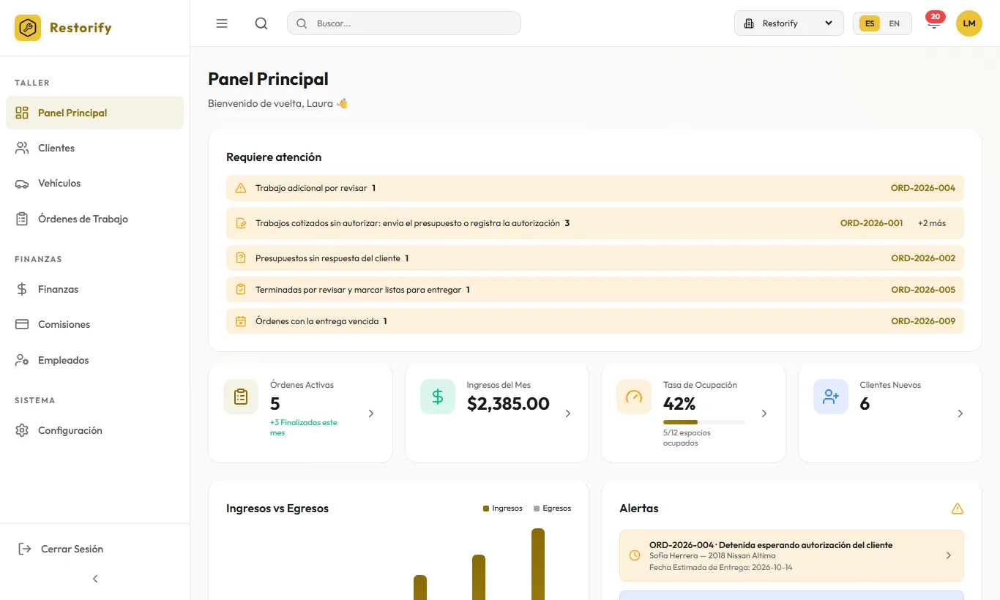

---

## 2. Vocabulario del sistema

**Sede.** Un taller físico. Todo lo que registras pertenece a una sede y no se
mezcla con las demás. Un administrador puede cambiar de sede; el resto del
personal solo ve la suya.

**Rol.** Define qué puede hacer cada persona. Hay tres: **administrador**,
**mecánico** y **pintor**. Mecánicos y pintores tienen exactamente los mismos
permisos; en este manual los llamamos **técnicos**.

**Cliente.** La persona dueña del vehículo. Un cliente puede tener varios
vehículos y varias órdenes.

**Vehículo.** El auto. Pertenece a un cliente y se identifica por su VIN
(el número de serie de 17 caracteres) y, cuando la tiene, su placa.

**Orden de trabajo.** El trabajo concreto que se le hará a un vehículo. Es el
centro del sistema: dentro de ella viven las fotos de ingreso, la mano de obra,
los repuestos, los técnicos asignados, el avance, los videos y notas de voz y la
firma del cliente. Cada orden recibe un número automático con el formato
`ORD-2026-001`.

**Mano de obra.** Lo que se cobra por el trabajo. Es la base de la comisión de
los técnicos, por eso es el único dinero de la orden que ellos ven.

**Comisión.** La parte de la mano de obra que le toca a un técnico cuando la orden se
entrega. Desde octubre de 2026 cada trabajo (tarea) tiene **su técnico**, y la comisión de
ese trabajo es suya.

**Tarea.** Una línea de mano de obra con su tipo (mecánica o pintura), su precio y su
técnico. Una tarea **sin técnico** no le paga comisión a nadie.

**Presupuesto.** Los trabajos que se le presentan al cliente para que los autorice.
**Lo que el cliente no autoriza no se hace ni se cobra.**

**Trabajo adicional.** Hallazgo imprevisto que el técnico encuentra en el piso del taller y reporta desde la orden, lo que pausa el trabajo mientras administración decide si cotizarlo al cliente o descartarlo.

**Listo para entregar.** Marca que pone administración sobre una orden finalizada para confirmar que el trabajo fue revisado en el taller; en ese momento el cliente recibe el correo avisándole que su vehículo está listo.

**Cobro por parqueo.** Cobro por el almacenamiento o estadía del vehículo en el taller, según si el trabajo tiene seguro o es particular.

---

## 3. Entrar al sistema

Abre la dirección del sistema en el navegador (`restorifyauto.net`). Verás la
pantalla de acceso.

1. Escribe tu **Correo Electrónico**.
2. Escribe tu **Contraseña**.
3. Presiona **Entrar**.

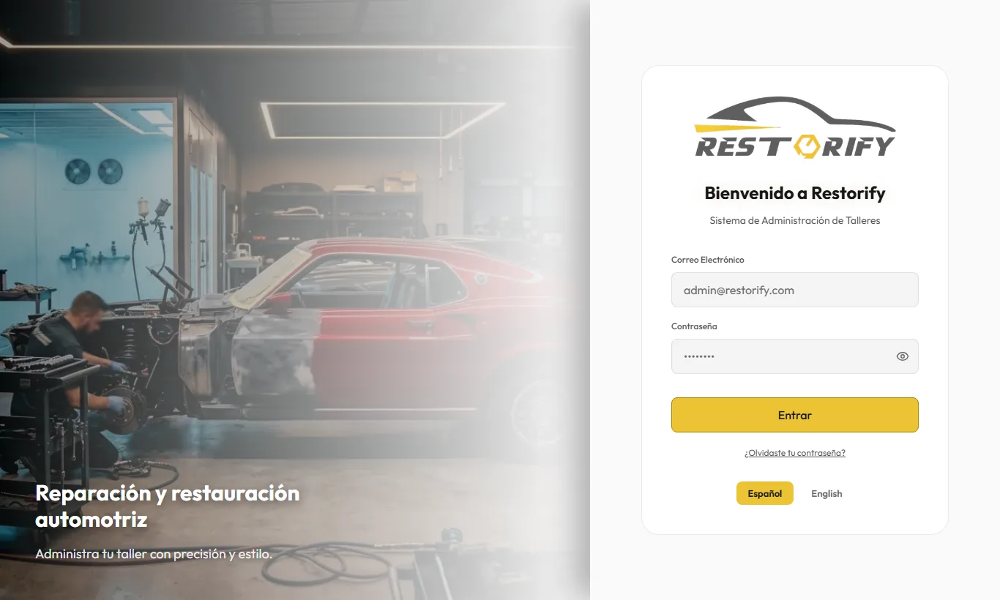

**No existe registro público.** Las cuentas las crea un administrador desde
Configuración o Empleados. Si no tienes cuenta, pídesela a quien administre el sistema.

En la misma pantalla puedes cambiar el idioma entre **Español** e **English**.
La elección se recuerda para la próxima vez.

Si el correo o la contraseña no son correctos, aparece un aviso rojo sobre el
formulario y no se entra. Si el aviso indica que la cuenta no tiene acceso al
taller, la cuenta existe pero nadie la dio de alta en el sistema: pídele a un
administrador que te dé de alta desde **Empleados**.

### Si olvidaste tu contraseña

1. Presiona **¿Olvidaste tu contraseña?** debajo del botón Entrar.
2. Escribe tu correo y presiona **Enviar enlace**.
3. Revisa tu bandeja de entrada —y la carpeta de correo no deseado— y abre el
   enlace que recibiste.
4. El enlace te lleva a una pantalla para escribir tu **Contraseña nueva** y
   confirmarla. Al guardarla con **Guardar contraseña**, **Entrar al sistema** te lleva al panel.

Cada enlace sirve **una sola vez** y vence al poco tiempo (una hora, con la configuración normal). Si lo abres de nuevo o tarde,
la pantalla te avisa que el enlace venció: vuelve al inicio y pide otro con **Volver a iniciar sesión**.

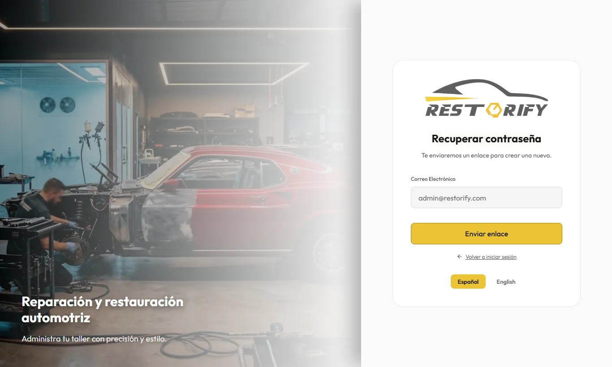

Por seguridad el mensaje de confirmación es el mismo exista o no una cuenta con
ese correo, para que nadie pueda averiguar qué correos están registrados. Si no
recibes nada, pídele a un administrador que te asigne una contraseña nueva desde
Configuración o Empleados.

### Cerrar sesión en un teléfono compartido

Si varias personas usan la misma tablet o teléfono, **cierra sesión al terminar**.
Además de proteger tu cuenta, así ese dispositivo deja de recibir tus
notificaciones y empieza a recibir las de quien entre después. Al cerrar sesión la app
borra lo que tenía cargado en pantalla: quien entre después no ve tus órdenes ni tus
montos.

---

## 4. Cómo está organizada la pantalla

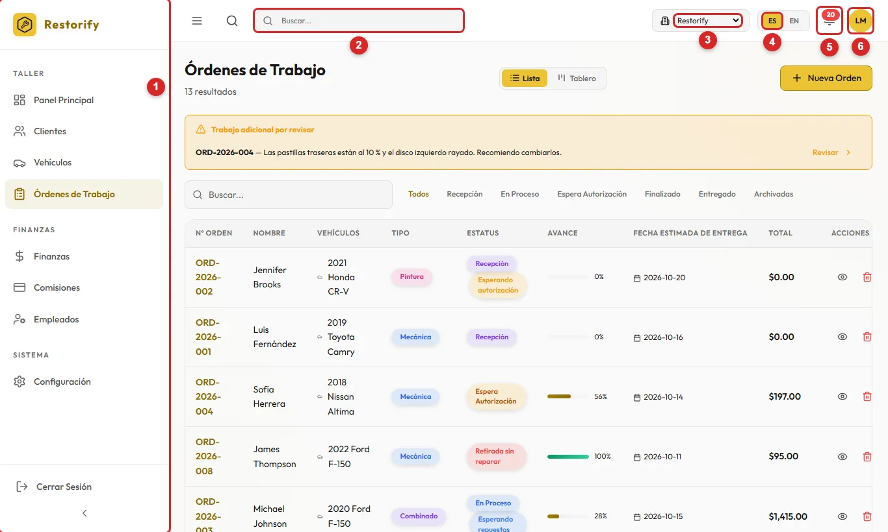

### Barra lateral (izquierda)

El menú principal, en tres grupos:
- **Taller**: **Panel Principal**, **Clientes**, **Vehículos**, **Órdenes de Trabajo** y, para los técnicos, **Mis comisiones**. (Clientes y Vehículos solo los ve administración).
- **Finanzas** (solo administradores): **Finanzas**, **Comisiones** y **Empleados**.
- **Sistema**: **Configuración**.

Abajo está el botón **Cerrar Sesión**. El tablero Kanban ya no tiene entrada propia en el menú: está dentro de **Órdenes de Trabajo** (sección 10).

Se puede plegar con la flecha para ganar espacio en pantalla.

### Encabezado (arriba)

- **Buscador global.** Campo **Buscar...**: escribe al menos 2 caracteres y busca a la vez entre
  clientes, vehículos y órdenes. Los resultados aparecen agrupados por tipo. Un cliente abre su ficha y una orden
  abre su detalle; un vehículo te lleva a la lista de **Vehículos**.
- **Selector de sede** (solo administradores). Cambia el taller activo. Todo lo
  que veas a partir de ese momento será de la sede seleccionada.
- **Idioma.** Botones ES / EN.
- **Campana de notificaciones.** Tus avisos: órdenes que te asignaron, avances de
  los técnicos, órdenes listas para entregar, comisiones generadas. Ver sección 11.
- **Avatar.** Tu foto o tus iniciales. Lleva a **Configuración**.

### En el teléfono

- La barra lateral se convierte en un menú que se abre con el botón ☰ de arriba a
  la izquierda. Ahí están el selector de sede y **Cerrar Sesión**.
- El buscador se abre con la **lupa** del encabezado y ocupa toda la pantalla.
- Aparece una **barra inferior** con los accesos más usados:
  - Para todos: **Panel** y **Órdenes**.
  - Para técnicos: **Comisiones** (abre directamente sus comisiones aceptadas y pagadas).
  - Para administración: **Clientes** y **Vehículos**.
- Las tablas se transforman en tarjetas, más fáciles de tocar con el dedo.
- Los formularios grandes (como Nueva Orden) se abren a pantalla completa.

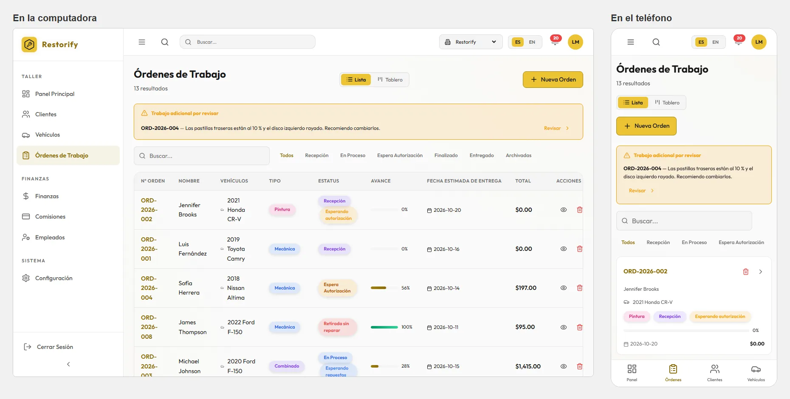

---

## 5. Panel principal

Es la pantalla de inicio. Resume cómo va el taller.

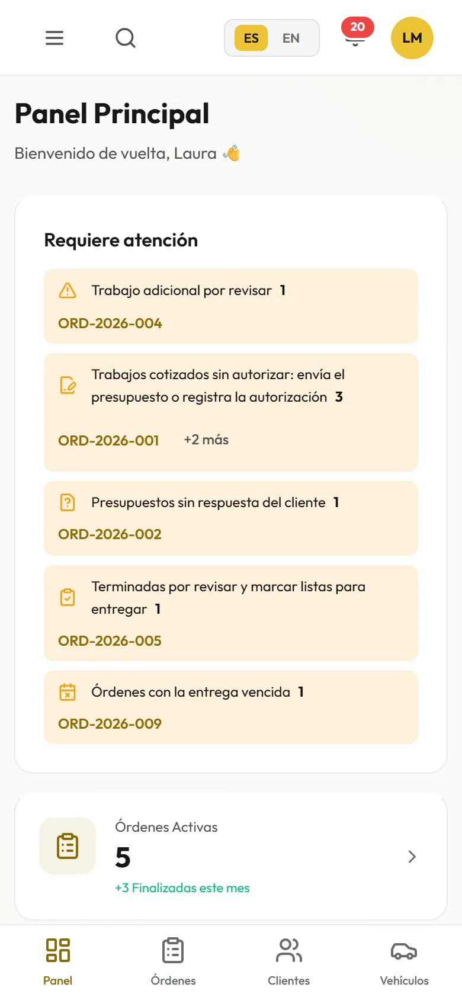

### Lo que ve un administrador
<!-- rol: admin -->

- **Requiere atención**, arriba de todo: lo que espera una decisión de la oficina, con el
  número de cada cosa y las órdenes a las que lleva:
  - **Trabajo adicional por revisar**: lo que reportó un técnico y nadie ha cotizado ni
    descartado. Abre la orden en Resumen.
  - **Trabajos cotizados sin autorizar: envía el presupuesto o registra la autorización**: trabajos agregados que aún no se envían al cliente ni se autorizan. Abre la orden en Trabajos.
  - **Presupuestos sin respuesta del cliente**: presupuestos enviados esperando que el cliente responda. Abre la orden en Trabajos.
  - **Tareas sin técnico: nadie cobra su comisión**: nadie cobra la comisión de esas tareas hasta que se les asigne un técnico. Abre la
    orden en Trabajos.
  - **Terminadas por revisar y marcar listas para entregar**: órdenes donde el personal terminó el trabajo, esperando que administración las revise y las marque listas para entregar al cliente.
  - **Órdenes con la entrega vencida** (las finalizadas no cuentan).
  - **Correos al cliente con error (últimas 72 h)**: el botón **Revisar** lleva a
    Configuración, donde se pueden reintentar.

  Si no hay nada pendiente, dice «Todo al día: nada espera una decisión de la oficina.» Se actualiza solo cuando alguien cambia una orden.
- **Órdenes Activas** y cuántas están **Finalizadas este mes**.
- **Ingresos del Mes**.
- **Tasa de Ocupación**: cuántos espacios del taller están ocupados respecto a la
  capacidad configurada.
- **Clientes Nuevos** del mes.
- **Ingresos vs Egresos**: gráfico comparativo de los últimos meses.
- **Alertas**: órdenes detenidas en espera de autorización y órdenes en proceso con poco avance (menos del 30 %).
- **Órdenes Recientes**, con botón **Ver orden** y su total.

### Lo que ve un técnico
<!-- rol: tecnico -->

La misma pantalla, sin nada de dinero: no aparecen ingresos, totales, clientes
nuevos ni el gráfico financiero. El indicador de órdenes dice **Mis Órdenes Activas**,
y las **Alertas** y las **Órdenes Recientes** muestran únicamente **sus propias órdenes**.

Arriba de todo está **Mis tareas**: los trabajos que tiene asignados en todas sus órdenes
sin entregar y que todavía no marca como hechos. Primero los que ya se pueden hacer (la
orden que vence antes, primero); al final, los marcados con **Esperando autorización**. Al
tocar uno se abre su orden en la pestaña **Tareas**, donde se marca **Realizado** y se
agregan avances. Las tareas hechas no se listan una por una, solo se cuentan («N hecha(s) en órdenes sin entregar»).

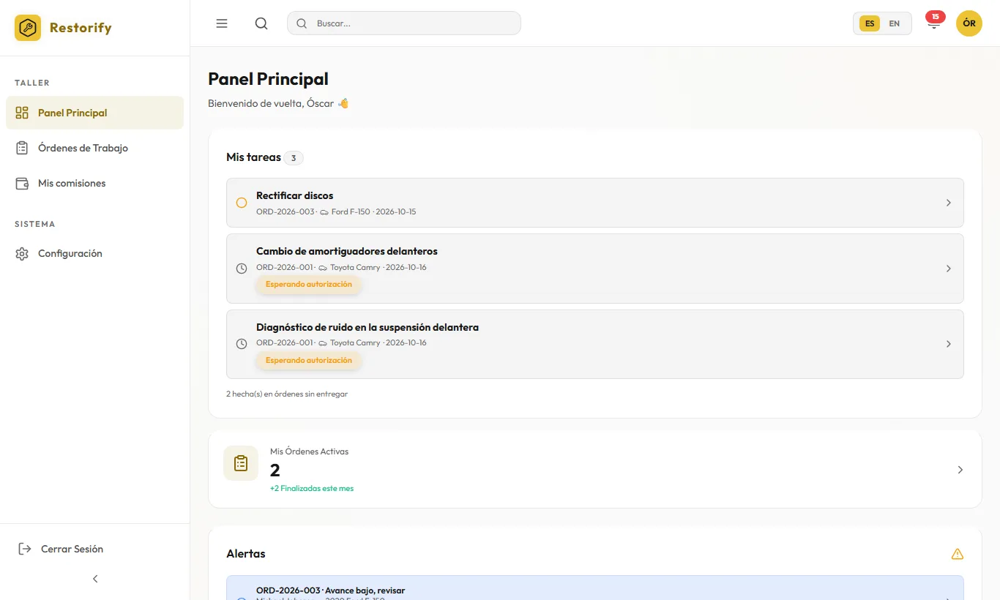

---

## 6. Clientes
<!-- rol: admin -->

*(Solo administradores. Un técnico ve el cliente dentro de sus órdenes.)*

Lista de todas las personas registradas en la sede, con su teléfono, correo,
cuántos vehículos tienen y cuántas órdenes han generado.

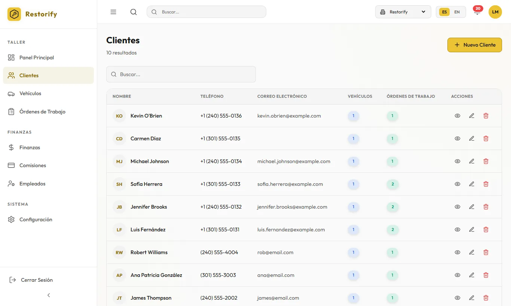

### Registrar un cliente

1. Presiona **Nuevo Cliente**.
2. Llena **Nombre** y **Teléfono** (obligatorios), y **Correo Electrónico**, **Dirección** y **Notas CRM** si los tienes.
3. Elige el **Idioma de los correos** (Español o English, en inglés por defecto). El cliente también puede cambiarlo al elegir idioma en su enlace.
4. **Crear**.

**El teléfono lleva su país.** A la izquierda del número está el país, con
**Estados Unidos (+1)** elegido de entrada y **México (+52)** justo después; el resto
son los países más comunes de la clientela. Elige el del número del cliente y escribe
el número sin el prefijo. Es el número que usa el sistema para **llamar** y para
**WhatsApp**, así que un país equivocado marca a otro lado. Si a un número de EE. UU.
le falta o le sobra un dígito, el campo te avisa con «Un número de Estados Unidos tiene 10 dígitos.» al salir de él.

> Los clientes que ya estaban registrados conservan su número como estaba y se leen
> como de EE. UU. Si uno es de otro país, ábrelo, elige el país correcto y guarda.

> Captura el **Correo Electrónico** siempre que el cliente lo tenga: ahí le llegan solos el
> aviso de ingreso y los cambios de estado de su vehículo, con el enlace a su
> reporte (sección 8, *Enlace del cliente*). Si lo escribes mal, el formulario te
> avisa antes de guardar.

Cuando el cliente tiene correo aparece la casilla **Recibe avisos por correo**.
Desmárcala si el cliente no quiere correos. El cliente también puede darse de baja
él mismo desde su enlace; en ese caso verás la casilla desmarcada.

### Ver el perfil de un cliente

El botón **Ver** abre su ficha completa (**Perfil del Cliente**): sus datos, todos sus **Vehículos Registrados** y el
**Historial de Servicios** con el estado de cada orden (el total solo lo ve un
administrador).

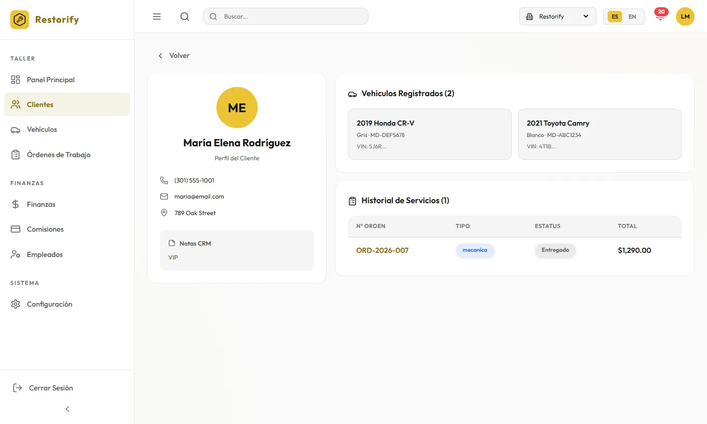

### Editar y eliminar

El botón **Editar** modifica los datos. **El botón Eliminar solo aparece para
administradores**: borrar un cliente arrastra consigo todos sus vehículos. Si el
cliente tiene órdenes de trabajo registradas, el sistema impide borrarlo para conservar el historial.

---

## 7. Vehículos
<!-- rol: admin -->

*(Solo administradores. Un técnico ve el vehículo dentro de sus órdenes.)*

Todos los autos registrados en la sede, con marca, modelo, año, VIN, placa,
color y dueño.

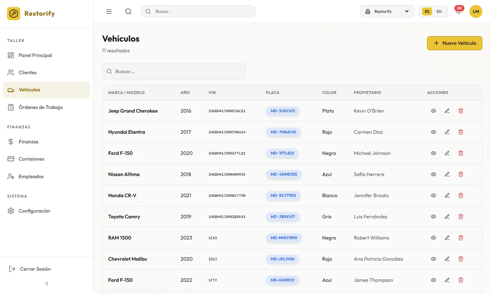

### Registrar un vehículo

El formulario está pensado para llenarse casi solo a partir del VIN.

1. Presiona **Nuevo Vehículo**.
2. **Propietario**: elige un cliente de la lista, o créalo ahí mismo con **Agregar cliente nuevo**.
3. **VIN**: escribe los 17 caracteres y presiona **Decodificar**. El sistema consulta la base de datos oficial
   de vehículos y rellena marca, modelo y año. Debajo aparecen datos adicionales
   (motor, carrocería, planta de ensamblaje). Un VIN nunca lleva las letras I, O
   ni Q; si las escribes, el sistema avisa con «El VIN no puede contener las letras I, O ni Q.».
4. Revisa **Marca**, **Modelo** y **Año**. Lo que escribas a mano tiene prioridad.
5. **Color**: elige de la lista o escríbelo. El color no viene en el VIN.
6. **Placa**: elige el **Estado de la placa** que la emitió y escribe el número de **Placa**. El sistema avisa
   si el formato no coincide con ese estado, sin impedirte guardarla.
7. **Crear**.

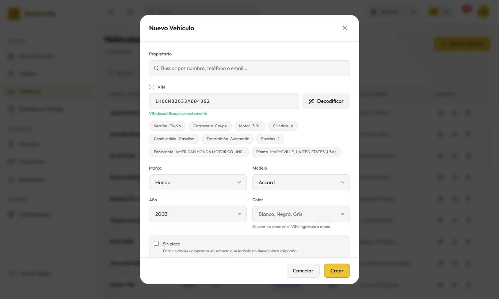

### Vehículos sin placa

Las unidades compradas en subasta llegan sin placa. Marca la casilla
**Sin placa** y los campos de placa y estado se desactivan. En las listas ese
vehículo aparecerá con la etiqueta «Sin placa».

No inventes un texto de relleno como «SIN PLACA» o «N/A» en el campo: aparecería
en las búsquedas y se imprimiría en la orden como si fuera una placa real.

### Editar y eliminar

El botón **Editar** modifica los datos del auto. **Eliminar es solo para administradores**, porque borra el
historial de servicio de ese vehículo. Si tiene órdenes de trabajo asociadas, el sistema no permite eliminarlo.

---

## 8. Órdenes de trabajo

El módulo más grande. Aquí vive el trabajo del taller.

### Cómo se ve la lista y el tablero

Arriba a la derecha está el selector **Vista**, que permite cambiar entre:
- **Lista**: la tabla de órdenes tradicional.
- **Tablero**: la vista Kanban con tarjetas ordenadas por columna de estado (sección 10).

El sistema recuerda automáticamente la última vista que utilizaste en ese dispositivo.

**Si eres administrador**, ves todas las órdenes de la sede activa y su total.
**Si eres técnico**, ves **Mis Órdenes de Trabajo**: únicamente las que tienes asignadas. Las de tus compañeros no aparecen ni en la lista, ni en el tablero, ni en el buscador. Si abres un enlace o aviso de una orden que no te corresponde, el sistema te avisa: «Esa orden no está entre las tuyas. Si te toca trabajarla, pide a administración que te asigne.».

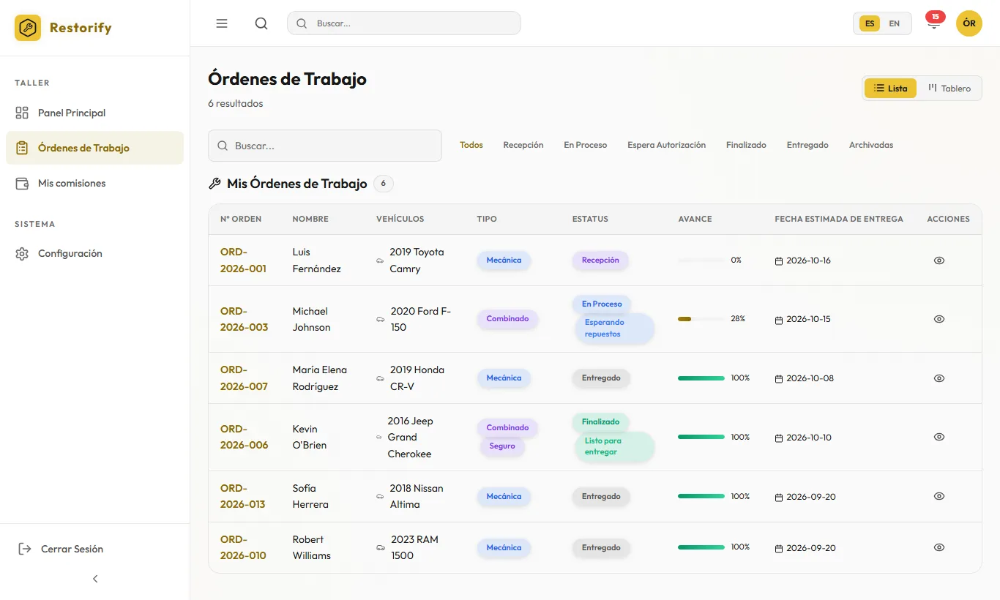

Arriba hay un buscador con el campo **Buscar...** (filtra por número de orden o nombre de cliente tanto en lista como en tablero) En la vista de lista, además, hay filtros por estado: **Todos**, **Recepción**, **En Proceso**, **Espera Autorización**, **Finalizado**, **Entregado** y **Archivadas** (en el tablero no hacen falta: las columnas ya son los estados).

Cada orden puede mostrar distintivos o insignias según su condición:
- **Seguro**: si el trabajo se procesa a través de una aseguradora.
- **Esperando repuestos**: si tiene piezas pedidas que aún no han llegado al taller.
- **Esperando autorización**: si tiene un presupuesto enviado al cliente pendiente de respuesta.
- **Por revisar**: si el técnico finalizó el trabajo y administración debe revisarlo antes de liberarlo.
- **Listo para entregar**: cuando administración confirmó que el trabajo está listo para que el cliente lo recoja.
- **Retirada sin reparar**: si el vehículo se retiró sin completar el trabajo.
- **Archivada**: si la orden entregada fue enviada al archivo histórico.

### Los estados de una orden

| Estado | Qué significa |
|---|---|
| **Recepción** | El vehículo acaba de ingresar. Aún no se trabaja en él. |
| **En Proceso** | Se está trabajando activamente en el vehículo. |
| **Espera Autorización** | La orden queda en pausa porque el técnico reportó trabajo adicional o administración envió un presupuesto que espera respuesta del cliente. Vuelve sola a En Proceso al responder el cliente o al descartar el hallazgo. El técnico no puede levantar la pausa por su cuenta. |
| **Finalizado** | El técnico terminó el trabajo. El avance pasa automáticamente al 100 % y se avisa a administración con «Trabajo terminado». **Al cliente todavía no le llega el aviso de listo**: su enlace muestra «En revisión final» y en la orden aparece la insignia **Por revisar**. El técnico no puede reabrirla a En Proceso; solo administración la reabre. |
| ↳ **Listo para entregar** | Marca sobre Finalizado que pone **solo administración** con el botón **Marcar listo para entregar**. En ese momento sale el correo al cliente «Su vehículo está listo» y su enlace muestra «Listo para recoger». |
| **Entregado** | El cliente se llevó el vehículo. **Solo un administrador** la marca, mediante el diálogo de entrega. Registra el cobro en Finanzas, asienta el costo de repuestos, congela el cobro de parqueo si aplica y genera las comisiones (sección 18). |
| **Retirada sin reparar** | El cliente se llevó el vehículo **sin que se hiciera todo el trabajo**. **Solo un administrador**, con el botón **Retirada sin reparar** (ver abajo). |

**Esperando repuestos** no es un estado general de la orden: en la tabla de repuestos, cada pieza se marca como **Sin pedir**, **Pedido** y después **Llegó**. Mientras falte una pieza por llegar, la orden muestra la insignia **Esperando repuestos** en la lista y en el tablero, y el cliente ve en su reporte qué pieza se está esperando. Al marcarla **Llegó**, los técnicos asignados reciben un aviso.

**El avance se mueve solo** con las tareas: cada tarea que se marca como hecha suma al avance según su precio de mano de obra (una de $400 pesa más que una de $50). El técnico o administrador lo puede ajustar a mano si no refleja el avance real; al marcar la siguiente tarea como hecha, se vuelve a calcular automáticamente.

### Crear una orden
<!-- rol: admin -->

Presiona **Nueva Orden** (botón visible solo para administradores). El alta se realiza en **cuatro pasos**, indicados arriba como **Paso 1 de 4**, etc.:
1. **Cliente**
2. **Vehículo y recepción**
3. **Trabajos**
4. **Depósito**

Los botones **Anterior** y **Siguiente** permiten navegar entre los pasos sin perder la información. Si falta algún dato obligatorio, el sistema te lleva a ese paso y resalta el campo faltante. Si capturas un cliente o vehículo nuevo y decides presionar **Cancelar**, el sistema los guarda en sus respectivos módulos para que no tengas que escribirlos de nuevo la próxima vez. La orden se crea únicamente con el botón **Crear** en el último paso.

**Paso 1 — Cliente.** Elige un cliente existente en **-- Seleccionar cliente --**, o pulsa **Nuevo Cliente** para registrarlo ahí mismo (Nombre y Teléfono son obligatorios).

**Paso 2 — Vehículo y recepción.** Elige el vehículo en **-- Seleccionar vehículo --**, o presiona **Nuevo Vehículo** para registrarlo con el decodificador de VIN. Luego registra las condiciones de ingreso:
- **Nivel de Gasolina**: E (vacío), 1/4, 1/2, 3/4 o F (lleno).
- **Millas de Ingreso**: odómetro actual (solo números enteros positivos).
- **Inspección 360°**: seis zonas fijas para fotografiar el estado del auto al entrar: Frontal, Trasera, Izquierda, Derecha, Interior y Tablero. Toca cada recuadro para tomar la foto o seleccionarla.
- Botones multimedia debajo de las zonas: **Foto**, **Video**, **Nota de voz** y **Galería**. Permiten registrar detalles de abolladuras previas, documentos o recorridos en video. Las fotos se comprimen en el teléfono antes de subir y el video se optimiza (el botón muestra «Procesando…»).
- **Notas de la inspección 360°**: texto libre para observaciones generales del estado del auto.

> Esta inspección es la prueba del taller si un cliente reclama después un daño previo. Las fotos y videos de la recepción son lo único que queda **Visible al cliente** desde el inicio. Las notas de voz de la recepción quedan como **Interno** hasta que un administrador decida publicarlas.

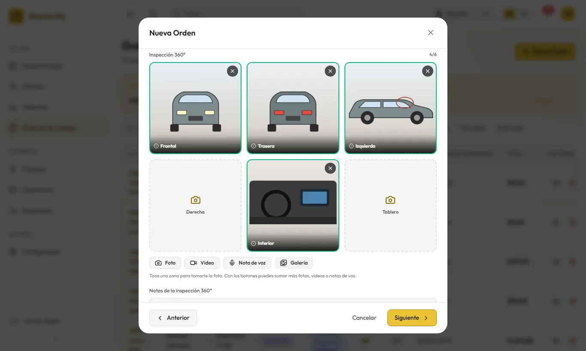

**Paso 3 — Trabajos.**
- **Tipo de Trabajo**: **Mecánica**, **Pintura** o **Combinado**.
- **Fecha Estimada de Entrega**.
- **Trabajo con seguro**: marca la casilla si el servicio lo cubre una aseguradora, e ingresa la **Aseguradora** y el **Número de reclamo**.
- **Agregar trabajo**: tipo (Mecánica o Pintura), descripción, precio y **Técnico** asignado. Si el tipo no coincide con el oficio registrado de la persona (por ejemplo, pintura a un mecánico), el sistema muestra la advertencia «¿Asignar una tarea de pintura a un mecánico?» con las opciones **Asignar igual**, **Elegir otro** o **Cancelar**. Puedes dejar la tarea en **Sin asignar**.
- **Agregar repuesto**: descripción, cantidad, precio unitario y costo opcional.
- Si escribes una tarea o repuesto y no presionas **Agregar**, el botón **Crear** te avisa para que lo agregues o lo descartes antes de continuar.

Lo que cotizas en este paso nace **Sin autorizar**: se cobra únicamente cuando el cliente lo autoriza a través de un presupuesto o cuando administración registra la autorización manual. La firma de recepción no autoriza los trabajos cotizados.

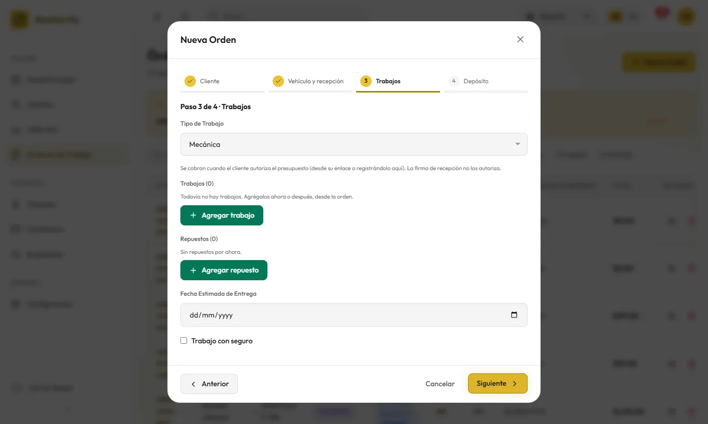

**Paso 4 — Depósito.** El anticipo que deja el cliente (deja 0 si no deja nada). Si el cliente paga un depósito:
- Elige **Cómo pagó el cliente** (Efectivo, Tarjeta, Zelle, Transferencia, Cheque).
- Si pagó con cheque, anota el **Número de cheque** o sube una **Foto del comprobante (opcional)**.
- Queda registrado automáticamente como ingreso en Finanzas bajo el concepto «Depósito inicial».

Al presionar **Crear**, el sistema genera el número de orden (por ejemplo, `ORD-2026-001`) y abre su detalle. Las fotos y archivos multimedia continúan subiendo en segundo plano sin interrumpir tu navegación.

### Solo administración abre órdenes

Mecánicos y pintores no ven el botón **Nueva Orden**. Abrir una orden compromete al taller y asignar tareas decide quién cobra comisiones; ambas facultades corresponden exclusivamente a administración.

### El detalle de una orden

Es la pantalla donde se sigue el trabajo día a día.

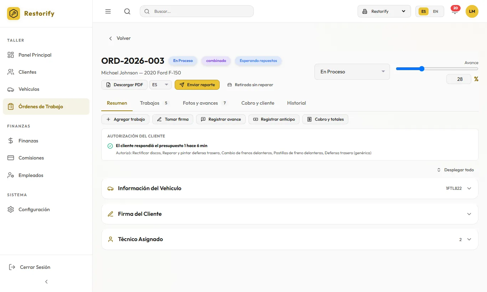

#### Encabezado de la orden

Arriba quedan siempre visibles:
- Número de orden, nombre del cliente y datos del vehículo.
- Insignias de estado: **Seguro**, **Esperando repuestos**, **Esperando autorización**, **Por revisar** o **Listo para entregar**, **Retirada sin reparar**, **Archivada**.
- Botones de acción (para administradores):
  - **Marcar listo para entregar**: botón verde cuando el técnico terminó y el trabajo fue revisado.
  - **Descargar PDF** con el selector **Idioma del PDF** (**ES** / **EN**).
  - **Enviar reporte**: abre la ventana para compartir el enlace del cliente por correo o WhatsApp.
  - **Archivar** / **Devolver al tablero**.
  - **Retirada sin reparar**: para cerrar la orden si el cliente se lleva el auto sin reparar.
- Selector de estado y barra de **Avance** (0 a 100 %).

#### Acciones rápidas

Debajo del encabezado aparecen botones destacados con las acciones más frecuentes según tu rol:
- **Para administradores**:
  - **Entregar y cobrar** (aparece destacado cuando la orden está marcada como lista para entregar).
  - **Agregar trabajo** (destacado si la orden aún no tiene mano de obra).
  - **Tomar firma** (destacado en recepción si la orden tiene trabajos y aún no está firmada).
  - **Registrar avance**.
  - **Registrar anticipo**.
  - **Cobro y totales**.
- **Para técnicos**:
  - **Mis tareas** (destacado, lleva directo a sus tareas asignadas).
  - **Registrar avance**.
  - **Reportar trabajo adicional** (activo mientras la orden no esté finalizada).
  - **Datos del vehículo**.

#### Pestañas (en computadora)

| Rol | Pestañas disponibles |
|---|---|
| **Administrador** | **Resumen** · **Trabajos** · **Fotos y avances** · **Cobro y cliente** · **Historial** |
| **Mecánico o pintor** | **Tareas** · **Orden** · **Avances** |

Junto a cada pestaña aparece un contador de líneas o archivos. Un indicador amarillo en **Trabajos** avisa que hay mano de obra o repuestos **Sin autorizar**.

#### Secciones plegables

Dentro de cada pestaña, las tarjetas vienen agrupadas como secciones plegables que arrancan **cerradas**: muestran su título y un resumen a la derecha (placa del auto, cantidad de líneas, total en dinero o un visto bueno). La flecha abre o cierra la sección, y los botones **Desplegar todo** y **Contraer todo** abren o cierran todas las secciones de esa vista. Si abres una orden desde una notificación o enlace directo, la sección correspondiente se abre automáticamente.

En el teléfono no hay pestañas superiores: todas las secciones aparecen apiladas en una sola columna en el mismo orden, con un botón **Desplegar todo** / **Contraer todo** al inicio.

Distribuídas por pestaña, las secciones son:

- **En la vista de Administrador**:
  - **Resumen**: **Información del Vehículo**, **Firma del Cliente**, **Técnico Asignado**. (Arriba muestra las alertas de trabajo adicional reportado, tareas sin técnico y trabajos pendientes de visitas anteriores).
  - **Trabajos**: **Mano de obra**, **Descripción de Repuestos**, **Presupuesto**, **Reparto de la comisión**.
  - **Fotos y avances**: **Inspección 360°**, **Avance del Trabajo**.
  - **Cobro y cliente**: **Totales**, **Parqueo** (si está habilitado en la sede), **Balance de la orden** (si está entregada), **Enlace del cliente**.
  - **Historial**: bitácora inalterable de todos los cambios de la orden.
- **En la vista de Técnico**:
  - **Tareas**: lista de **Tareas** asignadas y tarjeta **Tu comisión estimada**.
  - **Orden**: **Información del Vehículo**, **Inspección 360°**, **Descripción de Repuestos** (sin montos de dinero), **Firma del Cliente**, **Técnico Asignado**.
  - **Avances**: bitácora de **Avance del Trabajo**.

#### Trabajo adicional reportado por el técnico

Cuando un mecánico o pintor encuentra daños o piezas gastadas que no estaban en la orden original:
1. En sus acciones rápidas o en su lista de tareas presiona **Reportar trabajo adicional**.
2. Escribe en **Qué encontraste** y toma fotos, video o una nota de voz de evidencia.
3. El texto y los archivos son internos para el taller; el cliente no los ve.
4. Presiona **Reportar y pausar la orden**.
5. La orden pasa automáticamente a **Espera Autorización** y se genera una notificación para administración.

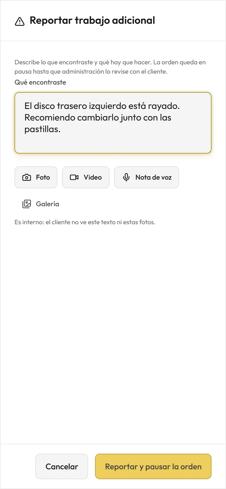

En el panel principal (en **Requiere atención**) y arriba de las pestañas Resumen y Trabajos de la orden, administración ve la tarjeta **El taller reportó trabajo adicional**:
- **Cotizar al cliente**: precarga una nueva tarea en Mano de obra con la descripción y el técnico que lo reportó. Administración le fija el precio y luego envía el presupuesto al cliente.
- **Descartar…**: abre una ventana para descartarlo internamente o marcar **Mostrarlo en el reporte del cliente** ingresando un **Texto para el cliente**. En ese caso aparece en su enlace como "Observación del taller" de carácter informativo, sin costo.
- Al cotizar o descartar el reporte, la orden sale de la pausa.

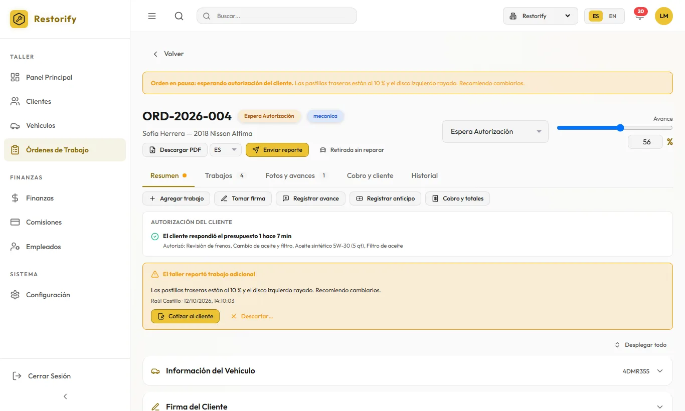

#### Mano de obra y Tareas

- **Para administradores (Mano de obra)**:
  - Botón verde **Agregar trabajo**: abre una fila con **Tipo** (Mecánica o Pintura), **Descripción**, **Precio** y **Técnico**.
  - Si el tipo no coincide con el oficio registrado de la persona, sale la advertencia de oficio.
  - En cada tarea existente hay dos selectores (**Tipo** y **Técnico**) que se pueden modificar en cualquier momento sin alterar lo cotizado. Al asignar una tarea a un técnico, este entra a la orden y recibe la notificación «Nueva tarea»; al retirársela recibe «Tarea reasignada».
  - Si una tarea no tiene técnico, muestra la insignia **Sin técnico**: nadie cobrará esa comisión hasta que se le asigne uno. La orden lo alerta arriba de Resumen con «N tarea(s) sin técnico: nadie cobrará su comisión hasta que se la asignes.» y el botón **Ver trabajos**.
  - Con la comisión pagada, los selectores de la tarea muestran un candado y el botón **Eliminar** se bloquea; para modificarlos, primero debe deshacerse el pago en Comisiones.
- **Para técnicos (Tareas)**:
  - Ve sus tareas con su descripción, su tipo y el precio de la mano de obra (de ahí sale su comisión). Los repuestos los ve sin precio.
  - Toca **Realizado** al terminar una tarea; si la marcó por error, presiona **Reabrir tarea**.
  - Con **Agregar avance** puede subir fotos, videos o notas de voz vinculados a esa tarea específica.
- **Insignias de cada línea**:
  - *(Sin insignia)*: **Autorizado** por el cliente. Se realiza y se cobra.
  - **Sin autorizar**: agregada recientemente; el cliente no la ha visto. No se cobra ni se realiza.
  - **Esperando al cliente**: incluida en un presupuesto enviado; no se puede editar mientras espera respuesta.
  - **No realizar** (tachada): rechazada por el cliente. No se realiza ni se cobra.

#### Repuestos

- **Administrador**: tabla con Descripción, Cantidad, Precio de venta, **Costo** (lo que pagó el taller; si se deja vacío asume el precio) y selector de pedido: **Sin pedir**, **Pedido**, **Llegó**. Al marcar **Llegó**, se notifica a los técnicos de la orden.
- **Técnico**: tarjeta **Descripción de Repuestos**, donde solo ve las piezas y cantidades requeridas para su labor, sin ningún precio ni costo.

#### Trabajo con seguro
<!-- rol: admin -->

Si la reparación la cubre una compañía de seguros:
- En la sección **Información del Vehículo**, presiona **Editar** junto a Seguro para abrir el diálogo **Editar seguro**.
- Marca la casilla **Trabajo con seguro**, ingresa la **Aseguradora** (por ejemplo State Farm o Geico) y el **Número de reclamo**.
- La orden muestra la insignia **Seguro** y, si el cobro de parqueo está activo en la sede, aplica automáticamente las reglas del perfil con seguro.

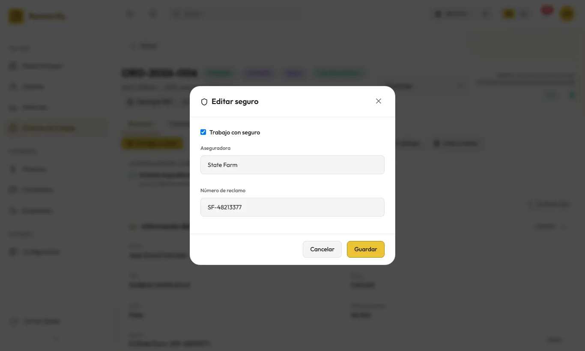

#### Tu comisión estimada (técnicos)
<!-- rol: tecnico -->

Los técnicos asignados ven en su pestaña Tareas la tarjeta **Tu comisión estimada**. Muestra cada tarea propia autorizada con su precio. El porcentaje y el monto dicen **Pendiente** hasta que administración acepta la comisión, después de entregar la orden; la tarjeta lo explica: «Tu comisión se confirma cuando administración la acepta, después de entregar la orden.» Ya aceptada, aparece el cálculo (*precio de la tarea × su porcentaje*) con su monto. Si el empleado está configurado a salario, la tarjeta le indica que la orden no le genera comisión.

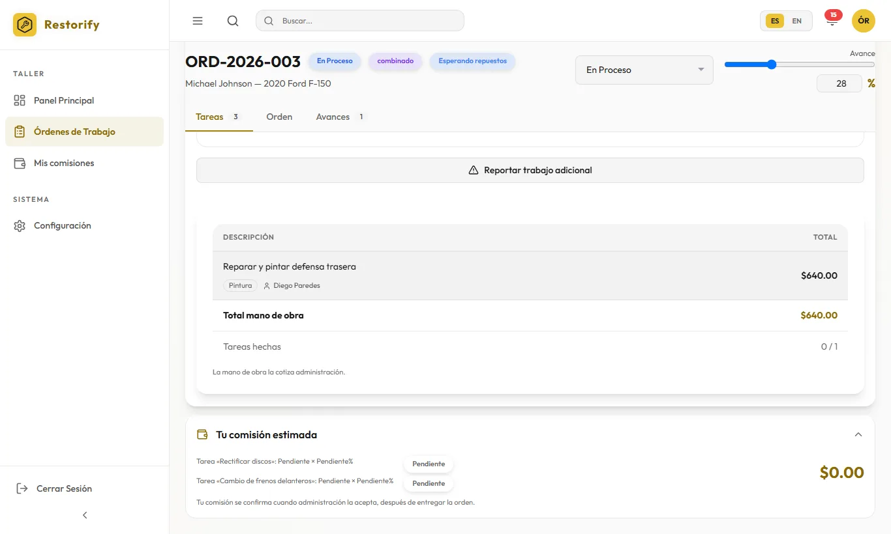

#### Técnicos asignados

Solo administración puede asignar personal de la sede de la orden.
- Quien entra por una tarea lleva la etiqueta **Por tarea** y cobra únicamente sus tareas.
- Quien está en trabajos heredados de antes de octubre de 2026 lleva **En el reparto** y participa en la bolsa por especialidad.
- No se puede eliminar de la orden a un técnico que tenga tareas asignadas; primero deben reasignarse sus tareas a otra persona.

#### Avance del trabajo

Bitácora donde el personal documenta los trabajos realizados con texto, fotos, videos o notas de voz. Se puede asociar el avance a una tarea específica. Un técnico puede borrar sus propios avances mientras la orden no esté entregada. Un administrador puede borrarlos todos y gestionar si se muestran o no al cliente.

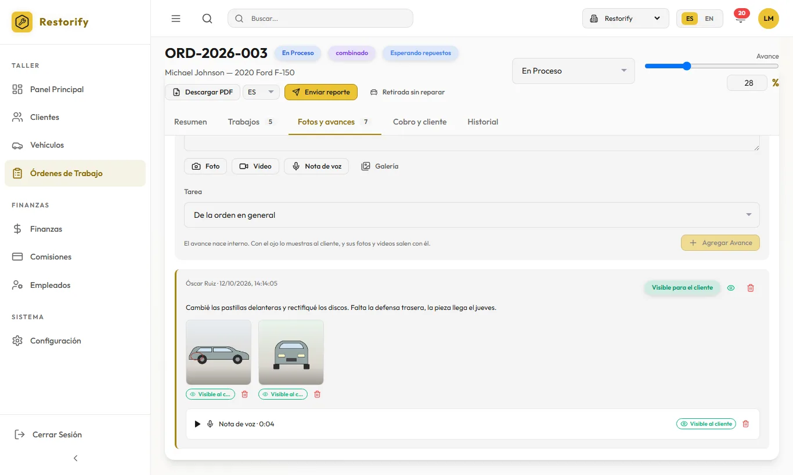

#### Firma del cliente
<!-- rol: admin -->

La captura administración en el mostrador durante la recepción. El cliente firma con el dedo sobre la pantalla para manifestar su conformidad con el estado en que entregó el vehículo (millas, nivel de gasolina y fotos de inspección 360°).
> **Importante:** Esta firma **no autoriza el presupuesto ni los trabajos cotizados**. Solo avala la recepción física del auto.

#### Presupuestos: lo que el cliente autoriza
<!-- rol: admin -->

Cuando se cotizan trabajos o repuestos, quedan **Sin autorizar**. En la sección **Presupuesto**, administración tiene dos alternativas:

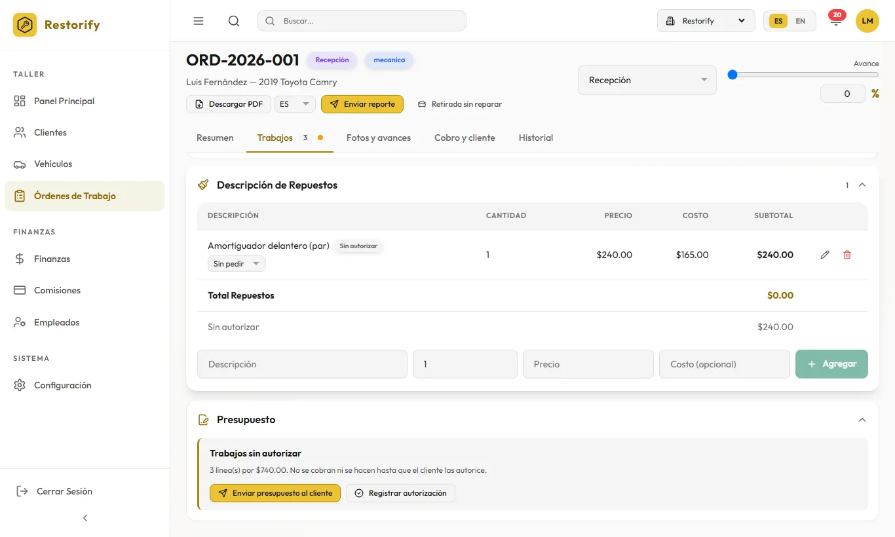

**A. Enviar presupuesto al cliente.** Presiona **Enviar presupuesto al cliente**. Al cliente le llega un correo con el enlace a su portal, donde revisa cada trabajo, marca individualmente lo que autoriza, escribe su nombre y confirma.
- Mientras espera respuesta, las líneas muestran **Esperando al cliente** y la orden pasa a **Espera Autorización**.
- Si necesitas corregir algo, pulsa **Cancelar presupuesto**.
- Si agregas trabajos adicionales mientras espera, presiona **Agregar al presupuesto y reenviar**.
- Si el cliente no tiene correo, puedes compartirle el enlace por WhatsApp desde la tarjeta Enlace del cliente.

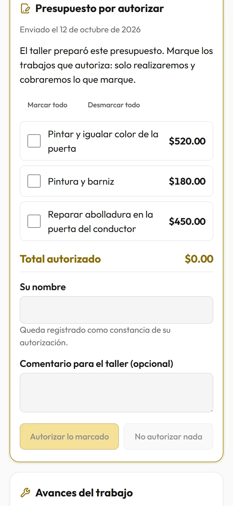

**B. Registrar autorización.** Si el cliente respondió por teléfono, en persona o por WhatsApp:
1. Pulsa **Registrar autorización**.
2. Aparece el diálogo **Trabajos autorizados por el cliente** con todas las líneas marcadas por defecto.
3. Desmarca las que el cliente no haya aceptado.
4. En **¿Cómo autorizó?**, elige: **Por teléfono**, **En persona** o **Por WhatsApp**.
5. Escribe en **Quién autorizó** y agrega una **Nota (opcional)**.
6. Pulsa **Registrar**. Al cliente le llega una constancia por correo.

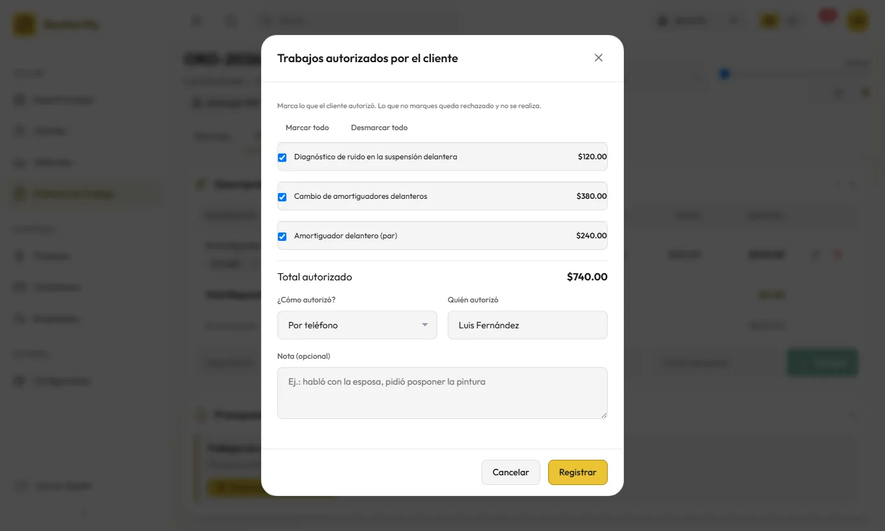

Lo autorizado suma inmediatamente al total de la orden y genera avisos a los técnicos sobre qué trabajos deben realizar; lo no autorizado queda marcado como **No realizar** y no se cobra ni se realiza. No se puede entregar una orden que tenga un presupuesto pendiente de respuesta.

#### Listo para entregar
<!-- rol: admin -->

Cuando el técnico marca el estado en **Finalizado**, el trabajo físico concluyó pero el cliente aún no es notificado. En el detalle de la orden aparece la insignia **Por revisar**.

Administración debe inspeccionar el vehículo y verificar las cuentas. Una vez conforme, pulsa el botón verde **Marcar listo para entregar** en el encabezado. En ese instante:
1. La orden cambia su insignia a **Listo para entregar**.
2. Se envía automáticamente el correo al cliente avisándole que su vehículo está listo.
3. En el reporte web del cliente, el estado pasa de «En revisión final» a «Listo para recoger».
4. Si la sede cobra parqueo para particulares, a partir de este evento comienzan a correr los días de gracia.

#### Entrega de la orden
<!-- rol: admin -->

Al seleccionar el estado **Entregado** o pulsar **Entregar y cobrar** en las acciones rápidas, se abre el diálogo de entrega:

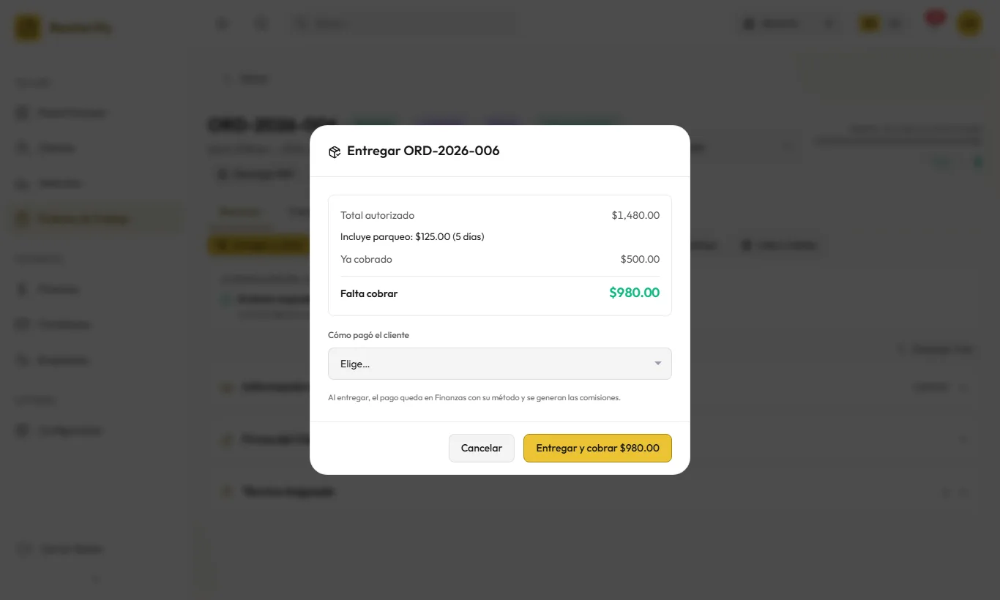

- Muestra el **Total autorizado** (incluyendo cobro por parqueo si aplica), lo **Ya cobrado** y:
  - **Falta cobrar**: si queda saldo pendiente. El botón indica **Entregar y cobrar (monto)**.
  - **Hay que devolver al cliente**: si el depósito o anticipos superaron el total. El botón indica **Entregar y devolver (monto)**.
  - **No hay nada pendiente de cobro.**: botón **Entregar**.
- Selecciona en **Cómo pagó el cliente** o **Cómo se le devuelve**: Efectivo, Tarjeta, Zelle, Transferencia o Cheque.
- Si es con cheque, registra el **Número de cheque** o la **Foto del comprobante (opcional)**.
- Al confirmar:
  - Se registra el movimiento de cobro o devolución en Finanzas.
  - Se registra el egreso por el costo de los repuestos.
  - El cobro por parqueo queda congelado con fecha de entrega.
  - Las comisiones se generan como «Por revisar» para los técnicos correspondientes.
  - Al cliente le llega el correo «Gracias por su visita».

#### Retirada sin reparar
<!-- rol: admin -->

Si un cliente decide llevarse su vehículo sin que se realice el trabajo cotizado, pulsa el botón **Retirada sin reparar** en el encabezado:

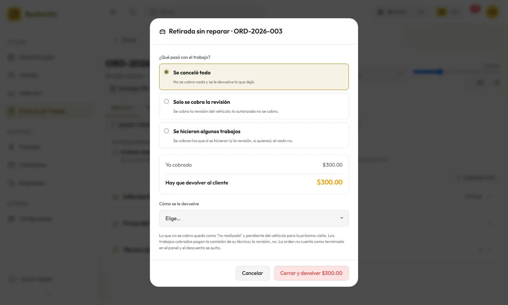

Elige en **¿Qué pasó con el trabajo?**:
1. **Se canceló todo**: no se cobra nada y se devuelve lo que el cliente haya dejado de depósito.
2. **Solo se cobra la revisión**: ingresa el monto en **Se cobra ($)** por diagnóstico o revisión del vehículo.
3. **Se hicieron algunos trabajos**: marca en **Trabajos que sí se hicieron** las tareas y repuestos efectivamente completados (y opcionalmente el cobro de revisión).

El sistema calcula la diferencia entre lo ya cobrado y lo que corresponde cobrar, solicitando el método de pago o devolución. Lo que no se cobró queda registrado como "no realizado" y aparecerá como sugerencia en futuras visitas de ese auto. Los trabajos cobrados generan la comisión de su técnico (la revisión no genera comisión). La orden no cuenta como finalizada en el panel.

#### Anticipos
<!-- rol: admin -->

Si el cliente realiza abonos parciales mientras el auto está en reparación (por ejemplo, para comprar repuestos), pulsa **Registrar anticipo** en las acciones rápidas o en la tarjeta **Totales** de la pestaña Cobro y cliente:
- Ingresa el **Monto ($)**.
- Elige **Cómo pagó el cliente** y adjunta el número de cheque o comprobante si aplica.
- Presiona **Registrar anticipo**.
- Se registra de inmediato en Finanzas y se suma a **Depósito y anticipos** en la orden, reduciendo el saldo que faltará cobrar en la entrega final.

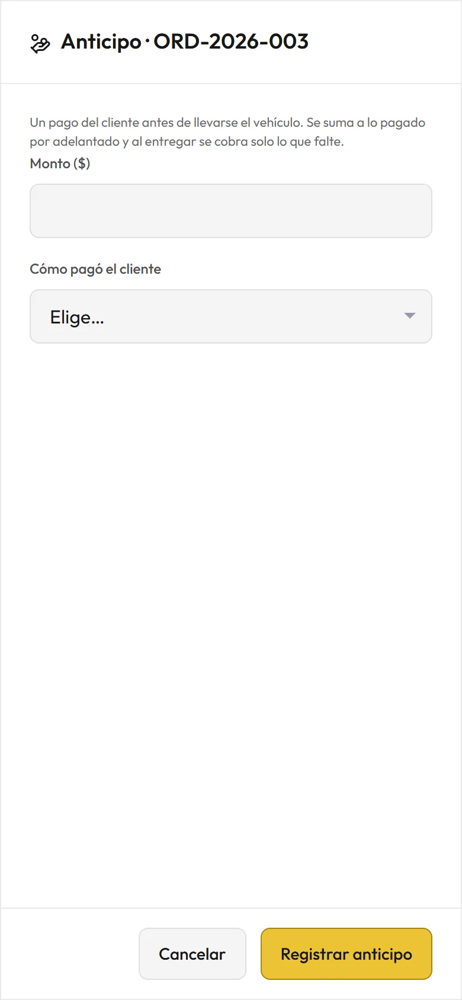

#### Descuento
<!-- rol: admin -->

Solo administradores, en la pestaña **Cobro y cliente** → **Totales** → **Aplicar descuento**:
- Selecciona el **Tipo de descuento**: **En dólares** o **En porcentaje**.
- Ingresa el monto o porcentaje y un **Motivo** (por ejemplo, "cliente frecuente").
- Presiona **Aplicar**.
- **El descuento lo absorbe el taller**: reduce el total que paga el cliente, pero no reduce la comisión de mano de obra de los técnicos ni altera el cobro por parqueo.
- Para eliminarlo, pulsa **Cambiar descuento** → **Quitar descuento**.

#### Historial de la orden
<!-- rol: admin -->

En la pestaña **Historial** (solo administradores), se registra una bitácora automática de auditoría que nadie puede editar ni borrar. Detalla qué usuario realizó cada cambio, la fecha y hora exacta, y los valores antes y después: cambios de estado, modificaciones en el avance, firmas, líneas agregadas o eliminadas, reasignaciones de técnicos, descuentos, presupuestos enviados y respondidos, y registros de entrega o retirada.

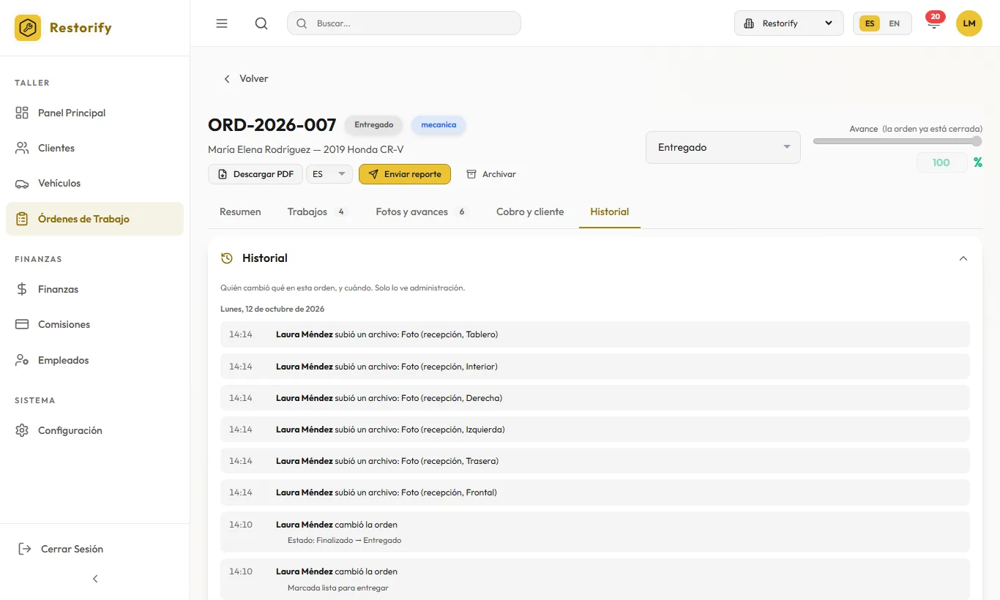

#### Enlace del cliente y avisos por correo
<!-- rol: admin -->

Cada orden cuenta con un enlace web único (`restorifyauto.net/r/...`) que se genera automáticamente cuando el cliente firma la recepción:
- El cliente lo abre en su teléfono sin necesidad de contraseñas ni registro.
- Visualiza el estado, avance, recepción, fotos y videos publicados, presupuesto por autorizar y el desglose de su cuenta.
- Permite llamar directamente al taller o escribir por WhatsApp si la sede tiene teléfonos configurados.
- En la tarjeta **Enlace del cliente**, administración puede: **Copiar**, **Abrir**, **Enviar por WhatsApp**, **Cambiar enlace** (invalida el anterior) o **Desactivar**.
- El enlace permanece activo mientras la orden está en curso y hasta 90 días después de entregada.
- **Correos automáticos**:
  - «Recibimos su vehículo»: al firmar la recepción.
  - «Estamos trabajando en su vehículo»: al pasar a En Proceso.
  - «Su vehículo está listo»: cuando administración presiona **Marcar listo para entregar**.
  - «Gracias por su visita»: tras entregar el vehículo.
  - Los correos se envían en el idioma configurado para el cliente (español o inglés).
  - Al publicar fotos o videos en un avance, presiona **Avisar novedades** en la tarjeta para enviar un correo informativo al cliente.

#### Enviar reporte y Descargar PDF
<!-- rol: admin -->

- **Enviar reporte**: abre una ventana para compartir el enlace del cliente directamente por correo electrónico o por WhatsApp.
- **Descargar PDF**: genera un documento para imprimir o archivar con los datos de la orden, fotos publicadas, trabajos autorizados, totales y firma. A la par del botón, el selector **Idioma del PDF** permite elegir si se genera en español (**ES**) o en inglés (**EN**).

#### Archivar una orden
<!-- rol: admin -->

Una orden entregada permanece en la lista principal durante 90 días. Para retirarla antes de la vista diaria, un administrador puede archivarla:
- En computadora: botón **Archivar** en la tarjeta del tablero o en el encabezado del detalle.
- En teléfono: en la tarjeta del tablero, menú **Mover a → Archivar**.
- La orden se traslada al filtro **Archivadas**. Sigue entregada sin alterar su contabilidad. Para recuperarla, ábrela desde Archivadas y presiona **Devolver al tablero**.

### Eliminar una orden
<!-- rol: admin -->

Solo un administrador puede eliminar una orden. Esto borra sus archivos multimedia, avances, comisiones y los movimientos automáticos que generó en Finanzas. Los movimientos importados del banco se conservan intactos.

**Si la orden ya tiene comisiones pagadas, el sistema impide eliminarla** para no romper la conciliación de los pagos. Primero debes dirigirte a **Comisiones → Pagos realizados**, presionar **Deshacer pago** sobre el pago correspondiente, y luego proceder a eliminar la orden.

---

## 9. Fotos, videos y notas de voz

Cada orden tiene su galería. Se alimenta desde la **inspección 360°** al crear la
orden y desde **Avance del trabajo** después.

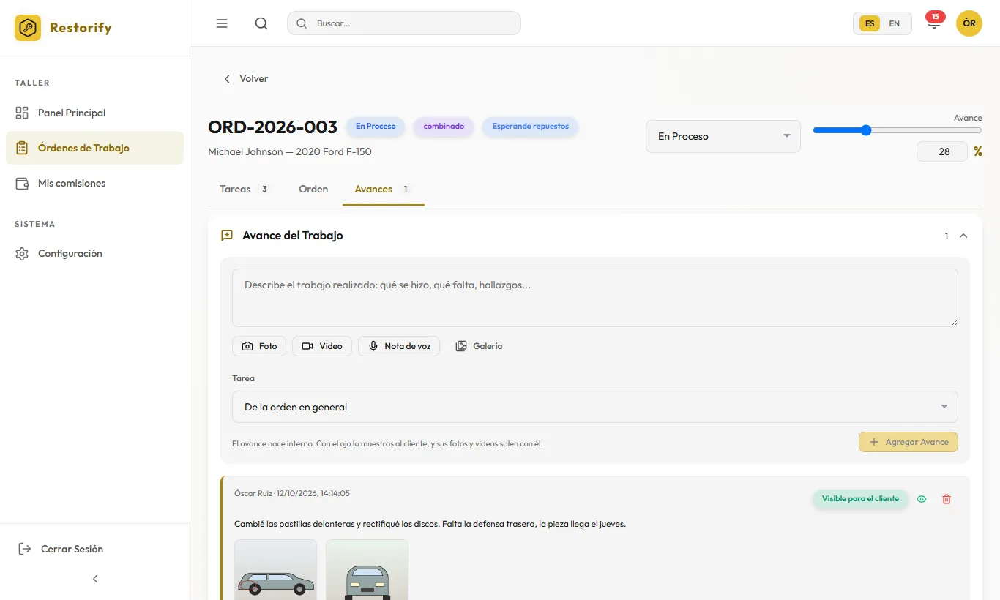

### Capturar

| Botón | Qué hace | Límite |
|---|---|---|
| **Foto** | Abre la cámara. La foto se reduce antes de subir | — |
| **Video** | Graba dentro de la app, en calidad adecuada para el teléfono. En los últimos 15 segundos el contador se pone rojo y **a los 2 minutos se detiene solo**. Puedes cambiar de cámara antes de grabar, revisar la toma (se reproduce al tocarla), repetir o usar el video. Antes de guardar el avance, **toca la miniatura del video para verlo** | 2 min |
| **Nota de voz** | Graba audio. Puedes escucharla antes de usarla | 2 min |
| **Galería** | Elige una foto o un video ya grabado. Los videos se convierten a un tamaño manejable («Convirtiendo video N %») | 2 min, 50 MB |

> **Graba con el botón Video de la app**, no con la cámara del teléfono. Un minuto
> de video del iPhone pesa cientos de megas; grabado desde la app pesa unos 11 y
> sube en segundos.

La primera vez el navegador pide permiso para la cámara y el micrófono. Si lo
niegas, la app te explica cómo activarlo en los ajustes.

### La bandeja de subidas

Mientras hay archivos subiendo aparece una bandeja flotante: «3 de 5 archivos
subidos». Tócala para ver cada archivo y su progreso.

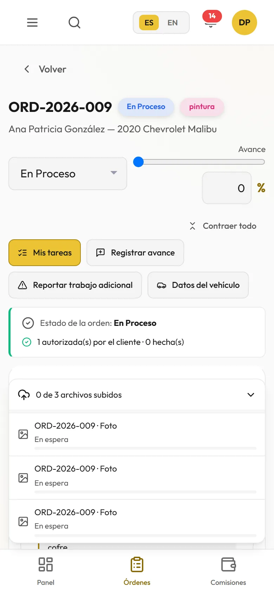

- **Puedes seguir usando la app** mientras suben.
- **Si se va la señal**, la bandeja dice «Sin conexión» y las subidas siguen solas
  cuando vuelve.
- **Si cierras o recargas la app**, los archivos pendientes siguen al volver a
  entrar con la misma cuenta. Los videos largos continúan donde se quedaron.
- **Si un archivo falla**, se queda en la bandeja con el motivo y dos botones:
  **Reintentar** o **Descartar**. Un archivo no se pierde hasta que tú lo descartas.

### Visibilidad para el cliente

Cada archivo muestra una etiqueta:

- **Visible al cliente** — las fotos y videos de la recepción nacen así.
- **Interno** — todo lo que se sube en un avance nace así. Una nota de voz grabada en la recepción también nace interna (es el personal del taller hablando): un administrador decide si la hace visible.

Un archivo suelto solo lo publica un **administrador**, con el botón **Mostrar en el
reporte del cliente** / **Ocultar del reporte del cliente**. Un avance es distinto:
quien lo escribió (técnico o administrador) puede tocar **Mostrar al cliente**, y con
él salen su texto y sus archivos; **Dejar de mostrar** lo vuelve interno. El avance que
se crea al reportar trabajo adicional queda interno: ese lo decide administración.
Así el técnico puede documentar todo con libertad, y lo que ve el cliente en su
enlace (sección 8, *Enlace del cliente*) es lo que alguien decidió publicar.

### Ver y borrar

- Toca una miniatura para abrirla en grande. Los videos y audios se reproducen
  ahí; las flechas pasan al siguiente archivo.
- Un técnico puede borrar **sus propios** archivos mientras la orden no esté
  entregada. Un administrador puede borrar cualquiera.

---

## 10. Tablero Kanban

La misma información que la lista de órdenes, vista como un tablero con una
columna por estado. Está dentro de **Órdenes de Trabajo**: arriba a la derecha, el
selector **Lista | Tablero** cambia de vista. La app recuerda la última que usaste, así que
quien trabaja con el tablero lo encuentra al volver. El buscador de órdenes filtra también
las tarjetas, y el número de la orden en cada tarjeta la abre.

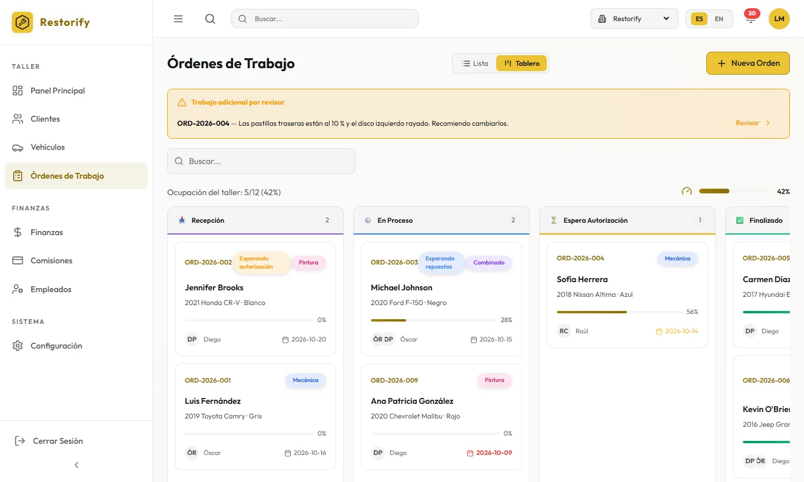

Arriba se muestra la **ocupación del taller**: cuántas órdenes activas hay contra
la capacidad de la sede.

Las tarjetas muestran el número de orden, el cliente, el vehículo, las personas asignadas y el tipo (**Mecánica**, **Pintura** o **Combinado**), además de insignias informativas como **Seguro**, **Esperando repuestos**, **Esperando autorización**, **Por revisar** o **Listo para entregar**. En órdenes entregadas, el botón **Archivar** permite enviarlas a la lista de archivadas.

Hay dos formas de cambiar una orden de estado:

- **En computadora**, arrastra su tarjeta a otra columna.
- **En teléfono**, cada tarjeta tiene abajo un selector **Mover a**. Las columnas
  se recorren deslizando de lado, una por pantalla.

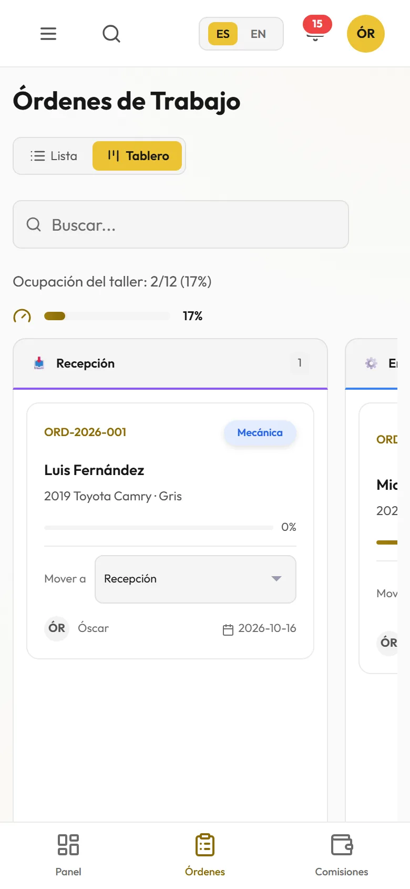

Un administrador puede mover cualquier orden. Un técnico solo las que tiene
asignadas, y nunca una **Finalizado** ni una **Entregado**: en esas tarjetas el
selector no aparece. Tampoco tiene las opciones **Recepción**, **Espera Autorización**
ni **Entregado**. Una orden en pausa sí muestra el selector, pero el sistema no la deja
salir de la pausa mientras haya trabajo adicional sin decidir o un presupuesto
esperando respuesta.

Mover una orden a **Entregado** abre el mismo diálogo de entrega que en el detalle de la orden.

---

## 11. Notificaciones

### La campana

El número rojo sobre la campana son tus avisos sin leer. Llegan **al instante**
mientras la app está abierta, con un mensaje breve en pantalla.

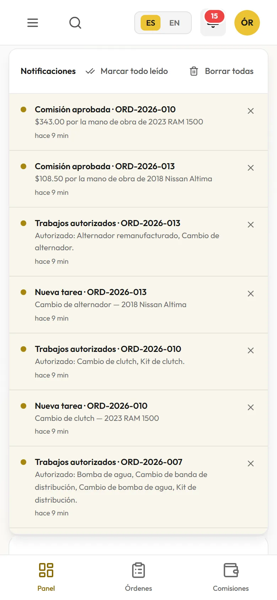

- Toca un aviso para abrir su orden; queda marcado como leído.
- **Marcar todo leído** limpia el contador.
- La **X** a la derecha de un aviso lo borra sin abrirlo.
- **Borrar todas** vacía la campana, incluidos los avisos viejos que no alcanzan a
  verse en la lista. Pide confirmación y no se puede deshacer.
- Nunca recibes aviso de algo que hiciste tú.
- Los avisos leídos se borran solos a los 60 días; los no leídos, a los 180.

### Qué avisos llegan

| Aviso | Lo recibe |
|---|---|
| **Nueva orden asignada** | El técnico al que asignan a mano (no cuando entra por una tarea) |
| **Nueva tarea** | El técnico al que le dan una tarea, con la tarea y el vehículo |
| **Tarea reasignada** | El técnico al que le quitan una tarea |
| **Tarea hecha** | Administradores, cuando un técnico marca una tarea como hecha |
| **Ya no estás asignado** | El técnico al que quitan |
| **Recepción registrada** | Administradores. Ya no se emite porque solo administración crea órdenes; los avisos anteriores se siguen leyendo |
| **Nuevo avance** | Administradores, cuando un técnico agrega un avance |
| **Trabajo terminado** | Administradores, cuando un técnico finaliza una orden: hay que revisarla y marcarla lista para entregar |
| **El cliente respondió el presupuesto** (o **El cliente no autorizó el presupuesto**, si no autorizó nada) | Administradores, cuando el cliente responde desde su enlace |
| **Trabajo adicional reportado** | Administradores, cuando un técnico reporta trabajo adicional |
| **Llegó un repuesto** | Técnicos asignados, cuando una pieza pedida se marca como **Llegó** |
| **Presupuesto sin respuesta** | Administradores, una vez al día si un presupuesto lleva más de 24 horas sin respuesta |
| **Trabajos autorizados** / **Trabajo no autorizado** | Técnicos asignados, cuando se responde el presupuesto con lo que se autorizó o rechazó |
| **Comisión aprobada** | Cada técnico, cuando administración acepta su comisión, con el monto aceptado |
| **Pasó la fecha de entrega** | Administradores y técnicos asignados, una vez al día por cada orden atrasada. **Reemplaza al del día anterior**: hay uno solo por orden, con los días de retraso al día |

### Notificaciones en el teléfono (push)

Con push activado, los avisos llegan al teléfono **aunque la app esté cerrada**,
como los de cualquier otra aplicación.

1. Ve a **Configuración → Notificaciones en este dispositivo**.
2. Presiona **Activar en este dispositivo** y acepta el permiso.
3. Presiona **Enviar prueba**: debe llegar en unos segundos.

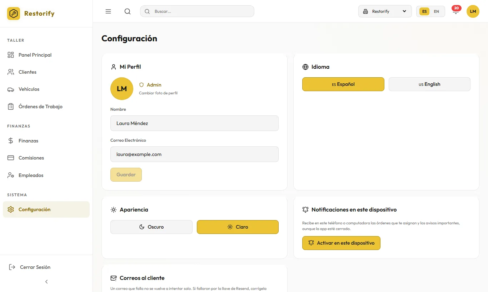

- Se activa **por dispositivo**: si usas teléfono y computadora, actívalo en los dos.
- En **iPhone** primero hay que instalar la app en la pantalla de inicio
  (sección 16); la tarjeta explica los pasos.
- Si negaste el permiso, la tarjeta te dice cómo activarlo en los ajustes del
  navegador.
- Al **cerrar sesión**, ese dispositivo deja de recibir tus avisos.
- Si la tarjeta dice **«Las notificaciones push no están configuradas en este
  servidor»**, no es un problema de tu teléfono: la versión publicada de la app se
  armó sin la llave de notificaciones. Avísale a quien administra el sistema.

---

## 12. Finanzas
<!-- rol: admin -->

**Solo administradores.** Registra todo el dinero que entra y sale de la sede.

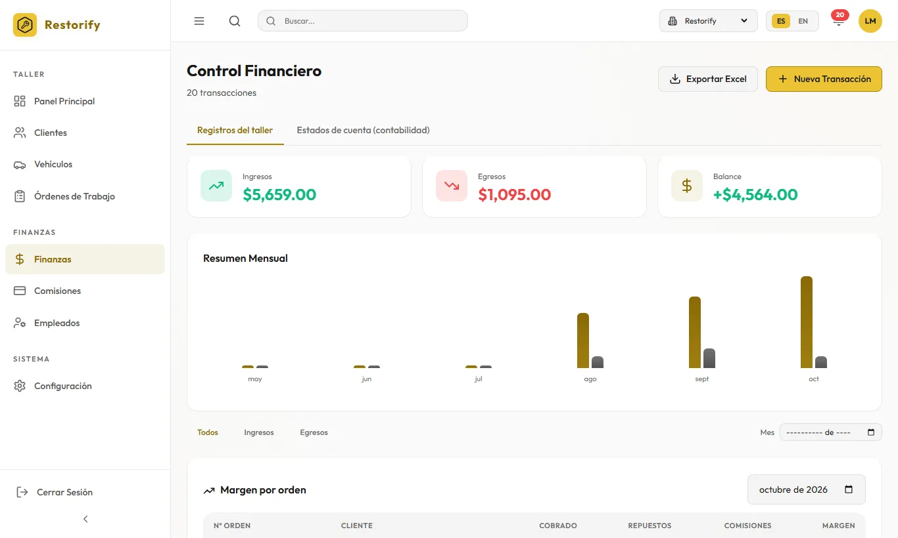

Tiene dos vistas:

- **Registros del taller**: lo que registra la app (cobros de las órdenes, costo de repuestos,
  comisiones y lo que registres a mano). Arriba, **ingresos**, **egresos** y **balance**;
  abajo, la tabla con filtros por tipo y por **mes**. **Exportar Excel** baja lo que muestra
  la tabla (por ejemplo, un mes) para el contador.
- **Estados de cuenta (contabilidad)**: los estados de cuenta del banco que importes, para
  ordenar meses anteriores y mandárselos al contador. Son contabilidad aparte: **no se suman**
  a los ingresos y egresos de la app. Cada uno muestra su periodo, cuánto entró y salió, y se
  exporta por separado.

Los métodos de pago son **efectivo, tarjeta, Zelle, transferencia y cheque**. Las comisiones
del banco y de Clover van en la categoría **Comisiones de banco y tarjeta**: regístralas a mano
una vez al mes, con el monto del estado de cuenta.

Muchos movimientos **los crea el sistema solo** (depósitos, cobros al entregar,
costo de repuestos, pagos de comisiones; sección 18). No los registres a mano o
quedarán duplicados. Un pago de comisiones aparece como **un egreso por cada orden** que
cubre ("Comisión Mario Mecánico - ORD-2026-014"), todos con el mismo número de cheque.

### Margen por orden

Entre las tarjetas y la tabla, **Margen por orden** lista las órdenes entregadas en el mes
que elijas: cuánto se **cobró**, cuánto costaron sus **repuestos**, cuánto generó en
**comisiones** y el **margen** que quedó, con los totales del mes. Las comisiones cuentan
desde que se generan, estén pagadas o no. Si una orden tiene vinculada una compra del banco
o un movimiento a mano, se ve en el **Balance** de la orden pero no se resta otra vez: el
costo de las piezas ya viene de sus líneas.

En el detalle de una orden entregada, la tarjeta **Balance de la orden** muestra lo mismo
para esa orden.

### Registrar un movimiento a mano

1. **Nueva Transacción**.
2. **Tipo**: ingreso o egreso.
3. **Categoría**: Pago de Cliente, Compra de Repuestos, Comisiones, Gasto Operativo o Comisiones de banco y tarjeta.
4. **Monto** y **fecha**. La fecha es la del taller: un movimiento del día 1
   cuenta en ese mes.
5. **Orden vinculada** (opcional): asocia el movimiento a una orden. En la tabla,
   esa columna lleva directo a la orden.
6. **Descripción**.
7. **Crear**.

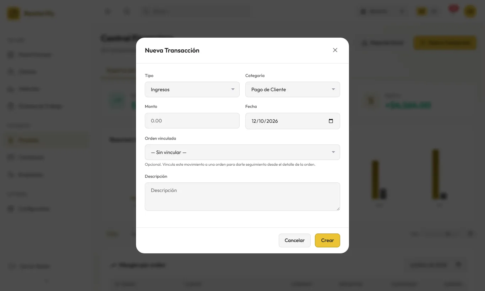

### Eliminar un movimiento

Cada fila tiene un botón de papelera. Úsalo **solo para movimientos manuales**
capturados por error.

> **No borres movimientos automáticos** («Depósito inicial», «Pago final», «Costo
> de repuestos», «Pago de comisiones», ajustes y reversiones). El sistema los usa
> para calcular los siguientes: si borras un «Pago final» y luego se corrige la
> orden, las cuentas quedan descuadradas. Para corregir el dinero de una orden,
> corrige la orden (mano de obra, repuestos, estado) y deja que el sistema
> registre el ajuste. Para deshacer un pago de comisiones, usa **Deshacer pago**
> en Comisiones.

### Importar el estado de cuenta del banco

Permite cargar el PDF del estado de cuenta y registrar sus movimientos sin
teclearlos uno por uno.

> Por ahora solo entiende estados de cuenta de **Wells Fargo**. El archivo debe
> ser el PDF descargado del banco, no un escaneo ni una foto.

1. En la vista **Estados de cuenta (contabilidad)**, **Importar Estado de Cuenta**.
2. Selecciona el PDF. Todo el procesamiento ocurre en tu navegador; el archivo no
   se envía a ningún servicio externo.
3. Aparece la lista de transacciones encontradas. El sistema propone una categoría
   según palabras clave, marca las que parecen transferencias internas y avisa de
   posibles duplicados.
4. Revisa, ajusta categorías, desmarca lo que no quieras importar.
5. **Importar seleccionadas**.

> **Toda fila marcada necesita categoría.** Mientras quede una sin categoría, el
> botón **Importar Seleccionadas** permanece apagado y arriba de él aparece
> cuántas faltan. La barra **Asignar a las no clasificadas** aplica una categoría
> a todas de golpe.

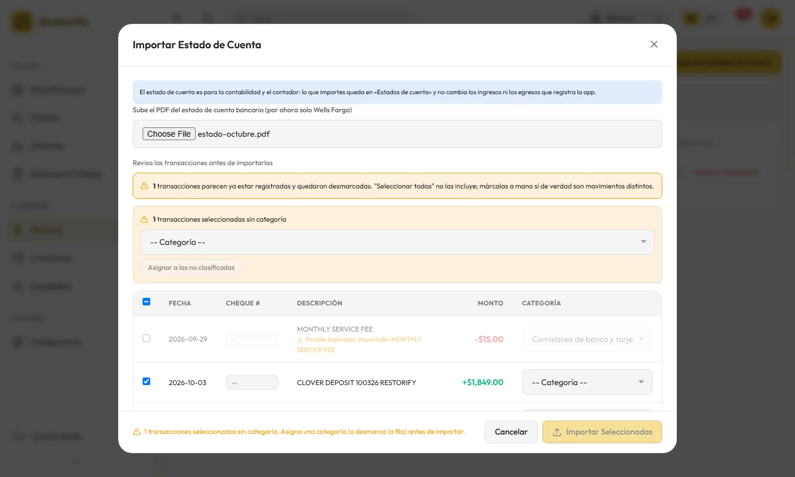

### Si importas el mismo estado de cuenta dos veces

Es el error más caro de esta pantalla, porque **duplica todos los ingresos y
egresos del mes**. El sistema te protege en tres niveles:

1. **Detecta el archivo repetido.** Si ese mismo archivo ya se importó en esta
   sede, aparece un aviso rojo con la fecha. Lo reconoce por su contenido, así que
   cambiarle el nombre no lo engaña.
2. **Desmarca los movimientos que ya se importaron** de otro estado de cuenta (mismo tipo,
   mismo monto, fecha con menos de dos días de diferencia) con la etiqueta «Posible
   duplicado». No los compara con los cobros que registró la app: son libros distintos.
3. **«Seleccionar todas» no las incluye.** Si de verdad es un movimiento distinto,
   márcalo a mano.

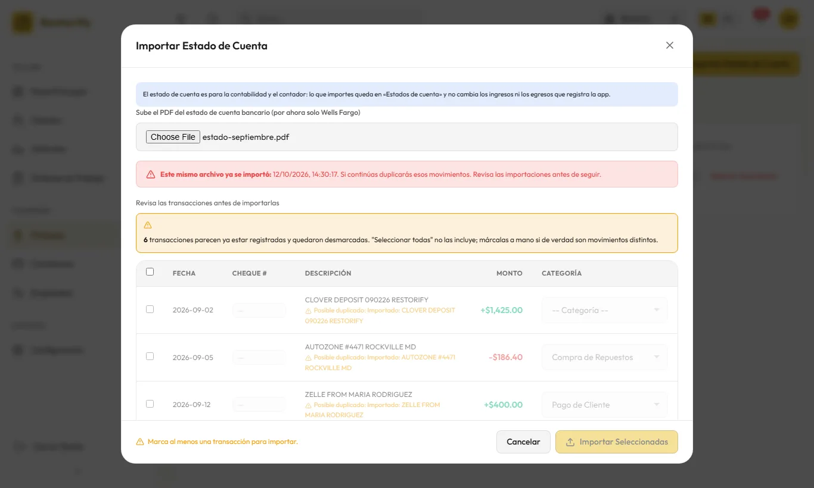

### Revertir una importación

En la lista de **Importaciones**, el botón **Revertir importación** elimina de
golpe todos los movimientos que entraron con ella. Es la salida cuando algo se
importó de más o mal categorizado: revertir y volver a importar.

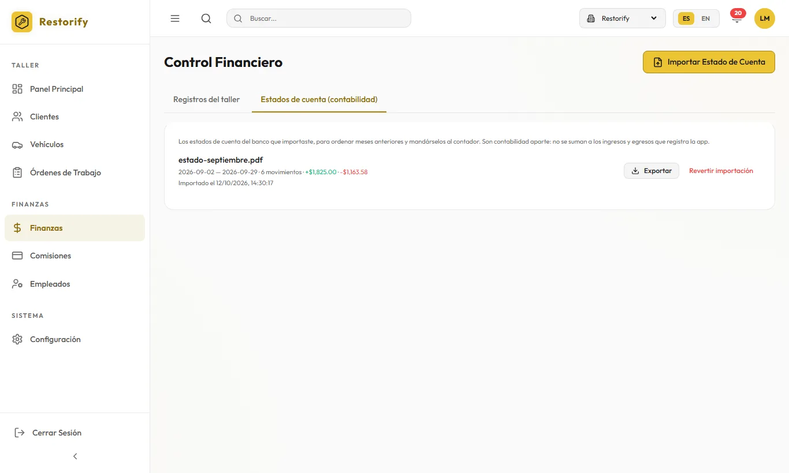

---

## 13. Comisiones

El personal técnico cobra por comisión sobre la mano de obra de las órdenes que entrega.
Administración gestiona la revisión, aprobación y pagos desde **Comisiones**, mientras que los técnicos consultan sus ganancias en **Mis comisiones** y en el detalle de cada orden.

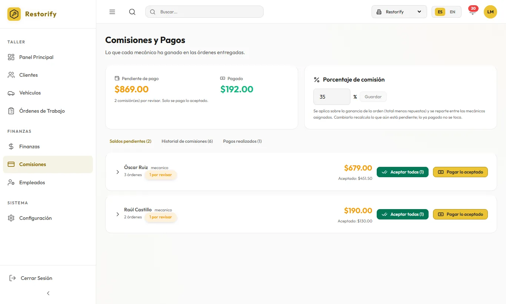

### Cómo se calcula

**Cada trabajo (tarea) le paga a su técnico**, a su porcentaje (el suyo, o el de la sede si
no tiene uno):

```
comisión de una tarea = precio de la tarea × porcentaje de su técnico
```

Ejemplo (al 35 %): la pintura de $1,000 le paga a la pintora **$350**; la mecánica de $200 le paga al mecánico **$70**. Si después se agrega una mano de obra extra de pintura de $500 y se le asigna a la pintora, cobra **$175** más.

- **Una tarea sin técnico no la cobra nadie.** La orden lo avisa en el Resumen y al
  entregar. Administración debe asignarle técnico antes de entregar para que genere comisión.
- Quien está a salario no genera comisión; lo de sus tareas se queda en el taller. Quien tiene un esquema mixto cobra su salario (informativo) y además la comisión de sus tareas.
- **Trabajos de antes de octubre de 2026.** Los que no tienen técnico asignado siguen con el reparto por especialidad: cada especialidad es una bolsa que se reparte entre los técnicos asignados a mano a esa especialidad (*bolsa ÷ compañeros × su porcentaje*).
- **El descuento del taller no reduce las comisiones:** el descuento lo absorbe el taller y la comisión se calcula sobre la mano de obra autorizada.
- **El cobro por parqueo no genera comisiones:** es un rubro de estancia vehicular del taller.

La comisión **se genera al entregar** la orden y nace con estado **Por aceptar** (sugerida). Si cambia la mano de obra, el equipo o un porcentaje antes de aceptarla, se recalcula sola. **Lo ya pagado nunca se recalcula**, y por eso un trabajo con la comisión pagada queda bloqueado (sección 8).

### Para administración: Comisiones y Pagos
<!-- rol: admin -->

*(Menú lateral: **Comisiones**.)*

Tiene tres pestañas:

- **Saldos pendientes** — cuánto se le debe a cada técnico y de qué órdenes.
- **Historial de comisiones** — cada comisión detallada, con estado **Por aceptar**, **Aceptada** o **Pagada**.
- **Pagos realizados** — los pagos registrados, con su fecha, método y comprobante.

#### Revisar y aceptar

Al entregar una orden, cada comisión nace **Por aceptar**. **Solo se paga lo aceptado.**

- En **Saldos pendientes**, la fila de cada técnico indica cuántas tiene por revisar. El botón **Aceptar todas (N)** las aprueba en bloque con los montos sugeridos.
- Para cambiar una antes de aceptarla, despliega la fila del técnico y presiona el lápiz de esa comisión: puedes ajustar el **Porcentaje** o directamente el **Monto** en dólares, y presionar **Aceptar**.
- Cuando administración acepta una comisión, pasa a **Aceptada** y el técnico la ve reflejada en su pantalla de comisiones.

#### Pagar un saldo

1. En **Saldos pendientes**, presiona **Pagar lo aceptado** en la fila del técnico (el botón permanece apagado si no hay nada aceptado).
2. Se abre el diálogo **Pagar saldo**: muestra el empleado, el monto calculado por el sistema, cuántas órdenes abarca y avisa si quedan comisiones sin revisar (que no entran en este pago).
3. Selecciona la **Fecha de Pago** y el **Método** (**Cheque**, **Efectivo**, **Zelle** o **Transferencia**).
4. Si pagas con **Cheque**, escribe el **Número de cheque** o adjunta la **Foto del cheque** (al menos uno de los dos es necesario para conciliar con el banco).
5. Presiona **Registrar pago**.

El pago descuenta el saldo del técnico y se registra automáticamente como un egreso de categoría **Comisiones** en Finanzas.

#### Deshacer un pago

En la pestaña **Pagos realizados**, cada pago tiene el botón **Deshacer pago**. Al usarlo, las comisiones de ese pago vuelven a quedar pendientes y se elimina su movimiento de egreso en Finanzas.

#### Cambiar el porcentaje de comisión

El porcentaje general de la sede se configura en la tarjeta superior o en Configuración → Sedes (por defecto 35 %). El porcentaje individual de cada persona se define en **Empleados**. Cambiar cualquiera recalcula únicamente las comisiones que todavía no se han pagado.

### Para el técnico: Mis comisiones
<!-- rol: tecnico -->

*(Menú lateral: **Mis comisiones**; en el teléfono, botón **Comisiones** de la barra inferior.)*

Los técnicos pueden consultar sus ingresos sin ver las finanzas del taller:

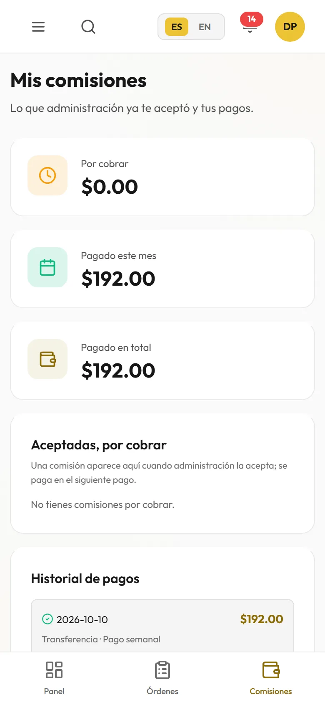

- Tarjetas de resumen arriba: **Por cobrar** (lo que administración ya aceptó y está listo para pagarse), **Pagado este mes** y **Pagado en total**.
- **Aceptadas, por cobrar**: lista de las comisiones aprobadas por la oficina que aún no se han liquidado, con el **Nº Orden**, la tarea o trabajo, el porcentaje (**%**) y el **Monto**.
- **Historial de pagos**: lista de los pagos recibidos, con su fecha, método, número de cheque y monto.

> **¿Por qué no aparece una orden que recién entregaste?** Cuando la orden se entrega, la comisión nace como sugerida ("por revisar"). Aparece en **Mis comisiones** en cuanto administración la revisa y la acepta.

### Empleados
<!-- rol: admin -->

*(Menú lateral, solo administradores.)*

Permite gestionar quién trabaja en el taller, cómo se le paga y qué actividad ha tenido:

- **Pago de cada empleado**: lista de mecánicos y pintores con su esquema de pago — *Comisión · 35 % (el de la sede)*, *Comisión · 40 %*, *Salario · $900.00 quincenal* o *Mixto*.
- Presiona **Ver** para abrir la ficha de la persona: muestra sus comisiones pendientes y pagadas, órdenes activas y entregadas, avances recientes y su configuración de **Pago**:
  - **Comisión**: porcentaje propio, o déjalo vacío para usar el de la sede.
  - **Salario**: monto y periodo. Es informativo (no se registra en Finanzas). Si el empleado pasa a salario y tiene comisiones pendientes, el sistema te avisa del monto: al pasar a salario las comisiones pendientes dejan de contar, por lo que conviene pagarlas antes.
- Debajo se encuentra la administración del personal: crear empleados con **Nuevo Usuario**, editar sus datos o darlos de baja.

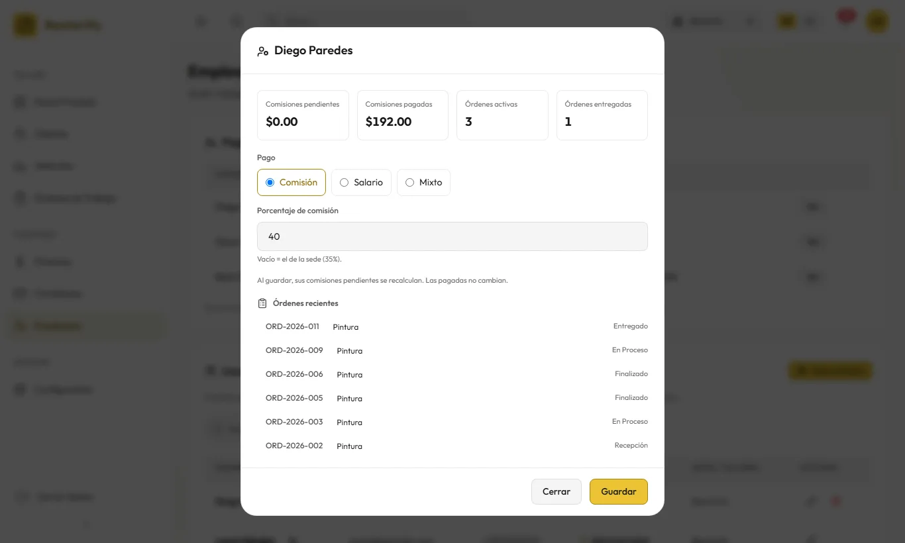

---

## 14. Cobro por parqueo
<!-- rol: admin -->

**Solo administradores.** Permite cobrar por el estacionamiento o estancia prolongada de vehículos en el taller, distinguiendo según si el trabajo es particular o con aseguradora.

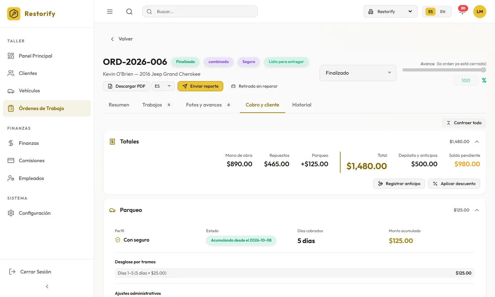

### Cómo se configura por sede

En **Configuración → Sedes / Talleres**, dentro de cada sede, la sección **Cobro por parqueo** permite activar y definir las reglas del taller:

- **Cobrar parqueo en esta sede**: activa o desactiva el módulo en esa sede.
- **Vigente desde**: fecha a partir de la cual empieza a aplicar el cobro (por defecto la fecha de hoy; el sistema no permite fechas pasadas para no generar cobros retroactivos sorpresa).
- **Incluir órdenes que ya estaban en el taller**: si se activa, aplica también a los vehículos ingresados antes de la fecha de vigencia.
- **Avisar al cliente cuándo empieza el cobro**: advierte en el portal del cliente con anticipación cuándo comenzará a cobrarse el parqueo.
- **Política para el cliente (español)** y **Política para el cliente (inglés)**: texto explicativo que el cliente verá en su enlace personal con las condiciones y motivos del cobro.

#### Los dos perfiles de cobro

Cada sede configura dos perfiles independientes:

1. **Con seguro**:
   - Aplica a órdenes marcadas con seguro.
   - Por defecto: empieza a contar desde la **Llegada del vehículo**, cobra el día de la llegada y tiene 0 días de gracia.
2. **Sin seguro (Particular)**:
   - Aplica a órdenes particulares.
   - Por defecto: empieza a contar cuando administración marca la orden como lista para entregar, no cobra el día del evento y otorga 2 días de gracia.

En cada perfil se puede personalizar:
- **Empieza a contar**: **Llegada del vehículo** o **Marcada lista para entregar**.
- **Días de gracia**: días gratuitos antes de empezar a cobrar.
- **Contar solo días hábiles**: si la gracia se cuenta de lunes a viernes o en días calendario.
- **Cobrar el día del evento**: si el día que detona el conteo cuenta como día 1.
- **Tope de días** y **Tope de monto ($)**: límites máximos que el cobro no superará.
- **Tramos de tarifa**: escalas de cobro diario (**Desde el día N**, tarifa **por día**). Puedes agregar más tramos con **Agregar tramo**.

Abajo, la herramienta **Vista previa en vivo** permite probar cualquier fecha de evento y fecha final para verificar el cálculo exacto antes de guardar.

### El parqueo en una orden de trabajo

Dentro de la orden, en la pestaña **Cobro y cliente** (sección **Parqueo**):

- Muestra el **Perfil** (**Con seguro** o **Sin seguro (Particular)**) y su **Estado**:
  - **Inactivo**: el módulo o perfil no están habilitados.
  - **Esperando que la orden se marque lista para entregar**: falta marcar la orden lista para comenzar la cuenta.
  - **Empieza el (fecha)**: el evento ocurrió y está corriendo el periodo de gracia.
  - **Sin cobro (orden previa al inicio del módulo)**: orden que ingresó antes de la fecha vigente sin marcar inclusión de previas.
  - **Sin cobro en esta orden**: parqueo desactivado específicamente para esta orden.
  - **Acumulando desde el (fecha)**: cobrando activamente según los días en el taller.
  - **Cerrado al entregar**: monto definitivo congelado al momento de la entrega.
- Detalla los **Días cobrados**, el **Monto acumulado**, si hay **Tope aplicado** y el **Desglose por tramos**.

#### Ajustes administrativos

Un administrador puede presionar **Ajustes administrativos** para modificar el cobro de esa orden:
- **Cobrar parqueo en esta orden**: marcar o desmarcar para exonerar la orden por completo.
- **Tarifa manual ($/día)**: fijar un precio diario fijo en lugar de los tramos de la sede.
- **Fecha de inicio manual**: establecer a mano desde qué día empieza a contar.
- **Días exonerados**: descontar días específicos (por ejemplo, por demoras del taller).
- **Nota interna**: motivo del ajuste.
- Guarda los cambios con **Guardar ajustes**.

### Reglas clave del parqueo

- **Se acumula solo:** el sistema actualiza el monto cada hora mientras el vehículo permanece en el taller.
- **Se congela al entregar:** al presionar **Entregar**, el parqueo se cierra definitivamente con la fecha del día y se suma al saldo por cobrar (**Incluye parqueo: (monto) (N días)**). Una orden entregada nunca vuelve a acumular parqueo sola.
- **No genera comisiones:** el dinero del parqueo pertenece al taller y no forma parte de la mano de obra.
- **El descuento no lo afecta:** si aplicas un descuento a la orden, este reduce solo la mano de obra y repuestos autorizados, nunca el cobro por parqueo.
- **En el enlace del cliente:** el cliente ve la política de parqueo, el aviso de cobro y el total desglosado en su cuenta en su idioma preferido.

---

## 15. Configuración

Accesible para todos desde el avatar del encabezado, con contenido distinto
según el rol.

### Para todos

- **Mi Perfil**: foto (**Cambiar foto de perfil**), nombre y correo.
- **Idioma** (**Español** / **English**) y **Apariencia** (**Oscuro** / **Claro**).
- **Notificaciones en este dispositivo**: activar, probar y desactivar push
  (sección 11).
- **Reportar un problema**: botón para notificar a soporte si encuentras un error o falla en el sistema. Puedes agregar captura de pantalla y se adjunta automáticamente un diagnóstico de los últimos 30 segundos (ocultando datos privados y fotos).

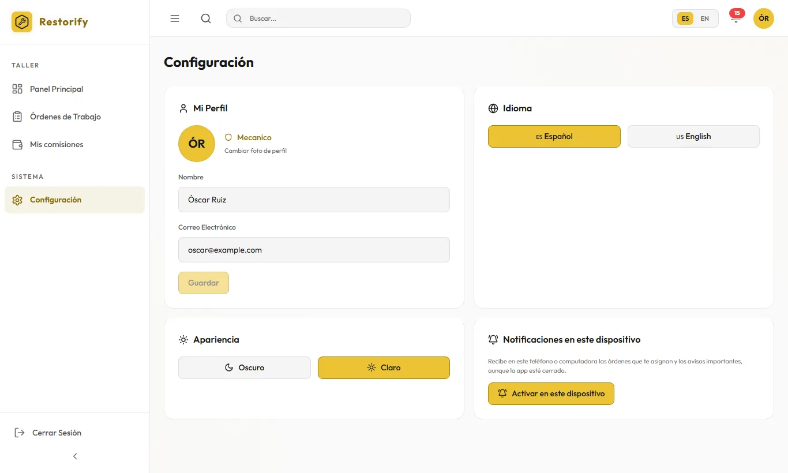

### Solo administradores: sedes, personal y correos
<!-- rol: admin -->

**Sedes.** Crear talleres nuevos con **Nueva Sede** y editar los existentes: nombre, dirección, **Cambiar logo de la sede**, **Color del tema**, **Capacidad del taller** (espacios de trabajo, para la ocupación del taller) y **Porcentaje de comisión**.

Datos de contacto y reglas de la sede:

- **Correo de contacto (respuestas de clientes)**: a dónde llegan las respuestas de los clientes a los correos automáticos.
- **Teléfonos de contacto**: lista administrable con **Agregar teléfono**. Cada teléfono define su **Tipo** (**Celular** u **Oficina**), descripción, número y si **Atiende WhatsApp**. El cliente los ve en su enlace (con botones para llamar y escribir), en los correos y en el PDF.
- **Cobro por parqueo**: configuración de reglas y tarifas de estacionamiento para esa sede (sección 14).

Un administrador también puede usar **Unirme a esta sede** para formar parte de su personal. Al eliminar una sede con **Eliminar todo**, el sistema muestra antes todo lo que se va a borrar y reubica a los empleados en otra sede.

**Personal.** El alta, la edición y la baja del personal, y el pago de cada quien, se gestionan en **Empleados** (sección 13); Configuración incluye el botón **Ir a Empleados**. Junto a cada persona, un ícono de campana indica en cuántos dispositivos tiene push activo.

**Correos al cliente.** Muestra el estado de los correos automáticos enviados por el sistema. Si hay correos que fallaron en las últimas 72 horas (por ejemplo, por fallas de conexión o servicio), aparece el botón **Reintentar todos** para volver a ponerlos en cola.

Para crear una cuenta de usuario desde la lista de usuarios:

1. Presiona **Nuevo Usuario**.
2. Completa **Nombre**, **Correo Electrónico** y **Contraseña Temporal** (mínimo 8 caracteres).
3. Selecciona el **Rol** (**Administrador**, **Mecánico** o **Pintor**).
4. Elige la sede en **Sedes / Talleres**.
5. Presiona **Crear**.

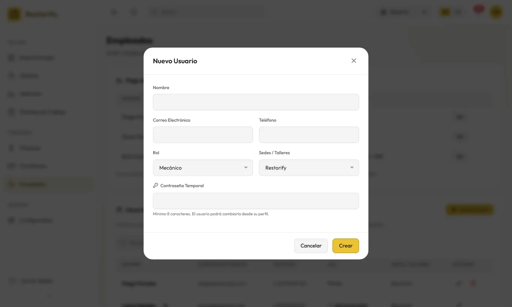

Para dar de baja a alguien, usa **Quitar empleado** en su fila. **Si tiene órdenes asignadas el sistema no lo permite**: primero hay que reasignar ese trabajo. **Si ya se le pagaron comisiones, tampoco**: sus pagos son el historial contable de lo que se le entregó.

---

## 16. Instalar la app en el teléfono

Restorify se puede agregar a la pantalla de inicio. Abre a pantalla completa,
con su ícono, y en iPhone es **obligatorio** para recibir notificaciones.

### Android (Chrome)

1. Abre `restorifyauto.net` en Chrome.
2. Menú ⋮ → **Instalar app** (o **Agregar a pantalla de inicio**).

### iPhone (Safari, iOS 16.4 o posterior)

1. Abre `restorifyauto.net` en **Safari** (no en Chrome ni en otra app).
2. Toca el botón **Compartir** (el cuadro con la flecha).
3. Elige **Agregar a inicio**.
4. Abre Restorify **desde el ícono nuevo**, inicia sesión y activa las
   notificaciones en Configuración.

La app instalada siempre carga la versión más reciente del sistema; no hay que
actualizarla.

---

## 17. Qué puede hacer cada rol

| | Administrador | Técnico (mecánico / pintor) |
|---|:---:|:---:|
| Panel principal | Todo, incluido dinero, ocupación y **Requiere atención** | Sin dinero ni ocupación; sus tareas y órdenes |
| Clientes y vehículos: ver | ✅ | Solo los de sus órdenes, dentro de la orden |
| Clientes y vehículos: crear, editar, **eliminar** | ✅ | ❌ |
| Órdenes: ver (lista y tablero) | ✅ todas las de la sede | Solo las suyas |
| Abrir una orden de trabajo (alta en 4 pasos) | ✅ | ❌ |
| Ver mano de obra (montos) | ✅ | ✅ |
| Ver repuestos con precio, totales y depósito | ✅ | ❌ (ve las piezas sin precio) |
| Costo de repuestos | ✅ | ❌ |
| Repuestos: marcar pedido / llegó | ✅ | ❌ (ve si se pidió o si llegó) |
| Agregar o editar mano de obra y repuestos | ✅ | ❌ |
| Asignar el técnico y el tipo de cada tarea | ✅ | ❌ (ve quién tiene cada una) |
| Reportar trabajo adicional | — | ✅ desde la orden |
| Revisar, cotizar o descartar trabajo adicional | ✅ | ❌ |
| Marcar una tarea como hecha | ✅ todas | ✅ las suyas y las que no tienen técnico |
| Ver su comisión en la orden | — | ✅ en sus órdenes (el monto, cuando administración la acepta) |
| Consultar **Mis comisiones** | — | ✅ solo lo suyo aceptado y pagado |
| Cambiar estado de la orden | ✅ | ✅ en sus órdenes (solo En Proceso y Finalizado) |
| Marcar **Listo para entregar** | ✅ | ❌ |
| Marcar **Entregado** o **Retirada sin reparar** | ✅ | ❌ |
| Aplicar descuento del taller o registrar anticipos | ✅ | ❌ |
| Cobro por parqueo: configurar en sede y ajustar en orden | ✅ | ❌ |
| Tomar la firma del cliente en la recepción | ✅ | ❌ (la ve) |
| Subir fotos, videos y notas de voz | ✅ | ✅ en sus órdenes no entregadas |
| Publicar archivos al cliente | ✅ | Solo sus avances, con sus fotos; un archivo suelto, no |
| Enviar reporte al cliente y descargar PDF (español o inglés) | ✅ | ❌ |
| Enlace del cliente: ver, compartir, cambiar, avisar novedades | ✅ | ❌ |
| Ver estado de autorización de cada trabajo | ✅ | ✅ |
| Enviar presupuestos y registrar autorizaciones | ✅ | ❌ |
| Órdenes: **archivar** y **eliminar** | ✅ | ❌ |
| Tablero: mover tarjetas | Todas | Solo las suyas (excepto a Entregado o pausadas) |
| Finanzas y Comisiones del taller | ✅ | ❌ |
| Empleados: ver pagos, crear y editar personal | ✅ | ❌ |
| Configuración: perfil, idioma, apariencia, push | ✅ | ✅ |
| Configuración: sedes, teléfonos y correos al cliente | ✅ | ❌ |
| Cambiar de sede activa | ✅ | ❌ |
| Notificaciones | Recepciones, avances, finalizadas, tareas hechas, presupuestos | Asignaciones, tareas, comisiones |

Todas estas reglas las aplica la base de datos, así que se cumplen aunque alguien
intente saltarse la interfaz.

---

## 18. Cosas que el sistema hace solo

Conviene conocerlas para no sorprenderse ni registrar el mismo dinero dos veces.

**Al crear una orden con depósito**, el depósito se registra como ingreso en Finanzas.

**Al registrar un anticipo**, se asienta como ingreso en Finanzas y se descuenta del saldo que faltará cobrar al entregar.

**Al finalizar una orden**, el avance pasa al 100 %, se registra la fecha de finalización y se avisa a administración («Trabajo terminado»). **No se le avisa al cliente:** su enlace indica «En revisión final».

**Al marcar Listo para entregar**, administración confirma la revisión; **en ese momento se despacha el correo al cliente** («Su vehículo está listo») y el enlace pasa a «Listo para recoger».

**Al marcar una orden como Entregado:**
- Se registra como **ingreso** el saldo pendiente (o como egreso si corresponde devolver dinero por un depósito mayor), con su método de pago y comprobante.
- Se registra como **egreso** el costo de los repuestos.
- El cobro por parqueo acumulado se congela con la fecha del día y se suma al saldo liquidado.
- Se generan las **comisiones sugeridas** (**Por aceptar**): la de cada tarea para su técnico (y el reparto de trabajos anteriores). El técnico recibe el aviso cuando administración la acepta, no al entregar. Una tarea sin técnico no genera comisión.

**Al retirar sin reparar**, según la opción elegida (cancelar todo, solo revisión o algunos trabajos), se liquida la diferencia con lo pagado, se cancelan presupuestos abiertos y lo no cobrado queda guardado como pendiente del vehículo para futuras visitas.

**Al editar una orden ya entregada**, se registra únicamente la diferencia —como cargo adicional o como reembolso— y las comisiones pendientes se recalculan.

**Al sacar una orden de Entregado**, se revierten el cobro y el costo de repuestos, se descongelan los estados y se borran las comisiones no pagadas. Si se vuelve a entregar, todo se registra de nuevo.

**El avance de la orden se calcula solo:** surge de las tareas marcadas como hechas sobre las autorizadas, ponderadas por el precio de cada una (un trabajo de $400 influye más en la barra que uno de $50).

**El cobro por parqueo acumula solo:** el sistema actualiza el monto cada hora mientras el vehículo permanece en el taller con el cobro activo. No genera comisión para los técnicos y el descuento del taller no lo reduce.

**Al aplicar un descuento**, el taller lo absorbe por completo: descuenta lo que paga el cliente pero no baja la mano de obra autorizada, de modo que las comisiones de los técnicos no disminuyen. Tampoco afecta el parqueo.

**Al agregar o quitar mano de obra o repuestos**, los totales se recalculan solos.

**Al pagar comisiones**, se registra el egreso en Finanzas. Al deshacer el pago, se elimina.

**La firma de la recepción no autoriza lo cotizado:** es la constancia de conformidad de cómo se recibió el vehículo. Lo cotizado se autoriza únicamente con un presupuesto enviado o mediante **Registrar autorización**.

**Al agregar un trabajo** después de la firma, queda sin autorizar: no se cobra ni se realiza hasta que el cliente lo autorice.

**Al responder un presupuesto**, lo autorizado suma al total (y si la orden ya se entregó, se registra el ajuste en Finanzas); los técnicos reciben el aviso de qué hacer y qué no, y al cliente le llega la constancia.

**Al firmar la recepción**, además, se crea el enlace del cliente y, si tiene correo, le llega el aviso de ingreso.

**Al cambiar el estado de una orden**, si el cliente tiene correo, le llega el aviso unos minutos después (se agrupan cambios en una ventana de 3 minutos).

**Al entregar una orden**, el enlace del cliente queda disponible 90 días más.

**Al eliminar una orden**, se eliminan sus archivos, comisiones y movimientos automáticos. Los importados del banco se conservan.

**Limpieza periódica.** Los avisos leídos se borran a los 60 días y todos a los 180. Los envíos de correo y push terminados a los 90 días. Los archivos que quedaron a medio subir o de órdenes borradas se eliminan del almacenamiento.

**El número de orden** se genera de forma que dos órdenes creadas al mismo tiempo nunca reciban el mismo número.

---

## 19. Problemas comunes

**«El cliente no recibió el correo de que su vehículo está listo.»**
La orden debe estar en estado **Finalizado** Y un administrador debe presionar el botón **Marcar listo para entregar**. Cuando el técnico pasa la orden a Finalizado, el sistema únicamente envía un aviso a la oficina («Trabajo terminado») para que la revise; el correo automático al cliente no sale y su portal no cambia a «Listo para recoger» hasta que administración coloca la marca de listo para entregar.

**«Soy técnico: ¿por qué no veo el monto de mi comisión en Mis comisiones?»**
La orden ya debe estar entregada, y además un administrador debe haber aceptado la comisión en **Comisiones**. Al entregar la orden, las comisiones nacen con estado **Por aceptar** (sugeridas); mientras administración no las revise y acepte, no aparecen en tu lista de **Aceptadas, por cobrar**. Mientras la orden no se entregue, puedes consultar **Tu comisión estimada** en la orden.

**«¿Por qué el cobro por parqueo marca $0 en una orden?»**
Puede ocurrir por varios motivos:
1. El módulo general o el perfil de esa orden (**Con seguro** o **Sin seguro (Particular)**) está deshabilitado en Configuración.
2. En una orden particular, todavía no ha sido marcada como lista para entregar (que es el evento que detona el cobro).
3. La orden aún está dentro de los días de gracia configurados.
4. La orden ingresó antes de la fecha vigente del taller y no se marcó la opción de incluir órdenes previas.
5. En la tarjeta de **Parqueo** de la orden, la casilla **Cobrar parqueo en esta orden** fue desmarcada en los ajustes administrativos.

**«El taller aplicó un descuento al cliente pero mi comisión no bajó, ¿está bien?»**
Sí, es totalmente correcto. Todo descuento comercial lo absorbe el taller por completo. Tu comisión se calcula sobre el precio de la mano de obra autorizada de tus tareas, sin verse reducida por el descuento.

**«Un correo al cliente aparece con error y no se envía solo.»**
Los correos con fallas no se reintentan indefinidamente de forma automática. Un administrador puede revisar la tarjeta **Requiere atención** en el Panel Principal o ir a Configuración → **Correos al cliente** y presionar **Reintentar todos** (o usar **Reintentar** en el historial de la tarjeta **Enlace del cliente** en la orden).

**«El total no incluye un trabajo que agregué.»**
Mira la insignia de la línea: si dice **Sin autorizar** o **Esperando al cliente**,
todavía no se cobra. Envía el presupuesto o registra la autorización.

**«No me deja editar ni borrar una línea.»**
Está **Esperando al cliente**. Cancela el presupuesto, corrige y vuelve a enviarlo.

**«El cliente firmó y los trabajos siguen sin autorizar.»**
Es lo esperado: la firma es la conformidad con cómo dejó el vehículo, no la autorización del
presupuesto. Envía el presupuesto o registra la autorización.

**«No me deja borrar una orden: dice que tiene comisiones pagadas.»**
Deshaz ese pago en **Comisiones**, borra la orden y, si corresponde, vuelve a pagar
las demás comisiones.

**«La app me sacó a la pantalla de inicio de sesión mientras trabajaba.»**
No debería pasar por mala señal. Si pasa, anota la hora y el teléfono y avísale a
administración: es un error que hay que revisar.

**«No me deja entregar la orden.»**
Tiene un presupuesto esperando respuesta. Registra la autorización (si el cliente ya
te respondió) o cancela el presupuesto.

**«Soy técnico: ¿hago este trabajo?»**
Si la línea no tiene insignia, está autorizada. **Sin autorizar** y **Esperando al
cliente**: todavía no. **No realizar**: no.

**«El cliente dice que autorizó y no aparece.»**
Revisa la tarjeta **Presupuesto** y el historial de correos de la tarjeta **Enlace del
cliente**. Si el correo salió pero no respondió, pregúntale por teléfono y usa
**Registrar autorización…**.

**«El cliente no recibió el correo.»**
Abre la orden y mira el historial de la tarjeta **Enlace del cliente**:
- *Programado*: todavía está en su espera de 2–3 minutos.
- *No enviado*: el motivo lo dice (sin correo, se dio de baja, ya había recibido ese
  estado).
- *Enviado*: pídele que revise el correo no deseado o las pestañas de Promociones.
- *Error*: avisa a quien administra el sistema o usa **Reintentar**.
Mientras tanto, mándale el enlace con **Enviar por WhatsApp**.

**«El cliente dice que el enlace no abre.»**
Si dice "ya no está activo" o "venció", usa **Crear enlace** o **Cambiar enlace** y
mándale el nuevo. Si dice "no válido", el enlace se cortó al copiarlo: vuelve a
mandarlo.

**«El cliente no ve las fotos del avance.»**
Los archivos de los avances son internos hasta que un administrador toca **Mostrar
en el reporte del cliente** en cada uno.

**«No me llegó el correo para recuperar la contraseña.»**
Revisa el correo no deseado. Si aun así no llega, pídele a un administrador que
te asigne una contraseña nueva desde Configuración o Empleados.

**«Entré pero no veo Finanzas ni Comisiones.»**
Son solo para administradores. Los técnicos ven únicamente sus propias ganancias en **Mis comisiones**.

**«Soy técnico y no veo los precios ni el total de la orden.»**
Es a propósito: el dinero de la orden lo maneja administración. Ves el precio de la
mano de obra de tus tareas (de ahí sale tu comisión) y las piezas sin precio; el total
de la orden y los pagos, no. Tu comisión la ves en **Mis comisiones** cuando
administración la acepta.

**«No puedo agregar mano de obra ni repuestos.»**
Los agrega un administrador. Si encontraste algo adicional durante la reparación, usa **Reportar trabajo adicional** en la orden para que administración lo revise y cotice. También puedes dejarlo documentado en un avance (con foto, video o nota de voz).

**«No encuentro una orden que sé que existe.»**
Revisa que el filtro de estado esté en «Todos» y —si eres administrador— que
estés en la sede correcta.

**«Me pidieron ayudar en una orden y no puedo editarla.»**
Pídele a un administrador que te asigne a ella o te asigne una de sus tareas. Asignar reparte la comisión de la
mano de obra, así que es una decisión de administración y nadie se pone a sí mismo.

**«No puedo mover la barra de avance.»**
La orden está Finalizada o Entregada, o no estás asignado a ella. El avance se calcula automáticamente a partir de las tareas realizadas.

**«Un video no sube / la bandeja dice que falló.»**
Expande la bandeja y lee el motivo. Si es la señal, presiona **Reintentar** con
mejor conexión. Si dice que el video dura más de 2 minutos o pesa más de 50 MB,
grábalo desde el botón **Video** de la app. Si no ves la bandeja pero el archivo
no aparece, vuelve a entrar con la misma cuenta en el mismo teléfono: las
subidas pendientes continúan.

**«La app no me deja usar la cámara o el micrófono.»**
Negaste el permiso. En Chrome: candado junto a la dirección → Permisos. En
iPhone: Ajustes → Safari → Cámara / Micrófono.

**«No me llegan las notificaciones al teléfono.»**
1. Configuración → **Enviar prueba**. Si llega, las notificaciones funcionan.
2. Si la tarjeta dice que no están activas en este dispositivo, actívalas.
3. En iPhone: ¿abriste la app desde el ícono de inicio y no desde Safari?
4. Revisa que el teléfono no tenga las notificaciones del navegador silenciadas
   (modo No molestar, ajustes de notificaciones de Chrome o de la app).
5. ¿Otra persona inició sesión después en ese dispositivo? Vuelve a entrar.
La campana dentro de la app funciona aunque push no esté activo.

**«Registré algo de dinero dos veces.»**
Si es un movimiento manual, bórralo con la papelera. Si es uno automático, no lo
borres: pide ayuda para corregir la orden (sección 12).

**«Presioné Importar Seleccionadas y no pasó nada.»**
Alguna fila marcada quedó sin categoría: el botón está apagado, no roto. Usa
**Asignar a las no clasificadas** o desmárcalas.

**«Importé el mismo estado de cuenta dos veces.»**
Finanzas → Importaciones → **Revertir importación** en la que sobra.

**«El importador dice que no encontró transacciones.»**
Puede ser un estado de cuenta de otro banco (solo se admite Wells Fargo) o un PDF
escaneado. Descárgalo directamente del banco.

**«No puedo eliminar un cliente.»**
Si tiene órdenes registradas, el sistema lo impide para no perder el historial.

**«No puedo dar de baja a un empleado.»**
Si todavía tiene órdenes asignadas hay que reasignarlas primero.

**«Registré un vehículo de subasta y me pide la placa.»**
Marca la casilla **Sin placa**.

**«Encontré un error en el sistema o la aplicación falló, ¿qué hago?»**
Ve a Configuración (tocando tu avatar arriba a la derecha) y usa el botón **Reportar un problema**. Describe qué intentabas hacer y envíalo. El sistema adjuntará un diagnóstico y un video de la pantalla de forma segura para que podamos revisarlo.

---

*Fin del documento. Última revisión del contenido: octubre de 2026.*
