# Los planos de Restorify

> **Restaurado el 11/10/2026.** Este documento (con sus diagramas) se perdió en la limpieza automática del 06/10/2026
> (commit `1955f30`, que fusionó la arquitectura y los planos en uno más corto, y `ec689da`, que
> lo reemplazó por [radiografia.md](radiografia.md)). Puesto al día el 11/10/2026 con lo posterior (historial, comisión por tarea, hallazgos, pago mixto, listo para entregar, idioma del cliente, teléfonos por sede, seguro y parqueo). Donde no coincida, mandan [ai-context.md](ai-context.md) y
> [mapa-de-secciones.md](mapa-de-secciones.md); lo pendiente de actualizar está en la
> [bitácora](bitacora.md#bitácora-de-traspaso-entre-agentes).


Esto es lo más parecido a los planos de una casa: **qué piezas hay, cómo se conectan y dónde
buscar para cambiar cada cosa**. Los diagramas están escritos en Mermaid: GitHub y VS Code
(con la extensión "Markdown Preview Mermaid Support") los dibujan solos.

Cómo usarlo: busca en el **índice** lo que quieres cambiar, ve al diagrama de esa parte y de
ahí al archivo indicado. Para el detalle de reglas, [reglas-de-negocio.md](reglas-de-negocio.md);
para el detalle de archivos por sección, [mapa-de-secciones.md](mapa-de-secciones.md); para lo
que **no se puede romper**, [ai-context.md](ai-context.md).

| Quiero cambiar… | Diagrama | Dónde empezar |
|---|---|---|
| Una pantalla o su texto | [1](#1-las-capas-de-la-casa) y [2](#2-el-mapa-de-pantallas) | `src/pages/`, `src/features/`, `src/i18n/translations.ts` |
| Una regla de dinero o de permisos | [1](#1-las-capas-de-la-casa) y [6](#6-el-camino-del-dinero) | `supabase/migrations/` (siempre una migración nueva) |
| Qué pasa al abrir, trabajar o entregar una orden | [3](#3-el-ciclo-de-vida-de-una-orden) | `useWorkOrderDetail.ts`, `entregar_orden` |
| Comisiones | [7](#7-comisiones) | `_reparto_comisiones`, `pages/Payroll.tsx` |
| Lo que ve el cliente | [8](#8-lo-que-ve-el-cliente) | `datos_portal`, `src/portal/` |
| Correos, avisos, traducciones | [9](#9-avisos-correos-y-traducciones) | `process-outbox`, `notificar()` |
| Quién puede hacer qué | [10](#10-quién-puede-hacer-qué) | políticas RLS y triggers `trg_*_guard` |
| Una tabla | [4](#4-las-tablas-y-cómo-se-relacionan) | `npm run db:donde -- <nombre>` |
| Publicar un cambio | [11](#11-cómo-sale-un-cambio) | [deployment.md](deployment.md) |

---

## 1. Las capas de la casa

La idea que explica todo: **no hay servidor propio**. El navegador habla directo con Supabase,
así que **la seguridad y el dinero viven en la base de datos**, no en la pantalla. Esconder un
botón no es un permiso.

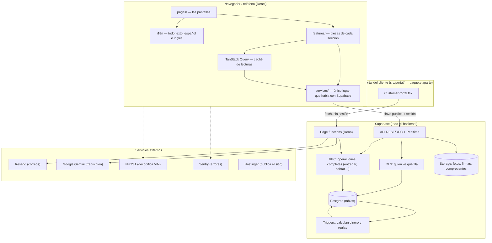

**Reglas de oro que salen de este plano**

- Una **lista** se lee con `fetchAll` (la API corta en 1.000 filas sin avisar); un **total de
  dinero** se pide a una RPC, nunca se suma en el navegador.
- Un cambio de **esquema o permisos** es una migración nueva en `supabase/migrations/`; nunca se
  edita una ya aplicada ni se cambia desde el panel de Supabase.
- Toda función SQL nueva se **revoca** a `PUBLIC, anon, authenticated` y se concede solo a quien
  la necesita.
- Las cifras al día (migraciones, tablas, funciones, pruebas) están en
  [radiografia.md §1](radiografia.md#1-cifras-actuales-del-proyecto).

---

## 2. El mapa de pantallas

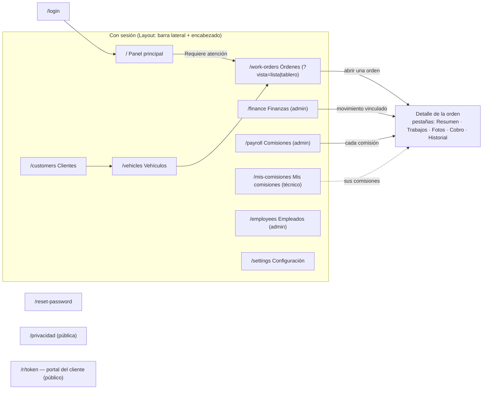

| Pantalla | Archivo | Servicio que usa |
|---|---|---|
| Panel | `pages/Dashboard.tsx`, `features/dashboard/` | `dashboard.service.ts` (`resumen_panel`, `requiere_atencion` `20261010000012`; `MyTasksCard`) |
| Clientes / Vehículos | `pages/Customers.tsx`, `pages/Vehicles.tsx` | `customers.service.ts`, `vehicles.service.ts` |
| Órdenes (lista y tablero) | `pages/WorkOrders.tsx` (`?vista=lista\|tablero`), `pages/KanbanBoard.tsx` | `workOrders.service.ts` (`/kanban` redirige a la vista tablero) |
| Detalle de una orden | `features/workOrders/WorkOrderDetail.tsx` + `useWorkOrderDetail.ts` | `workOrders.service.ts`, `quotes.service.ts`, `commissions.service.ts`, `parking.service.ts` |
| Alta de una orden | `features/workOrders/WorkOrderCreateModal.tsx` (4 pasos) | `workOrders.service.ts` → RPC `create_work_order` (seguro, tareas, depósito) |
| Finanzas | `pages/Finance.tsx`, `pages/finance/ImportStatementModal.tsx` | `finance.service.ts` |
| Comisiones | `pages/Payroll.tsx` (admin), `pages/MyCommissions.tsx` (técnico) | `commissions.service.ts` (`resumen_mis_comisiones` `20261010000022`) |
| Empleados | `pages/Employees.tsx`, `features/employees/` | `employees.service.ts`, `users.service.ts` |
| Configuración | `pages/Settings.tsx` (teléfonos de sede, parqueo, push) | `sedes.service.ts`, `parking.service.ts`, `users.service.ts` |

---

## 3. El ciclo de vida de una orden

El corazón del programa. Cada flecha dice **quién** la mueve y **qué hace la base** solita.

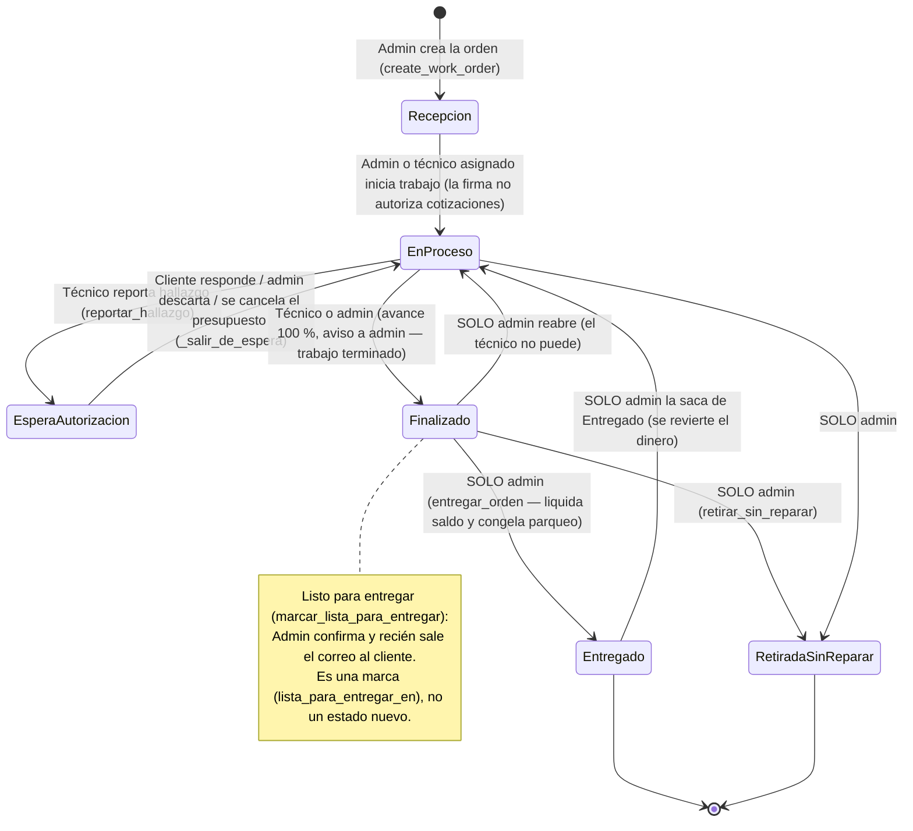

Qué dispara cada paso (todo en la base, `supabase/migrations/`):

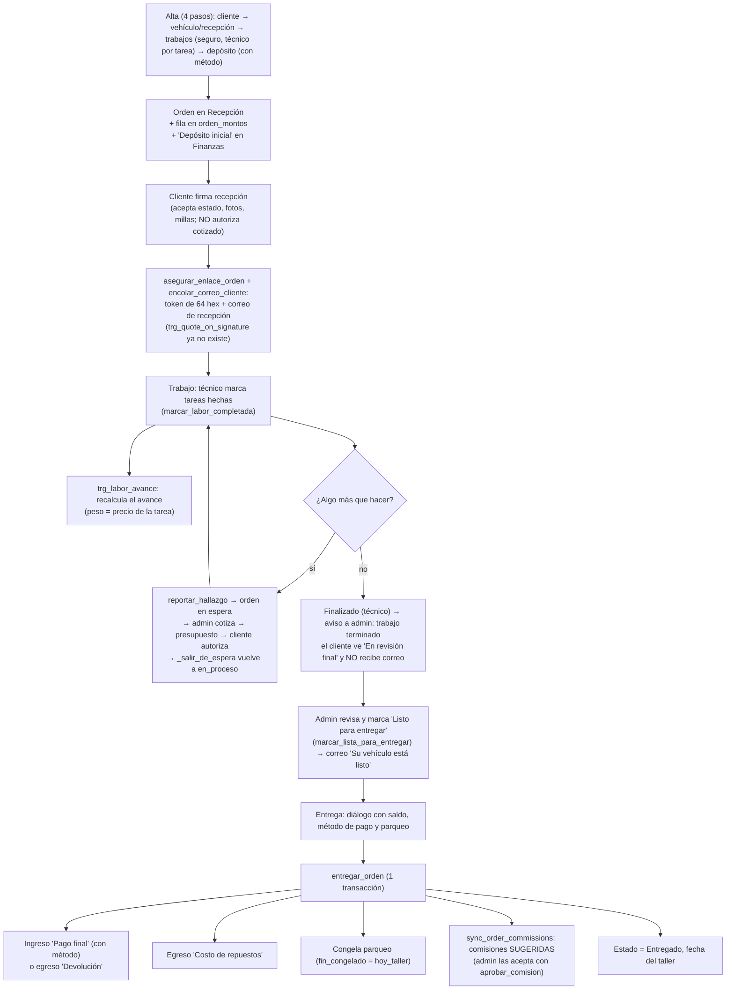

**Dónde tocar:** el flujo de pantalla está en `features/workOrders/useWorkOrderDetail.ts`; el
cobro y entrega, en la función SQL `entregar_orden` (`npm run db:donde -- entregar_orden`); y la
confirmación de revisión, en `marcar_lista_para_entregar` (`20261010000021`).

La firma de recepción ya **no** autoriza lo cotizado (`20261010000022`; `trg_quote_on_signature` se
eliminó): firmar acredita el estado de recepción del vehículo; lo cotizado se autoriza solo mediante
presupuesto (`enviar_presupuesto`) o "Registrar autorización".

---

## 4. Las tablas y cómo se relacionan

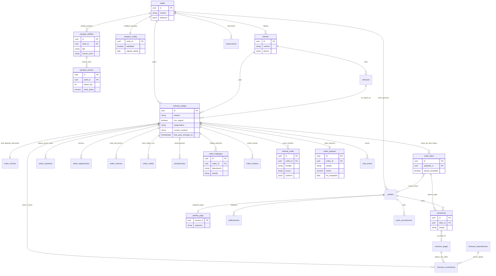

Otras tablas: `finanzas_reglas_categorizacion` (palabras clave de la importación bancaria),
`traducciones` (diccionario es↔en, `20261010000013` y `15`), `numero_orden_contadores` (el `ORD-AAAA-###`).

**Piezas clave del esquema:**

- **Historial de la orden (`20261010000004`):** la tabla `historial_orden` y el trigger genérico
  `trg_historial` auditan quién cambió qué en la orden, tareas, repuestos, asignaciones, depósito o parqueo.
- **Hallazgos (`20261010000010`):** tabla `orden_hallazgos` para el trabajo adicional reportado por el técnico.
- **Comisión por tarea (`20261010000006` y `08`):** `orden_labor.asignado_a` vincula la tarea a su técnico y genera
  `comisiones.labor_id`. Las líneas nacen con `reparto_heredado = false`. Administración acepta cada comisión
  (`comisiones.estado = 'sugerida' | 'aceptada' | 'pagada'`, `20261010000014`).
- **Pago mixto (`20261010000020`):** `perfiles_pago.esquema = 'mixto'` (salario informativo + comisión por tarea).
- **Listo para entregar (`20261010000021`):** `ordenes_trabajo.lista_para_entregar_en` y `lista_para_entregar_por`.
- **Trabajo con seguro (`20261010000027`):** `ordenes_trabajo.con_seguro`, `aseguradora`, `numero_reclamo`.
- **Teléfonos de la sede (`20261010000025` y `26`):** columna JSONB `sedes.telefonos` con `label`, `numero`, `tipo`
  ('oficina' | 'celular') y `whatsapp`; los normaliza `_telefonos_sede`. No existe una tabla `sede_telefonos`;
  `sedes.telefono` y `sedes.whatsapp` quedan como respaldos que sincroniza `sedesService`.
- **Idioma del cliente (`20261010000022`):** `clientes.idioma` ('en' por defecto).
- **Cobro por parqueo (`20261010000028`):** tablas `parqueo_config`, `parqueo_perfiles`, `parqueo_tramos` y
  `orden_parqueo`. Resumen y reglas en [parqueo.md](parqueo.md).

**Tres cosas que sorprenden:**

- El dinero está **separado**: `orden_montos` y `orden_repuestos` solo los lee un admin. El
  técnico asignado ve la mano de obra (de ahí sale su comisión) y las piezas **sin precio** (por la RPC `repuestos_de_orden`).
- Solo lo **autorizado** cuenta: `orden_labor` y `orden_repuestos` tienen `estado`
  (`borrador | pendiente | aprobado | rechazado`) y los totales suman solo `aprobado`.
- Lo importado del banco (`importacion_id`) **no** cuenta en nada de la app.

Las cifras exactas de tablas y migraciones están en [radiografia.md §1](radiografia.md#1-cifras-actuales-del-proyecto).

---

## 5. Cómo viaja un dato (de pantalla a base y de vuelta)

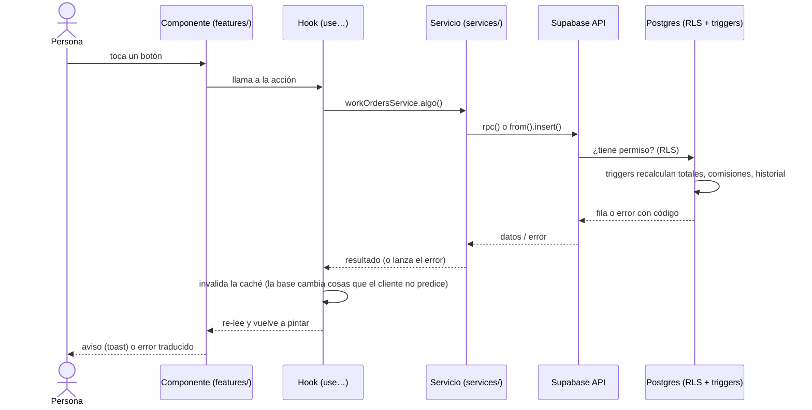

- Los errores se guardan **crudos** y se traducen al pintar (`lib/errors.ts`).
- Un `UPDATE`/`DELETE` que la RLS rechaza **no da error**, devuelve cero filas: por eso los
  servicios piden `.select('id')` y usan `assertAffected` / `assertDeleted`.
- Lo que cambia en otra pantalla se entera por **Realtime** (`useOrderSync`): el evento es una
  señal, se vuelve a leer el dato.

---

## 6. El camino del dinero

Lo único que **nadie escribe a mano**: lo asientan triggers y RPC, siempre con signo e
idempotentes (comparan "lo que debería haber" con "lo que ya hay" y registran la diferencia).

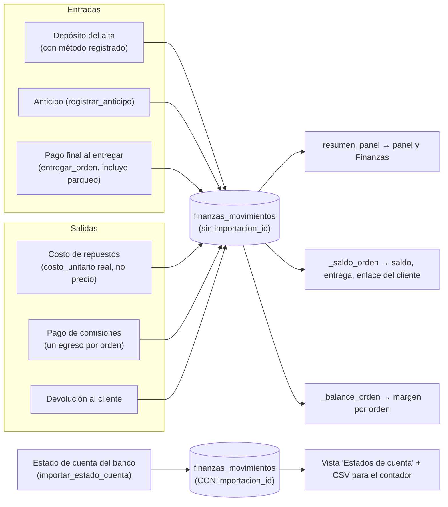

Cuentas que hace la base (no las repitas en el navegador):

```
total de la orden  = mano de obra aprobada + repuestos aprobados − descuento + parqueo
saldo              = total − (depósito + anticipos + pagos − devoluciones)
margen de la orden = cobrado − costo de repuestos − comisiones devengadas
fecha de un asiento automático = hoy_taller(sede)   ← hora local del taller, no UTC
```

- **Cobro por parqueo (`20261010000028`):** `orden_parqueo.monto` entra a `total_general`
  (`recalculate_order_totals`) y de ahí al saldo que liquida `entregar_orden`. Lo calcula la
  función pura `_parqueo_calculo` y se congela al entregar (`fin_congelado`). Ni genera
  comisiones ni recibe descuento. Detalle en [parqueo.md](parqueo.md).
- **Descuento (`aplicar_descuento`, `20261010000017`):** en `$` o en `%`
  (`orden_montos.descuento`). Lo absorbe el taller: **no baja las comisiones** (salen de la
  mano de obra autorizada) y **no toca el parqueo**.
- **Costo de repuestos (`costo_unitario`, `20261010000017`):** opcional en el alta y en la tabla;
  si no se indica, toma el precio de venta (`trg_part_cost_follows_price`). Finanzas registra el
  costo real del repuesto sin alterar las comisiones del técnico.
- **Anticipos (`registrar_anticipo`, `20261010000017`):** incrementan `orden_montos.deposito_inicial`
  guardando el método de pago utilizado.
- **Movimientos bancarios aislados (`20261010000016`, `20261010000017`):** los asientos con
  `importacion_id IS NOT NULL` son contabilidad aparte; la app los ignora al calcular saldos,
  márgenes y paneles. Categoría `comision_bancaria` para comisiones del banco y Clover.
- **Fecha del taller (`hoy_taller(sede)`, `20261010000017`):** todos los asientos automáticos y
  cálculos de parqueo usan la fecha en la zona horaria de la sede (`sedes.zona_horaria`), nunca
  `CURRENT_DATE` en UTC.

**Retirada sin reparar** (`retirar_sin_reparar`, `20261010000017`–`18`):

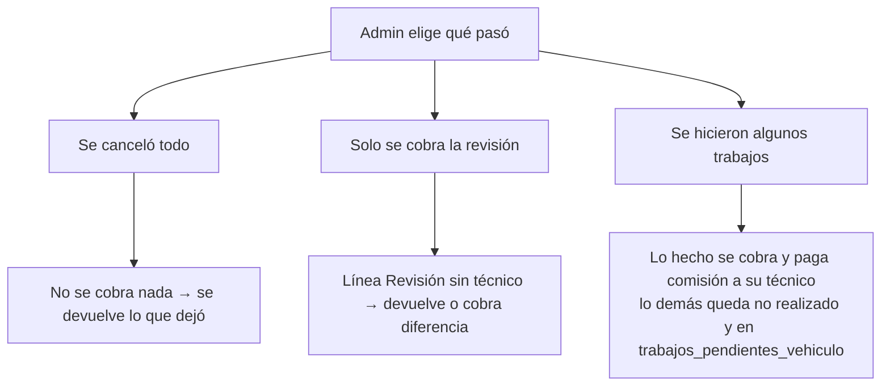

`saldo_retiro` suma también el parqueo devengado al saldo de liquidación.

---

## 7. Comisiones

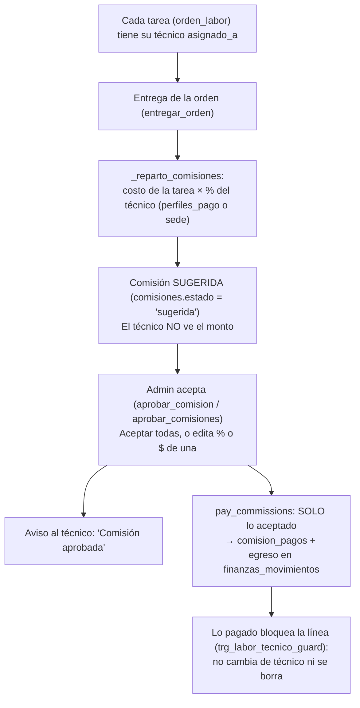

- **Comisión por tarea (`20261010000006`, `20261010000008`):** cada línea autorizada de
  `orden_labor` tiene su técnico (`asignado_a`, administrado por admin) y su comisión le
  corresponde a él (`comisiones.labor_id`): costo de la línea × su porcentaje (`perfiles_pago`
  o el de la sede). Una tarea nueva sin técnico queda como `sin_asignar` en
  `comisiones_estimadas`: nadie cobra hasta que se le asigne uno.
- **Líneas anteriores (`reparto_heredado`):** las de antes de octubre de 2026 sin técnico
  (`reparto_heredado = true`) se reparten por especialidad entre los asignados
  a mano (`origen = 'manual'`). Asignar técnico a una heredada fija `reparto_heredado = false` y
  la saca de la bolsa para siempre.
- **Aprobación administrativa (`20261010000014`, `20261010000018`):** al entregar, la comisión
  nace como `sugerida`. La base oculta el monto al técnico (`comisiones_estimadas` devuelve nulo
  y la política RLS de `comisiones` no le permite leer filas sugeridas). Administración la
  aprueba en la tarjeta de la orden (`CommissionEstimateCard`) o en bloque en Comisiones
  (`pages/Payroll.tsx` vía `aprobar_comisiones`). Al aceptarse, el técnico recibe el aviso
  con el monto definitivo.
- **Solo se paga lo aceptado (`20261010000018`):** `pay_commissions` exige `estado = 'aceptada'`;
  rechaza pagar comisiones que sigan en estado sugerido.
- **Esquema mixto (`perfiles_pago.esquema = 'mixto'`, `20261010000020`):** combina salario
  informativo y comisión normal. En la base el filtro de comisiones es siempre
  `esquema <> 'salario'`, de modo que solo `salario` queda excluido del reparto.
- **Lo pagado bloquea la tarea (`trg_labor_tecnico_guard`):** no permite cambiar de técnico,
  especialidad ni borrar la línea (en pantalla se muestra un candado). Para cambiarla, primero
  debe revertirse el pago en Comisiones.
- **Pantalla del técnico:** en `/mis-comisiones` (`pages/MyCommissions.tsx`), el técnico consulta
  sus comisiones aprobadas y pagadas, respaldadas por la RPC `resumen_mis_comisiones` (`20261010000022`).
- **Descuentos y retiros:** el descuento no afecta las comisiones (se liquidan sobre la mano de
  obra autorizada); una retirada sin reparar solo comisiona las tareas autorizadas conservadas
  (`p_conservar`).
- Detalle completo en [comisiones.md](comisiones.md).

---

## 8. Lo que ve el cliente

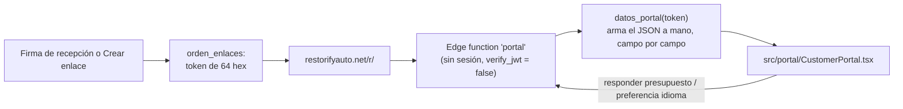

- **Ve:**
  - **Estado:** 4 pasos (Recibido → En proceso → Listo → Entregado). Si el técnico finalizó pero
    administración aún no confirma la orden como lista, muestra **"En revisión final"**.
  - **Trabajos y presupuesto:** trabajos y repuestos autorizados a precio de venta; presupuestos
    pendientes para autorizar o rechazar línea por línea.
  - **Avances y fotos:** fotos y videos de avances publicados por el taller, y avances que el
    técnico marcó con `visible_cliente = true` (`orden_avances.visible_cliente`).
  - **Cuenta:** desglose de mano de obra y repuestos autorizados, depósito del alta, anticipos
    (`registrar_anticipo`), descuento (`aplicar_descuento`), saldo final o a favor, y cargo por
    parqueo si aplica (`20261010000028`: tramos, costo diario, días de gracia o exoneración).
  - **Observaciones del taller:** textos redactados por administración en hallazgos descartados
    con `en_reporte = true` (`orden_hallazgos.texto_cliente`, `20261010000010`/`11`).
  - **Contacto de la sede:** lista de teléfonos (`sedes.telefonos` JSONB, `20261010000025`/`26`)
    con tipo (oficina o celular), descripción, botón de llamada `tel:` y botón directo de
    WhatsApp (`wa.me`) con mensaje prellenado si el número atiende WhatsApp.
  - **Idioma y traducción:** español o inglés. El idioma del cliente se guarda en
    `clientes.idioma` ('en' por defecto, `20261010000022`) y se puede alternar desde el portal
    (`preferencia_idioma_portal`). Con el portal en inglés, `translateReport` traduce las notas
    de inspección, tareas, repuestos y avances mediante `datos_portal.traducciones`
    (`_diccionario_traducciones`).
- **No ve:** nombres de técnicos, comisiones, costos de repuestos, notas internas, fotos internas
  de hallazgos, ni VIN completo.
- Todo dato nuevo para el cliente se agrega **a mano** en `datos_portal` (nunca `to_jsonb(fila)`).
- El portal es un **paquete aparte**: no importa `lib/supabase`, `services/` ni
  `i18n/translations.ts`; tiene sus textos en `portal/strings.ts`. Detalle en
  [portal-y-correos.md](portal-y-correos.md).

---

## 9. Avisos, correos y traducciones

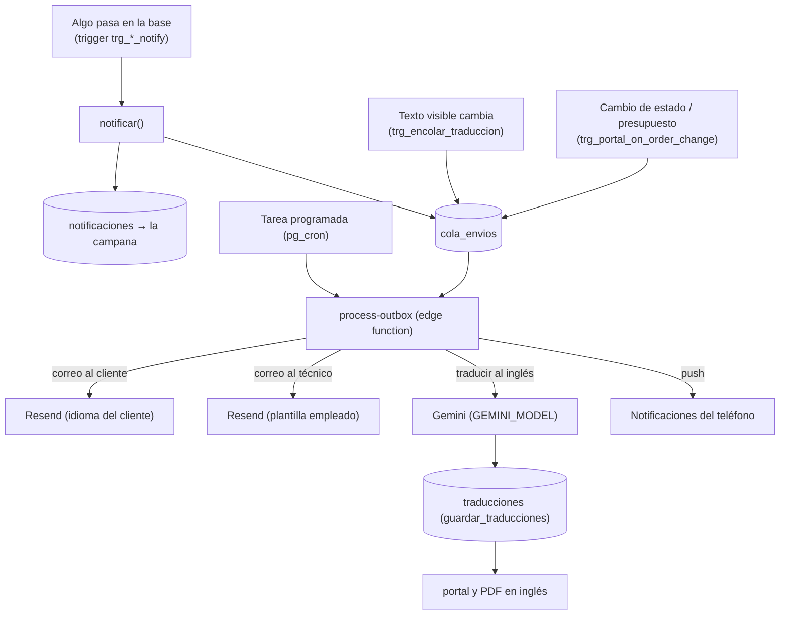

- **Correos al cliente (`portal-y-correos.md`):** encolados por `trg_portal_on_order_change`.
  Finalizar por el técnico **no** envía correo; sale cuando administración confirma con
  `marcar_lista_para_entregar` (`20261010000021`). Se envían en el idioma del cliente
  (`clientes.idioma`, `'en'` por defecto, `20261010000022`). Si la sede cobra parqueo, el aviso
  de listo incluye la fecha límite antes de que empiece el cobro por día (`20261010000028`).
- **Correo al técnico (`20261010000023`):** `notificar()` encola correos al mecánico o pintor
  (plantilla `empleado`, `renderEmployeeEmail`) al asignarle orden, asignarle tarea o cuando el
  cliente responde un presupuesto. La fila en `cola_envios` va **sin `orden_id`** para que nunca
  se confunda con un correo al cliente.
- **Traducción automática (`20261010000013`, `20261010000015`):** al cambiar textos visibles
  (inspección 360, tareas, repuestos o avances públicos), `trg_encolar_traduccion` encola en
  `cola_envios` con canal `traduccion`. `process-outbox` lee textos con `_textos_cliente(orden_id)`,
  invoca la API de Gemini (`GEMINI_MODEL`, por defecto `gemini-3.8-flash`) y guarda el resultado
  en `traducciones` mediante `guardar_traducciones`. La lectura se realiza vía `traducciones_orden`
  (admin y técnico asignado), `traducciones_portal` y `_diccionario_traducciones`.
- **Resiliencia:** un trigger auxiliar **nunca bloquea** una escritura: va en
  `BEGIN … EXCEPTION → WARNING`. Si un correo falla, queda en `cola_envios` con su error para
  reintento administrativo.
- Detalle: [portal-y-correos.md](portal-y-correos.md), [multimedia-y-notificaciones.md](multimedia-y-notificaciones.md).

---

## 10. Quién puede hacer qué

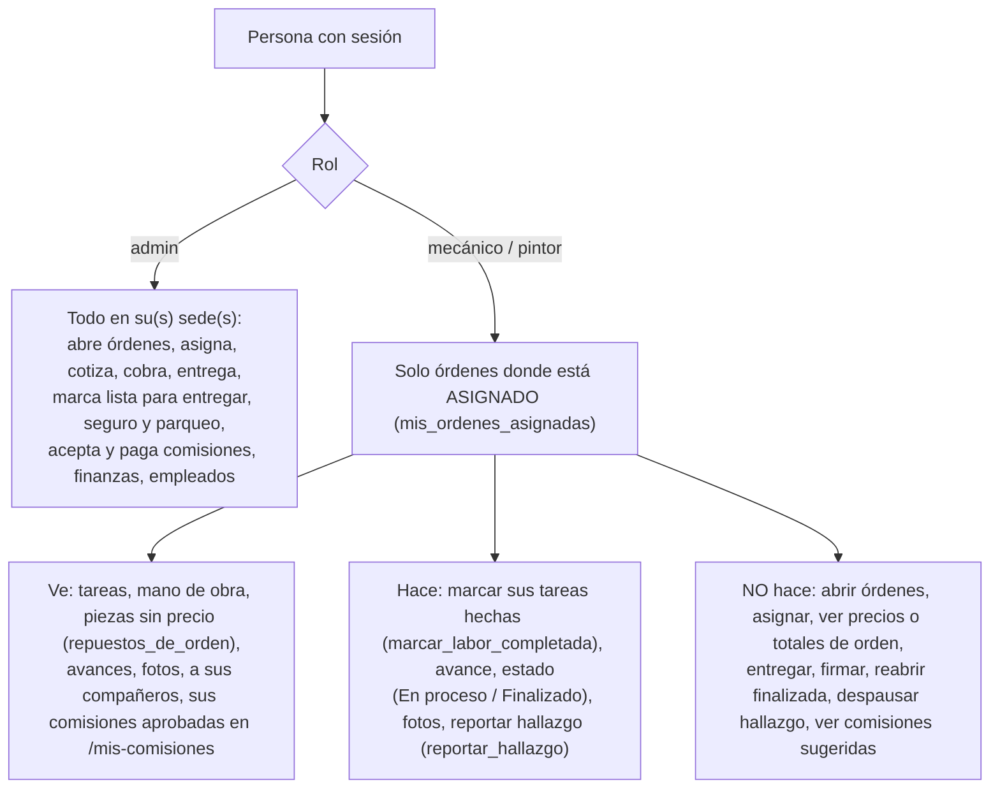

La impone **la base** (RLS y triggers), no la pantalla: `mis_ordenes_asignadas()`,
`is_admin()`, `trg_order_technician_guard`, `trg_labor_tecnico_guard`. Tabla completa en
[reglas-de-negocio.md §3](reglas-de-negocio.md#3-qué-puede-hacer-cada-rol).

---

## 11. Cómo sale un cambio

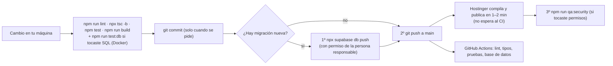

- La base va **antes** que el sitio: una app nueva sobre una base vieja rompe funciones.
- **Nombres de migraciones:** una migración nueva se nombra **después de la última que haya en
  `supabase/migrations/`** (hoy después de `20261010000028`, por ejemplo `20261010000029_...`),
  **nunca según la fecha de hoy**. Una fecha anterior a la última migración aplicada no se aplica
  con `supabase db push`.
- **Publicación:** Hostinger publica la rama `main` en 1–2 minutos directamente (verificado el
  30/09/2026). Commits solo cuando se piden.
- Si el CI falla con "job was not acquired by Runner", es un incidente de GitHub: se relanza con
  *Re-run all jobs*.

---

## 12. Dónde buscar cuando algo no funciona

| Síntoma | Mira primero |
|---|---|
| Un número de dinero está mal | La función SQL que lo calcula (`npm run db:donde -- <nombre>`), no la pantalla |
| "Algo salió mal" tras publicar | `lib/staleChunk.ts` (pestaña con archivos viejos); recarga |
| Una pantalla muestra una clave como `workOrders.algo` | Falta la traducción: `src/i18n/translations.ts` (es **y** en) |
| Un técnico no ve algo / ve de más | Políticas RLS de esa tabla en `supabase/migrations/` |
| Un correo no llegó | `cola_envios` (estado y último error); `process-outbox`; llave de Resend |
| El cliente ve algo raro en su enlace | `datos_portal` y `src/portal/` |
| Una lista parece cortada | ¿Usa `fetchAll`? La API corta en 1.000 filas |
| Fechas corridas un día | ¿Usa `hoy_taller()` / `lib/dates.ts`? Nunca `CURRENT_DATE` ni `toISOString()` |
| Un cambio no aparece en la otra pantalla | `ORDER_TABLES` y la publicación de Realtime |
| El cobro por parqueo no se calcula o da $0 | `parqueo_config.habilitado`, perfil (`seguro` o `particular`), días de gracia, `vigente_desde` y que exista el evento detonador; [parqueo.md](parqueo.md) |
| Una orden finalizada no avisó al cliente | Normal: el técnico no avisa al cliente; el correo sale al marcar "Lista para entregar" (`marcar_lista_para_entregar`) |
| La firma de recepción no aprobó lo cotizado | Normal: la firma ya no autoriza trabajos (`20261010000022`); se autorizan por el portal o con "Registrar autorización" |
| El técnico ve su comisión vacía o en blanco | La comisión está en estado `sugerida`; hasta que administración la acepte (`aprobar_comision`) el monto permanece oculto |
| El texto en inglés en el portal o PDF sale en español | Cola en `cola_envios` canal `traduccion`, logs de `process-outbox`, y variable `GEMINI_API_KEY` |
| El técnico no recibió correo de asignación | `cola_envios` con plantilla `empleado` (va sin `orden_id`); revisar correo en `perfiles` |
| WhatsApp de la sede no abre desde el portal | `sedes.telefonos` JSONB (`_telefonos_sede`): número con 10+ dígitos y flag `whatsapp = true` |

---

*Última revisión: 11 de octubre de 2026 (migraciones hasta `20261010000028`). Si cambias la
estructura —una tabla, un estado, una pantalla, un flujo de dinero— actualiza el diagrama
correspondiente en el mismo cambio.*

